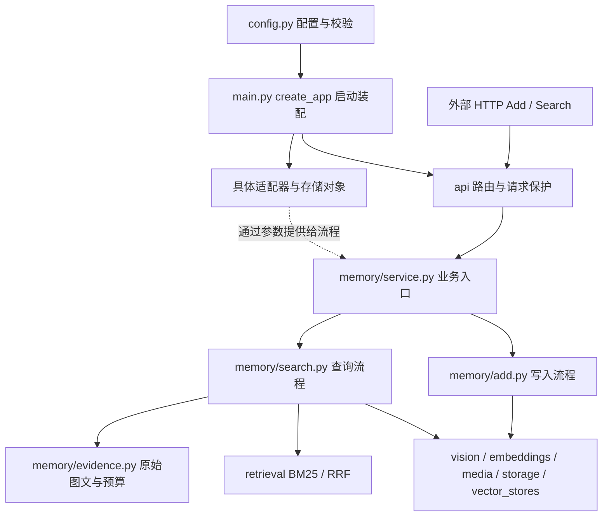
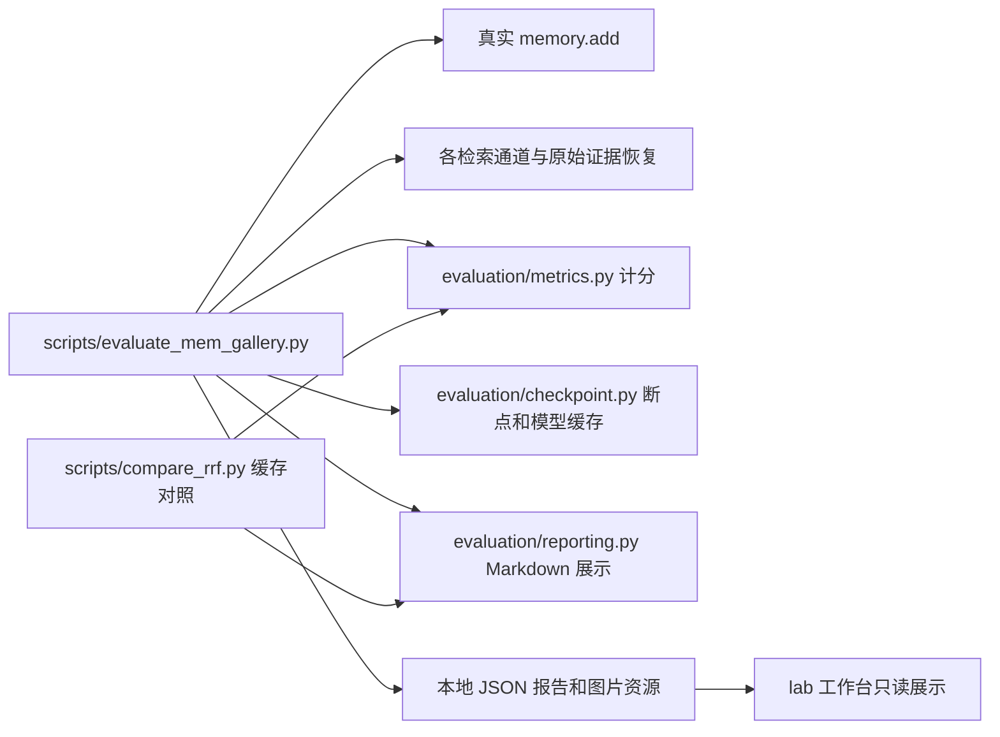

# 项目结构与模块职责

更新：2026-10-25，基于 v0.3.0 发布后的本地整理。这里解释当前源码；历史 Wiki 和笔记中的规划不代表全部已经实现。

## 先分清：服务、工具、资料不是一回事

```text
项目根目录/
├── src/memory_app/       Python 应用及可复用能力
│   ├── main.py          启动装配：连接具体工具，注册 API 和生命周期
│   ├── config.py        配置读取和校验，不保存真实密钥
│   ├── api/             HTTP 格式、鉴权、请求容量保护
│   ├── memory/          Add/Search 用例、图片关联、索引来源、返回证据
│   ├── media/           原图校验、按用户范围保存和读取
│   ├── storage/         原始消息、幂等记录、图片派生缓存的 SQLite 持久化
│   ├── embeddings/      文本 → 向量；Ollama/兼容接口适配器
│   ├── vector_stores/   保存、比较和检索已有向量
│   ├── retrieval/       BM25 与 RRF 排序算法
│   ├── vision/          图片任务：描述、可见文字、背景、OCR 和缓存版本
│   ├── llms/            视觉模型的 OpenAI 兼容请求与连接管理
│   ├── evaluation/      本地评测复用能力：媒体适配、断点、计分、报告、探针
│   ├── lab/             本机实验工作台，不是给官方调用的 API
│   ├── governance/      操作人工具：数据保留、只读发布检查
│   ├── errors.py        把异常转换为安全的错误反馈
│   └── diagnostics.py   把底层故障归为固定类别，避免回显秘密
├── scripts/             操作入口，保留已有命令；用途见 scripts/README.md
├── tests/               回归与受控测试，不是第二套业务实现
├── deploy/              Compose 和部署验收说明
├── docs/                当前结构、方法、数据保留和发布流程
├── 笔记/                按日期记录思路、学习和实验过程；旧 Wiki 属于历史资料
├── data/                私有运行数据、公开数据集副本、实验产物，Git 忽略
├── .conda/              本地 Python 环境，Git 忽略
└── build/               打包生成的源码副本，Git 忽略，不是开发源文件
```

`src/memory_app` 也包含本机辅助能力，因此不是这个目录里的所有模块都会在每次 HTTP 请求中执行。生产主链与工作台、评测、治理工具分别启动。

## 线上主链：入口装配一次，memory 处理每次请求



`main.py` 决定本次运行选什么模型、存储和 API 配置，创建对象并交给服务。它不是每搜一次就重新执行的 Search 算法。
HTTP 路由负责接收和检查请求格式，`MemoryService` 调用 Add/Search，流程再调用各项能力。模型分析出的文字属于派生信息，不覆盖原始图文。

当前没有插件注册系统或统一的大基类。大多数协作通过传入对象、调用约定方法完成；`Protocol` 只在明确声明接口的地方使用。不为凑齐架构图增加空抽象层。

## 几组看起来重复、实际应该分开的模块

| 模块 | 各自负责什么 | 为什么不直接合并 |
| --- | --- | --- |
| `embeddings/` 与 `vector_stores/` | 生成向量；保存和检索向量 | 换模型不等于换数据库；两项能力可分别替换 |
| `storage/sqlite.py` 与 `vector_stores/sqlite.py` | 消息/幂等/派生缓存；向量查询 | 共用一个 SQLite 文件，但管理的数据和操作不同，不是两个独立数据库 |
| `vision/` 与 `llms/` | 图片分析任务与输出校验；具体 SDK/HTTP 调用 | 识图任务不应直接承担所有鉴权、超时和连接处理；当前 `llms/` 尚无独立文字对话模型 |
| `memory/errors.py`、根目录 `errors.py`、`diagnostics.py` | 定义异常类型；转换用户反馈；识别底层故障 | 业务问题、对外文字和网络/OS 分类是三件事；异常类中的 `pass` 并不表示未完成 |
| `media/validation.py` 与 `evaluation/gallery_media.py` | 服务输入媒体限制；公开数据集原图适配和显式压缩 | 本地下载上限与参赛 API 媒体上限不同，不能为了复用代码放宽 API 限制 |
| `memory/units.py` 与 `memory/indexing.py` | 文本分片；把原文/图片派生内容组织成索引记录 | 前者虽小但是真实复用能力，不因只有几行就必须删除 |

## 评测和工作台如何接上主业务



评测会经过真实 Add 和检索/返回预算，但不经过 HTTP，也不生成最终答案。它为了分别比较 BM25、向量和融合，保留了自己的通道编排；不能简单把它改成只调线上 Search，否则会丢掉诊断信息。
工作台读取报告时不调用模型；启动新实验是另一项操作，可能产生费用。治理工具不参与检索，也不会因访问健康接口而清理数据。

## 这一轮实际整理了什么

1. 将 `rank_metrics`、`summarize`、`summarize_images` 从大脚本归位到 `evaluation/metrics.py`。
2. 将 `markdown_report` 归位到 `evaluation/reporting.py`；它只渲染传入报告，不读取环境变量或调用模型。
3. RRF 对照改为直接导入这两个包模块，不再为了计分而导入另一份命令行评测脚本。
4. 原评测脚本仍导入并提供原函数名，旧命令和现有调用保留；不是维护两份函数实现。
5. 工具用途统一放在 `scripts/README.md`，主 README 链接过去，不再维护两份易过期的表格。
6. 修正 README 中“没有请求体限制/没有 Docker”等已过时描述，以及图片背景模式的错误提示。
7. 统一参赛 PowerShell、参赛示例、Docker 与 Compose 的正式任务目录为 `official/evaluation/runtime`，只改示例与辅助脚本，不执行会话配置或迁移数据。

这一轮没有改计分公式、模型、提示词、分块、RRF 权重、报告 JSON 结构或检查点指纹；没有删除数据、报告或历史笔记。公开的 v0.3.0 标签不会随着本地整理移动；后续本地候选 Commit 也不会自动成为公开版本，发布时须按新 Commit 重新确认。

## 暂留的问题：不是这一轮顺手大改

- `evaluate_mem_gallery.py` 仍同时包含数据集读取、评测编排与 CLI 装配。下一轮可以再拆 `gallery_dataset.py`、评测 runner 和薄入口，须先保持模型缓存和报告兼容性。
- `package_smoke.py` 复用 `deployment_smoke.py` 的 `run_probe`，仍是开发脚本之间的调用。可在需要模块化测试工具时提取专门的 probe；不是业务源码依赖脚本，也不是重复测试应删掉。
- 模型适配器的错误白名单与外层反馈白名单有交集，但安全边界不同，需确认允许集合一致后再集中管理，不能只为去重扩大错误输出范围。
- 本地 Wiki 尚未同步全部新功能。历史学习资料保留，但不继续充当当前实现清单。
- `build/`、缓存、旧实验产物可能占空间；它们不属于业务代码。这次不删除，若后续清理应单独确定目标和恢复需求。`.conda/` 不是可随手删除的缓存。

整理优先级：先消除错误依赖和过期入口，再拆过重文件；最后才判断是否真有完全无引用、无兼容价值的模块。不要为了“目录更少”把功能、测试和历史记录混在一起。
