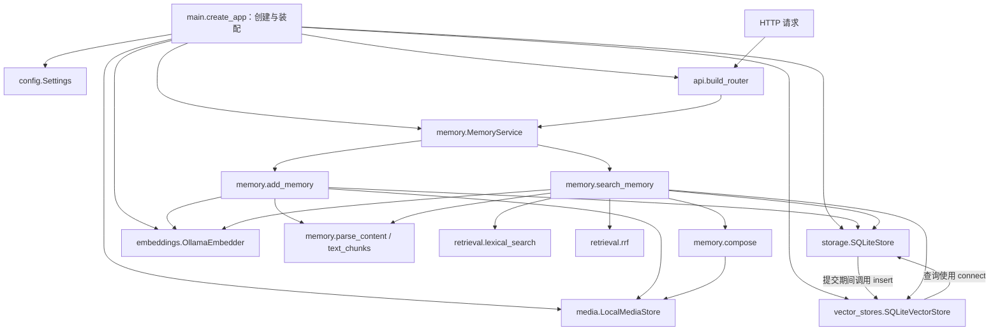

# 01 系统总览与文件地图

> 日期：2026-10-02 · V0 实际实现
> [返回阅读导航](./2026-10-02-00-阅读导航.md)

## 系统的边界

系统输出“找到的记忆证据”，没有生成最终回答的聊天循环。对外只有 Health、Add、Search 三个业务接口，另有 FastAPI 自动生成的接口文档。请求来自比赛平台、脚本或人工调用，都进入同一套业务流程。

代码按功能划分，每个目录对应一种能力。`main.py` 创建对象并连接它们；`api` 把 HTTP 数据交给 `memory`；`memory` 协调存储与检索。底层能力也有明确依赖，例如向量存储复用原始存储的数据库连接。

## 运行时模块调用图

实线表示调用或使用关系。装配入口放在顶部，它创建其他对象；接收到请求之后才经过 API 与流程层。



`storage` 与 `vector_stores` 的相互使用是当前共享 SQLite 的具体实现：`commit_add()` 调用传入对象的 `insert(conn, ...)`，`search()` 使用 `store.connect()`。这不是所有未来数据库都必须维持的依赖形式；换成外部向量库时需要重新设计提交协调。

## 文件地图

```text
src/memory_app/
  main.py                   应用工厂、对象装配、异常响应
  config.py                 运行配置
  api/
    schemas.py              外部数据结构与标识校验
    routes.py               路由、鉴权与业务入口连接
  memory/
    service.py              Add/Search 门面、耗时日志
    add.py                  写入流程
    search.py               查询流程
    models.py               Unit、Candidate 内部类型
    errors.py               内部异常分类
    parser.py               有序内容解析
    units.py                400 字符文本分块
    evidence.py              原始证据还原与响应预算
  storage/sqlite.py         原始记忆、请求记录、事务
  media/
    validation.py           图片 Data URI、格式、大小校验
    local.py                图片文件与 URI 恢复
  embeddings/
    base.py                 Embedder 协议
    ollama.py               本机 HTTP 调用与向量校验
  vector_stores/sqlite.py   向量写入及线性相似度查询
  retrieval/
    lexical.py              中文字符/双字词与英文词 BM25
    fusion.py               RRF 排序
scripts/                    外部 smoke、故事演示、小评测
tests/                      接口行为、边界与故障检查
```

各包的 `__init__.py` 用于包组织，没有隐藏的业务流程。`src/memory_demo.egg-info`、`__pycache__`、`.conda` 是安装或运行产物，不属于业务模块。

## 为什么这样分

### 1. 把“选择工具”和“使用工具”分开

你可以这样理解目前的主链路：外界通过 HTTP 调用 `api`；API 将请求交给 `MemoryService`；这个服务再调用 `add_memory()` 或 `search_memory()`；两个流程函数使用存储、媒体、向量生成和检索能力，完成工作并返回数据。

`main.py` 的任务是启动时把这些对象创建好并连接起来。它读取 `config.py` 中的配置，选择使用 SQLite、磁盘图片存储和 Ollama，然后把这些对象交给 MemoryService。它不负责每个请求具体先执行哪一步。

三个角色分别是：

- **main 选择并装配工具**：例如创建 `OllamaEmbedder`，知道我们当前用的是 Ollama。
- **Add/Search 安排工作步骤**：例如“先生成查询向量，再找相似记忆”，使用 `embedder.embed(...)`，不用自己创建 Ollama 客户端。
- **具体模块执行工作**：例如 `OllamaEmbedder.embed()` 知道怎样发 HTTP 请求给 Ollama，以及怎样检查返回的向量。

除了 `memory/`，数据库相关代码在 `storage/sqlite.py` 与 `vector_stores/sqlite.py`：前者主要保存原始记忆和请求记录，后者负责向量。SQLite 是数据库；SQL 是这些文件里使用的查询语言，我们没有另建一个名为 `sql` 的模块。

### 2. “对象通过参数传入”是什么意思

下面是 main 中装配代码的简化写法；省略了具体配置参数：

```python
store = SQLiteStore(...)           # 创建原始记忆存储对象
media = LocalMediaStore(...)       # 创建图片存储对象
embedder = OllamaEmbedder(...)     # 创建向量生成对象
vectors = SQLiteVectorStore(store)

service = MemoryService(store, media, embedder, vectors)
```

这里传入的是已经创建好的 Python 对象。MemoryService 保留它们，收到请求时继续传给流程函数。实际代码使用 `self.dependencies` 保存四个对象：

```python
self.dependencies = (store, media, embedder, vectors)
result = add_memory(payload, *self.dependencies)
```

`*self.dependencies` 把元组里的四个对象展开为四个参数，等价于：

```python
result = add_memory(payload, store, media, embedder, vectors)
```

这样，Add/Search 拿到对象就能调用它的方法。比如调用 `embedder.embed(chunks)`，不必在流程函数内部固定写 `OllamaEmbedder(...)`。这种由外部创建对象、再交给使用者的方式通常叫“依赖注入”；在这里就是传参数，并不需要额外框架。

所以，将来换 embedding 时，我们可以提供另一个拥有相同方法的对象，再调整 main 和配置。HTTP 路由仍然调用 `service.add()`、`service.search()`。模型前缀、向量维度和已有索引也需要相应处理，不能只更换类名就认为迁移完成。

### 3. “流程接收普通字典”是什么意思

外部发来的是 JSON。API 先用 Pydantic 请求模型检查字段，再通过 `body.model_dump(mode="json")` 转成 Python 字典，交给业务层。流程里就可以这样取值：

```python
user_id = payload["user_id"]
messages = payload["messages"]
```

因此，Add/Search 无需直接操作 FastAPI 的 HTTP Request 对象。以后 HTTP 字段格式变化，可以优先在 API 层完成校验与转换，让业务层继续收到约定好的数据。直接从脚本调用流程函数时，脚本也要提供符合约定的字典；它不会自动经过 HTTP 层的全部校验。

### 4. “按方法约定协作”和 Protocol 是什么

流程对对象的要求是具体的。例如，向量生成对象应当提供 `embed(texts, query=False)` 方法，返回一组向量，并有 `version` 属性说明向量版本。当前 Ollama 实现和测试用的模型替身都按这个约定工作。

`embeddings/base.py` 用 Python 的 `Protocol` 把这个要求写了出来：

```python
class Embedder(Protocol):
    version: str

    def embed(self, texts: list[str], *, query: bool = False) -> list[list[float]]: ...
```

它表达的是：“任何对象，只要具有这里约定的属性与方法，就可以符合 Embedder 接口。”它不负责实际计算，也不会自动保证某个对象返回正确向量；实际执行与校验在 `OllamaEmbedder` 中。

其他存储、媒体对象也有这样的调用要求，比如 `store.list_units(user_id)`、`media.put(key, raw)`，但当前没有为它们逐个编写 Protocol 声明，主要靠具体实现和测试保证配合正确。业务参数也尚未全面使用 Protocol 类型标注，所以目前的协议声明主要帮助阅读与后续类型检查。

“没有统一继承大基类”表示我们没有要求所有工具都继承同一个 `BaseTool`；“没有插件注册框架”表示它们没有经过自动发现、注册和加载，而是在 main 中直接创建并传入。当前只有少量实现，这样组织足够清楚。

### 5. 设计计划和已写代码需要区分

完整架构计划列出了未来可能需要的目录和接口，但 V0 只写了当前用得上的部分。例如 `vision/`、`llms/`、Pi 适配器尚未创建，存储与媒体的正式协议文件也尚未补齐。

阅读本章的文件地图，可以知道现在已经有什么；阅读完整架构计划，可以知道后面准备加什么。后续增加真实的新实现时，再完善对应接口和装配方式。

源码入口：[create_app](D:/Dev/Windows/Python/26-10-Memory/src/memory_app/main.py:14)、[MemoryService](D:/Dev/Windows/Python/26-10-Memory/src/memory_app/memory/service.py:10)、[Unit 与 Candidate](D:/Dev/Windows/Python/26-10-Memory/src/memory_app/memory/models.py:5)。

## 自检

你能否说明：为什么不用让 `main.py` 执行每次 Search？为什么 `embeddings` 和 `vector_stores` 分开？为什么目录里还没有 `vision` 和 `llms`？

下一章：[启动装配与 HTTP 接口](./2026-10-02-02-启动装配与HTTP接口.md)。
