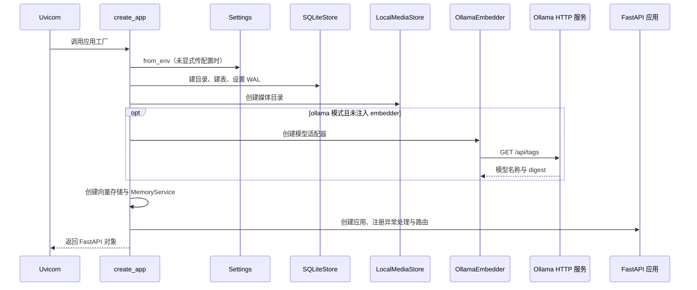
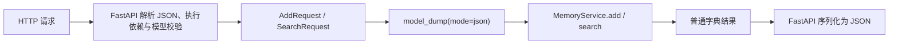

# 02 启动装配与 HTTP 接口

> 日期：2026-10-02 · V0 实际实现  
> [返回阅读导航](./2026-10-02-00-阅读导航.md)

## 应用怎样启动

启动命令中的 `memory_app.main:create_app` 指向 Python 包里的函数，`--factory` 表示 Uvicorn 应调用它来创建应用。`create_app()` 返回一个 FastAPI 对象，而不是立刻执行 Add/Search。

配置或模型初始化失败会阻止应用工厂成功返回。这发生在开始接收请求之前，所以不能把启动错误理解为某次 HTTP 请求返回了 503。

源码：[应用工厂](D:/Dev/Windows/Python/26-10-Memory/src/memory_app/main.py:14)、[模型初始化](D:/Dev/Windows/Python/26-10-Memory/src/memory_app/embeddings/ollama.py:7)。

## 配置表

| 环境变量 | 默认值 | 使用位置 |
| --- | --- | --- |
| `MEMORY_DATA_DIR` | `data` | 数据库与媒体根目录，相对当前工作目录 |
| `MEMORY_EMBEDDINGS` | `ollama` | `ollama` 或 `none`，控制是否创建模型 |
| `OLLAMA_BASE_URL` | `http://localhost:11434` | Ollama HTTP 地址 |
| `OLLAMA_EMBED_MODEL` | `nomic-embed-text:latest` | 需要已存在的完整模型标签 |
| `MEMORY_API_KEY` | 空字符串 | 是否开启 Add/Search 鉴权 |

`Settings` 是冻结的 dataclass，用于保存配置。`.env.example` 只是说明，程序不会自动读取 `.env`。默认从环境变量取值，测试也可以显式传入 `Settings(data_dir=tmp_path, ...)`。使用 `.conda/python.exe` 并不自动激活 shell 的所有环境变量。

源码：[Settings](D:/Dev/Windows/Python/26-10-Memory/src/memory_app/config.py:7)。

## 一次请求如何越过 API 边界

`build_router(service, api_key, mode)` 在函数内部定义路由。内部函数通过 Python 闭包保留传入的 service，因此收到请求时使用启动期间创建的同一个业务服务对象。

这张图强调请求对象转换的位置，不规定 FastAPI 内部鉴权与所有字段校验的精确先后顺序。

业务流程使用字典，未导入 FastAPI；这样演示、评测脚本也可以直接调用业务函数。不过直接调用者需遵守数据约定，不能假定自动获得 Pydantic 的全部校验。

源码：[build_router](D:/Dev/Windows/Python/26-10-Memory/src/memory_app/api/routes.py:6)、[请求模型](D:/Dev/Windows/Python/26-10-Memory/src/memory_app/api/schemas.py:41)。

## 三个接口

| 接口 | 输入 | 输出 |
| --- | --- | --- |
| `GET /health` | 无 | status、version、embeddings 模式 |
| `POST /add` | request_id、user_id、session_id、非空 messages | success=true 与原样三个 ID |
| `POST /search` | query、user_id、top_k，可选 options | 排序后的 data 数组 |

消息角色支持 `user` 和 `assistant`，时间戳是可选严格整数。Content 是非空字符串或非空的有序 text/image_url 数组。`top_k` 是 0–100 的严格整数，布尔值不作为整数接受。这是当前实现的范围。

Identifier 校验拒绝只有空白的标识，但不去掉有效标识首尾空格。因此 `alice` 与 ` alice ` 是两个不同范围；服务原样回传 ID。空白内容在 `parse_content()` 进一步拒绝。

Health 不需鉴权，也不实时检查 Ollama 或数据库写入。它能返回 200 不等于每条能力都已通过探测。`/docs`、`/openapi.json` 是 FastAPI 提供的说明入口，目前未额外保护。

## 鉴权和错误分类

设置 API Key 后，支持 `X-Api-Key`、`Authorization: Bearer ...` 或 `Authorization: Token ...`。识别到后一种头时会覆盖前一种值，比较使用 `secrets.compare_digest()`。当前 V0 依靠调用方正确提供 user_id，并没有把 API Key 映射成独立用户身份。

| 类型 | HTTP 状态 | 情况 |
| --- | --- | --- |
| 鉴权失败 | 401 | 提供的 Key 不匹配 |
| Conflict | 409 | 同用户、同 request_id，内容不同 |
| 模型校验 / InvalidContent | 422 | 字段错误、空白内容或非法图片 |
| ModelUnavailable | 503 | 请求阶段模型不可用 |
| StorageUnavailable | 503 | 数据库或文件访问失败 |

验证错误响应仅保留 loc/type/msg，不回显整段输入 Base64。未知的程序错误没有被统一吞掉，仍可能是 500；明确的 503 分类不是保证所有错误都可自动恢复。

## 自检

为什么 `--factory` 必须与工厂函数配套？`model_dump()` 发生在哪里？为什么重启后才会重新读取环境配置？

下一章：[Add 写入调用链](./2026-10-02-03-Add写入调用链.md)。
