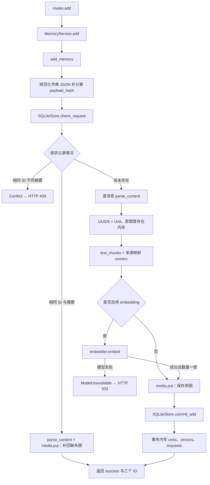
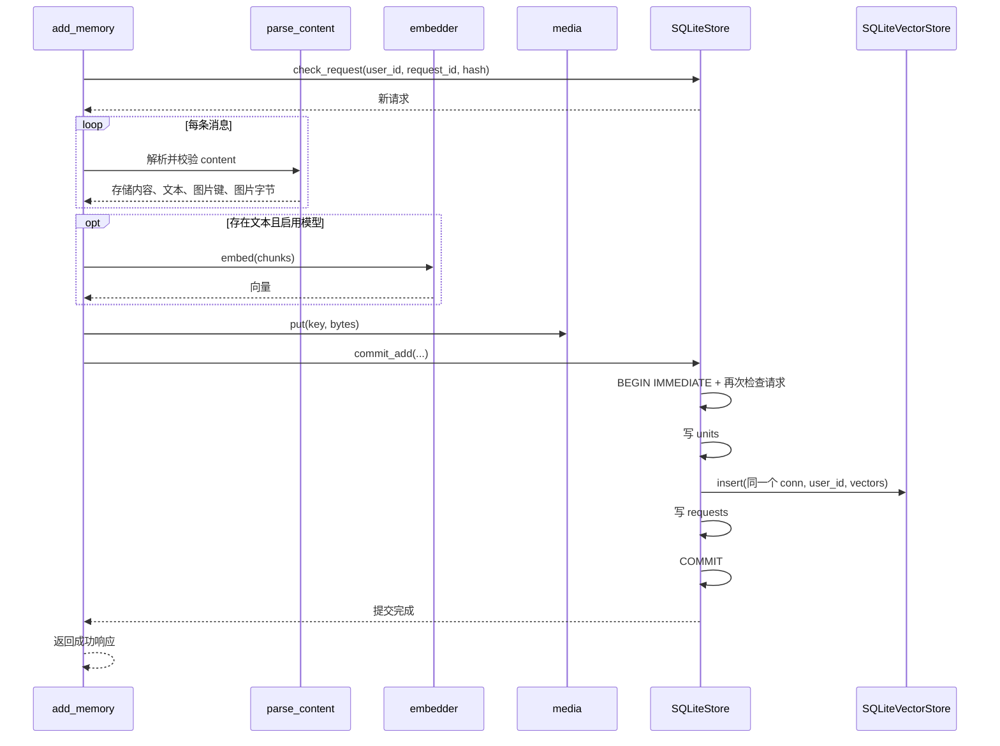

# 03 Add 写入调用链

> 日期：2026-10-02 · V0 实际实现  
> [返回阅读导航](./2026-10-02-00-阅读导航.md)

## 主函数的输入与输出

`add_memory(payload, store, media, embedder, vectors)` 接收已在 HTTP 层校验并转换的字典，以及四个启动时装配的能力对象。输出只是成功标识与三个原样 ID，记忆本身保存在存储里。

源码：[add_memory](D:/Dev/Windows/Python/26-10-Memory/src/memory_app/memory/add.py:12)、[MemoryService.add](D:/Dev/Windows/Python/26-10-Memory/src/memory_app/memory/service.py:14)。

## 函数调用与分支图

## 逐步解释

1. 将传入字典按键排序并用固定 JSON 分隔符序列化，计算 SHA-256。这里的摘要是 API 标准化后的数据摘要，不是原始 HTTP 字节的哈希。例如 JSON 键的顺序变化不会制造不同请求。
2. 以 `(user_id, request_id)` 查幂等记录。相同内容直接复用成功状态并补回缺失原图；不同内容抛出冲突。不同用户可以使用相同 request_id。
3. 遍历消息并解析有序图文。所有消息先验证，统计整次 Add 的图片大小；没有因第一条消息合法就提前提交第一条。
4. 每条消息按 `[user_id, request_id, 消息序号]` 生成 UUID5，创建一个 Unit。相同来源生成相同 ID，同消息内容在不同 request_id 下可以成为不同单元。
5. 文本每 400 字符分块，保存 `owners=(unit_id, chunk_order)`。模型输出向量后，用这个列表把各块重新关联到原始单元。
6. 模型计算完成后保存图片，再提交数据库。模型 HTTP 请求不占用 SQLite 写事务。
7. 事务提交成功后返回响应。离线模式没有向量，但已存文本能立即用于词法检索；纯图片单元能按相同图片哈希检索。

## 写入时序图

## 为什么事务里还要检查一次

请求 A、B 可能同时在第一次检查时看到“未存在”，各自开始模型计算。`BEGIN IMMEDIATE` 让写入事务有明确的并发边界；后来进入的请求会再次检查，发现同摘要就不重复写，不同摘要就冲突。数据库主键进一步约束重复记录。

这保证最终记录不重复，但不会阻止并发重复请求各自消耗一次 embedding 计算。当前没有“处理中”状态或单请求锁队列。

源码：[事务提交](D:/Dev/Windows/Python/26-10-Memory/src/memory_app/storage/sqlite.py:54)。

## 失败时的边界

模型失败不会提交新单元。数据库写入途中失败，units、vectors、requests 一起回滚。原图已保存而数据库失败时，文件可能留下未引用副本；文件系统不属于 SQLite 事务，当前没有垃圾回收。

重复 Add 的图片恢复只补缺失文件。`media.put()` 遇到已存在路径会直接返回，因此没有校验已存在但损坏的文件内容，也不会靠重试重建旧模型版本的向量。

## 跟着一个例子读

上传“3号机床出现红色告警灯”及一张照片时，Unit 的 content 保留两块及顺序，text 只包含那句文字，media_keys 指向原图。embedding 来自文字，向量记录指向 Unit ID。Add 本身没有识别图片里的灯；调用方已经给出了这段说明。

## 自检

为什么把模型计算放在数据库事务外？为什么重复请求还可能调用 `media.put()`？为什么一个消息单元可以对应多个向量记录？

下一章：[Search 查询调用链](./2026-10-02-04-Search查询调用链.md)。
