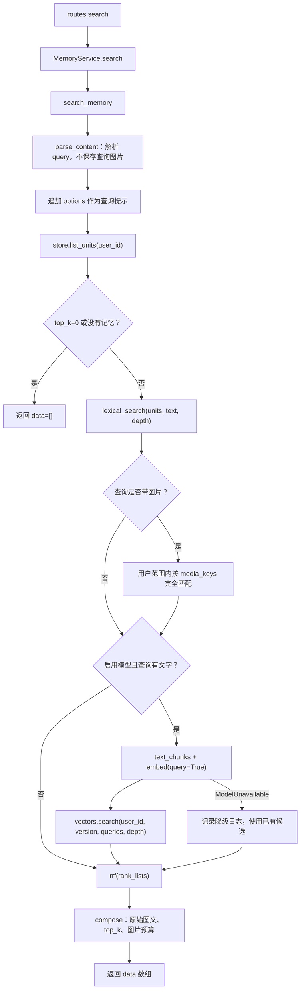
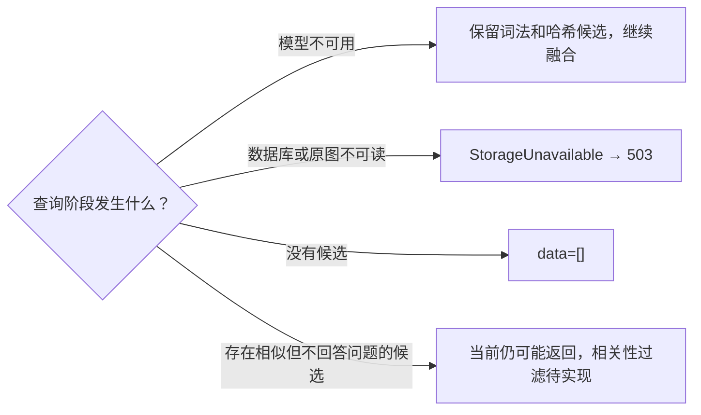

# 04 Search 查询调用链

> 日期：2026-10-02 · V0 实际实现  
> [返回阅读导航](./2026-10-02-00-阅读导航.md)

## 查询的目标

`search_memory()` 返回最多 top_k 条同一用户的原始证据。模型只负责把查询转成向量，没有回答问题的 LLM 调用。

源码：[search_memory](D:/Dev/Windows/Python/26-10-Memory/src/memory_app/memory/search.py:13)、[MemoryService.search](D:/Dev/Windows/Python/26-10-Memory/src/memory_app/memory/service.py:25)。

## 函数调用图

从上到下是当前执行顺序：先词法，再可选图片哈希，再可选向量，最后融合。这些通道当前没有并行调度。

## 查询处理

解析 query 时产生文本与图片键，图片字节只用于校验和算哈希，不会保存为新的记忆。顶层 options 拼接到文本中参与召回，但不会生成答案或成为事实记录。

先按 user_id 加载 Unit 列表。session_id 不限制检索，因此同一用户能跨会话找回记忆。向量通道也在 SQL 中限定 user_id 和模型版本，图片哈希路径同样包含用户范围。

查询的候选深度是 `max(top_k * 3, 30)`，是每路最多召回多少条，不是最终返回条数。`top_k=100` 时每路深度为 300，融合后再由 compose 挑选最多 100 条。

## 三路各返回什么

| 通道 | 条件与输入 | 候选来源 |
| --- | --- | --- |
| BM25 | 用户 Unit 中的 text、查询文字 | 词法分数大于零的消息 |
| 图片哈希 | query 含图片 | 包含完全相同图片字节的消息 |
| 文本向量 | 有 embedder 且有查询文字 | 当前模型版本的用户向量记录 |

候选都是 `Candidate(id, score)`。图片哈希候选分数设为 1，但 RRF 只读取排名，并不会因此自动获得最高权重。当前哈希候选顺序来自按 Unit ID 排序的列表。

纯图片 query 没有附带文本或 options 时，不会做文本 embedding；它只可能靠相同图片哈希命中。视觉相似但字节不同的图片不能靠这条通道识别。

## 结果如何还原

compose 根据候选 ID 在已经加载的 Unit 中找到原始内容，检查原图大小，按顺序恢复图片 Data URI。超过剩余图片预算时跳过整个单元并继续后面的候选，不截去单元里的某一张图。因此实际返回条数可能少于 top_k。

每条结果包含 id、content、score、created_at。score 是融合分数，不是回答可信概率。created_at 是持久化时的时间；原消息 timestamp 与 role 存在 Unit 中，但当前响应没有单独返回，也没有据此做时间排序。

源码：[compose](D:/Dev/Windows/Python/26-10-Memory/src/memory_app/memory/evidence.py:4)。

## 故障与无证据的区别

向量计算错误的 try 区域也包含向量搜索，但只捕获 ModelUnavailable；数据库错误不会被误当成模型降级。原图缺失时不会悄悄返回文字片段，整个请求明确报告存储不可用。

当前没有可靠的“这个问题没有答案证据”判断。相关内容靠前只能说明检索相似，不能说明用户的护照号等事实存在。

## 自检

为什么每一路都要保留用户范围？depth 和 top_k 有什么区别？为什么 Search 模型故障可以降级，而原始证据损坏要报错？

下一章：[数据存储与图文还原](./2026-10-02-05-数据存储与图文还原.md)。
