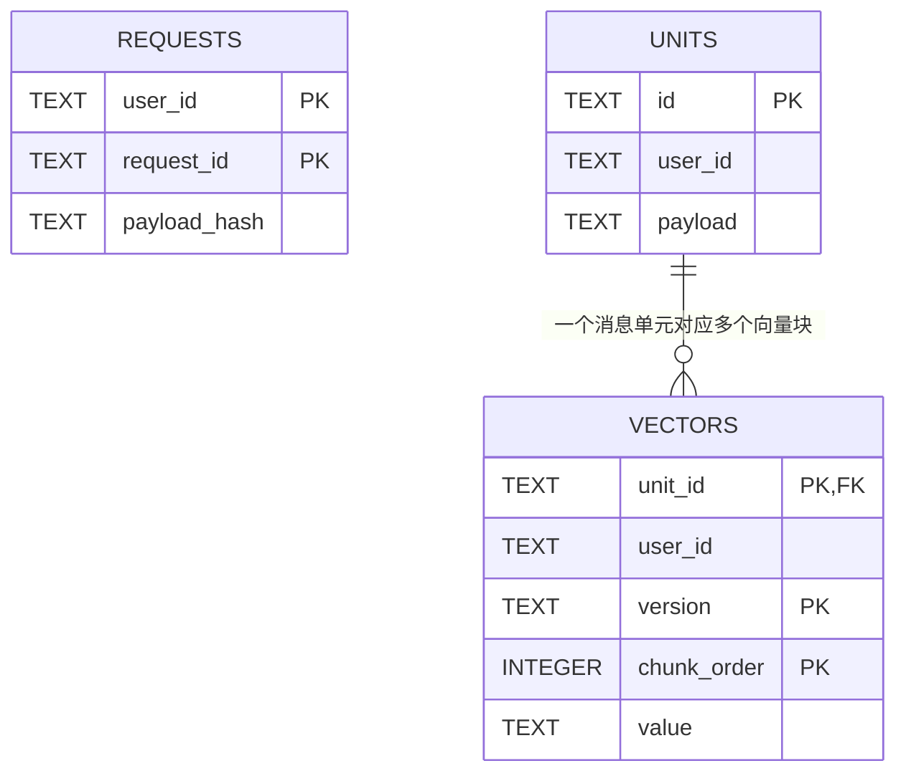
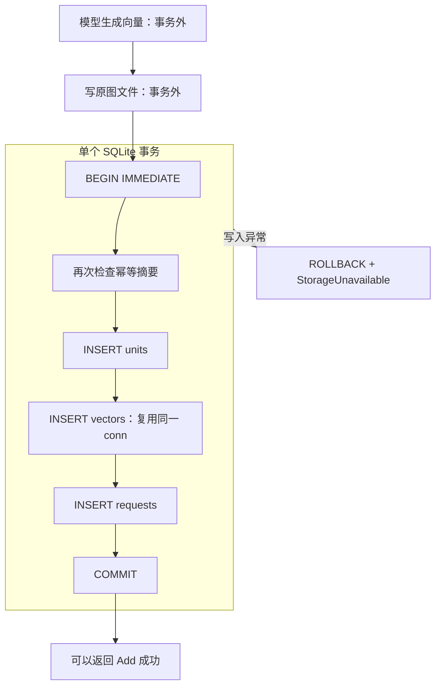
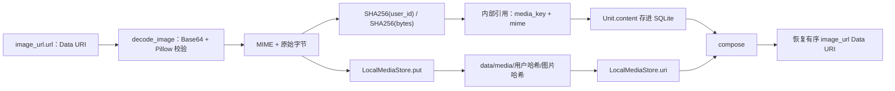

# 05 数据存储与图文还原

> 日期：2026-10-02 · V0 实际实现  
> [返回阅读导航](./2026-10-02-00-阅读导航.md)

## 内部对象和数据库表的区别

Python 中使用 `Unit` 表示一条消息来源的记忆，使用 `Candidate` 表示检索命中的 ID 与分数。Unit 是 dataclass，在写库时经 `asdict()` 变成字典，再序列化为 JSON。数据库没有给 Unit 每个字段单独建列。

| Unit 字段 | 用途 |
| --- | --- |
| id | 稳定来源 ID，连接检索块与原消息 |
| user_id、session_id | 用户隔离与来源会话 |
| role、timestamp | 原消息角色与可选 Unix 毫秒时间 |
| content | 原文，或保持顺序的文本块与内部图片引用 |
| text | 拼接出的文本检索内容，不含图片像素含义 |
| created_at | 本次写入生成的 UTC ISO 时间 |
| media_keys | 图片文件键列表，用于匹配与响应预算 |

源码：[Unit](D:/Dev/Windows/Python/26-10-Memory/src/memory_app/memory/models.py:5)、[parse_content](D:/Dev/Windows/Python/26-10-Memory/src/memory_app/memory/parser.py:5)。

## 表结构与关系



requests 的复合主键是 `(user_id, request_id)`；vectors 的复合主键是 `(unit_id, version, chunk_order)`，unit_id 外键连接 units.id。requests 和 units 没有显式数据库外键，来源关系通过稳定 ID 的生成规则与同一事务维持。

requests 只记录已成功提交的摘要，没有 pending/failed 状态。Unit 的 JSON 中也没有独立 request_id 字段。设计计划中的 RawMessage、ContentPart、DerivedArtifact、MemoryState 尚未分别建表；当前以 Unit JSON 保留消息字段，并通过 vectors 保存一种派生索引。

同一 SQLite 文件中同时存事实和索引，职责仍分开：SQLiteStore 管理请求与 Unit，SQLiteVectorStore 管理向量写入与查询。

源码：[建表](D:/Dev/Windows/Python/26-10-Memory/src/memory_app/storage/sqlite.py:11)、[向量写入](D:/Dev/Windows/Python/26-10-Memory/src/memory_app/vector_stores/sqlite.py:9)。

## 事务边界



图中的正常写入路径假设事务内复查仍是新请求；若另一请求已先提交，则复用或冲突分支提前结束。`with conn` 负责事务提交或回滚，`connect()` 的 finally 负责关闭连接。每次使用创建独立连接，没有全局共享一个 SQLite connection。

WAL 有助于读写并发，`BEGIN IMMEDIATE` 在写入流程明确申请写事务；仍然是 SQLite 单写者，无法据此推定已经能承受比赛 Full 的规模。连接等待上限设置为 30 秒。

源码：[connect](D:/Dev/Windows/Python/26-10-Memory/src/memory_app/storage/sqlite.py:31)、[commit_add](D:/Dev/Windows/Python/26-10-Memory/src/memory_app/storage/sqlite.py:54)。

## 图片如何从 HTTP 走到磁盘



图片 Data URI 不作为整段 Base64 保存在数据库。内部图片块形如：

```json
{"type":"image_url","media_key":"用户哈希/图片哈希","mime":"image/png"}
```

返回时会还原为外部格式，文本和图片的顺序保持。解码后的原始图片字节未重编码，Base64 文本的换行等书写形式可能规范化；因此保证的是原图字节与内容顺序，不是输入 URI 字符串所有表现形式都逐字符不变。

验证接受 PNG/JPEG/WebP，单图最多 10 MiB，核对声明 MIME 与真实文件格式，调用 Pillow.verify 并处理解压炸弹警告。实际图片没有经过 OCR 或视觉模型。

源码：[decode_image](D:/Dev/Windows/Python/26-10-Memory/src/memory_app/media/validation.py:14)、[媒体对象](D:/Dev/Windows/Python/26-10-Memory/src/memory_app/media/local.py:8)。

## 原子文件保存与幂等

同一用户的相同字节使用同一个文件路径。`put()` 在目标目录创建临时文件，写入后 flush/fsync，再 `os.replace()` 到最终路径。finally 清理残留临时文件。

这是单个文件的原子替换，不是媒体与数据库联合事务。同一用户跨多条消息可以共享原图，返回预算仍按实际返回的图片出现次数累计；不同用户有独立路径。

若文件已存在，put 直接返回。缺失文件可以通过原 Add 请求重放补回，但已存在的损坏文件尚未校验。缺图被 Search 访问时会变为明确 503，不会输出半份内容。

## 当前存储限制

数据库没有迁移版本、用户删除和 TTL；未引用图片缺少垃圾回收。原文可支撑未来重建派生索引，但 request_id 未独立保存在 Unit JSON 等细节，需要在新增治理功能时评估迁移。读取 units 当前按 ID 排序，未按消息时间或来源序号排序；图文块顺序保留不等于已经实现会话顺序恢复。

## 自检

为什么一个 SQLite 文件仍可以有两个职责不同的对象？哪些操作会随回滚撤销？为什么图片恢复时不需要重新算 embedding？

下一章：[Embedding 与检索算法](./2026-10-02-06-Embedding与检索算法.md)。
