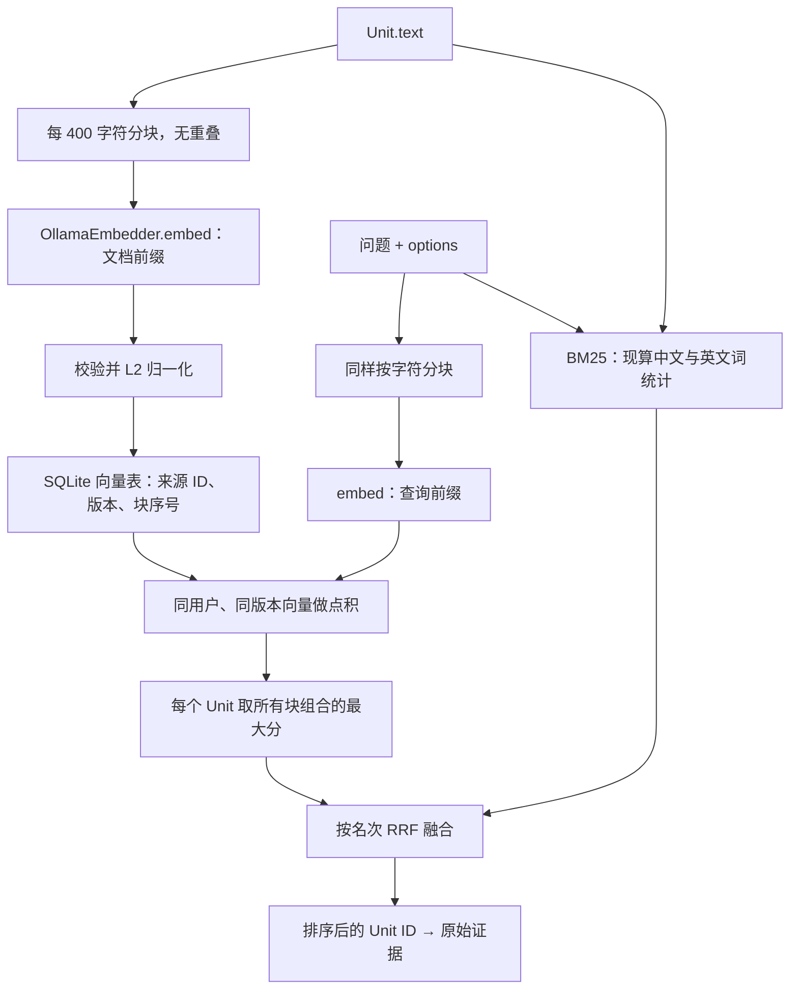

# 06 Embedding 与检索算法

> 日期：2026-10-02 · V0 实际实现  
> [返回阅读导航](./2026-10-02-00-阅读导航.md)

## 一条文本怎样变成检索候选

## 分块的职责

`text_chunks()` 只是按 Python 字符长度每 400 切一块，没有句子识别、tokenizer、重叠或摘要。400 字符与 400 模型 token 不同，当前不能保证任意内容都一定落在模型上下文上限内。

分块用于向量生成，BM25 仍使用整个 Unit.text；Search 返回完整 Unit.content。长消息末尾也会得到向量，不会只索引前 400 字符。

源码：[text_chunks](D:/Dev/Windows/Python/26-10-Memory/src/memory_app/memory/units.py:1)。

## Ollama 适配器

初始化查询 `/api/tags`，确认完整标签存在并读取模型 digest。向量版本由模型标签、digest、前缀策略版本、分块版本组成，确保查询只使用对应版本的记录。

`embed(texts, query=False)` 每批最多 16 条文本，调用 `/api/embed`：文档加 `search_document: `，查询加 `search_query: `，显式 `truncate=False`，单次 HTTP 超时 120 秒。`trust_env=False` 避免本地请求使用 shell 代理配置。

校验检查输出数量、非空、真正的数值类型、有限数值、非零向量和同次调用维度一致，再做 L2 归一化。HTTP 或格式错误统一转换为 ModelUnavailable。

源码：[初始化](D:/Dev/Windows/Python/26-10-Memory/src/memory_app/embeddings/ollama.py:7)、[embed](D:/Dev/Windows/Python/26-10-Memory/src/memory_app/embeddings/ollama.py:19)。

当前版本的 digest 在初始化时读取，没有在每次请求前检查标签是否在服务运行期间被重新指向另一模型。切换模型时应重启并重建相应索引；自动重建工具尚未实现。默认前缀是为当前 nomic 配置编写的，替换其他模型需重新确认其要求。

## 向量存储与相似度

SQLiteVectorStore 从表里取出同用户、同版本的全部向量，JSON 解码后逐条计算点积。对于归一化向量，点积就是余弦相似度。

一条消息有多个文本块时，取该消息任意文档块与任意查询块组合的最大分。最终按分数降序，分数相同时按 Unit ID 排序。维度不同的记录当前会跳过，没有重建或告警修复流程。

这是线性扫描，没有 ANN 索引。当前向量通道没有最小相关性阈值，负分候选也可能进入排名；它会找“相对最像”的内容，不能证明证据充分。

源码：[向量 search](D:/Dev/Windows/Python/26-10-Memory/src/memory_app/vector_stores/sqlite.py:15)。

## BM25 词法通道

英文与数字用小写 `[a-z0-9_]+` 提取；中文连续片段同时产生单字和相邻双字词。它没有使用完整中文分词器。例如“红色告警灯”产生单字及“红色、色告、告警、警灯”等相邻组合。

每次 Search 对该用户全部 Unit.text 重算词频、文档频率与平均长度，再以 BM25 形式计算得分，参数为 k1=1.2、b=0.75。查询词先转为集合；分数为零的文档不进入候选。

这条通道并没有提前建立 SQLite FTS 表。目录称为检索能力，实际实现是 Python 中现算 BM25。单字匹配可提高召回，也会让“我”“的”“号”等共同字造成噪声；目前没有停用词处理。

源码：[tokens](D:/Dev/Windows/Python/26-10-Memory/src/memory_app/retrieval/lexical.py:7)、[lexical_search](D:/Dev/Windows/Python/26-10-Memory/src/memory_app/retrieval/lexical.py:15)。

## RRF：统一排序尺度

每条候选在每路的排名 rank 从 1 开始，融合分数是所有命中通道的 `1 / (60 + rank)` 之和。k=60 是当前默认值，不是比赛规定。

同一路重复 ID 只加一次分，不同路相同 ID 累加。RRF 使用 ID 与排名，不比较 BM25 分数与余弦值；融合后按得分降序、ID 稳定处理并列。

| 候选 | BM25 排名 | 向量排名 | RRF 分数（近似） |
| --- | ---: | ---: | ---: |
| A | 1 | 3 | 0.03227 |
| B | 4 | 1 | 0.03202 |
| C | 2 | 未命中 | 0.01613 |

单路输入也会经过当前 rrf 函数，只是保持那一路排名并将分数变成倒数排名值。RRF 不能找回各路都没有召回的无描述图片。

源码：[rrf](D:/Dev/Windows/Python/26-10-Memory/src/memory_app/retrieval/fusion.py:4)。

## pass、Protocol 与可替换点

`Embedder(Protocol)` 描述 version 属性与 embed 方法约定。OllamaEmbedder 不必显式继承它，只要结构符合即可；当前流程参数没有全面标注 Protocol，主要靠方法调用与测试验证。

协议方法里的 `...` 是声明占位；真正生成向量的是适配器。`errors.py` 类体中的 `pass` 表示继承父类行为无需添加实现，不是留空的检索算法。

源码：[Embedder 协议](D:/Dev/Windows/Python/26-10-Memory/src/memory_app/embeddings/base.py:4)、[异常类型](D:/Dev/Windows/Python/26-10-Memory/src/memory_app/memory/errors.py:1)。

## 自检

为什么向量版本不能只写 `latest`？为什么先保留单路效果，再看融合效果？为什么余弦排名最高仍可能没有答案证据？

下一章：[测试运行与扩展指南](./2026-10-02-07-测试运行与扩展指南.md)。
