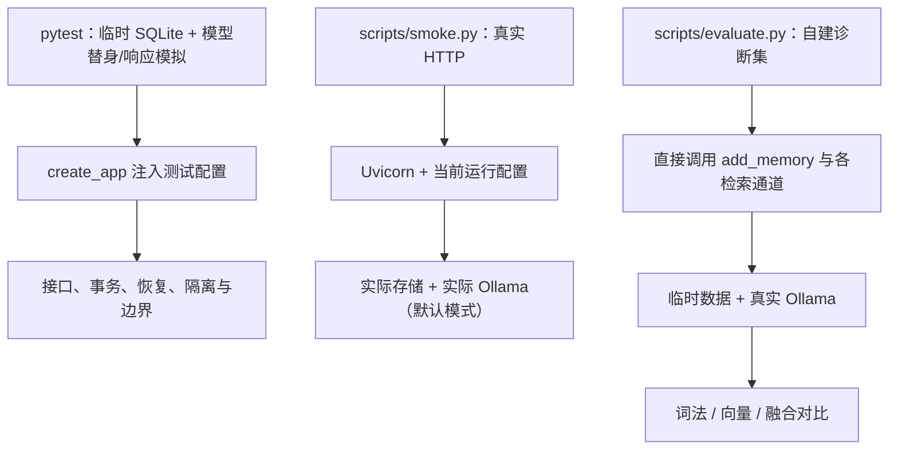

# 07 测试运行与扩展指南

> 日期：2026-10-02 · V0 实际实现  
> [返回阅读导航](./2026-10-02-00-阅读导航.md)

## 三种验证各自证明什么



单元与行为检查提供确定性故障场景；HTTP smoke 验证服务真正可调用；小评测比较真实检索效果。三者互补。evaluate 绕过 HTTP，不验证鉴权、API 模型转换或真实整条 Search 输出预算，也不会自动因为一个检索指标差就退出失败。

## 当前检查覆盖

当日修复后运行结果为 29 项通过。其中参数化输入会分别计数，所以测试函数数量和用例数量不同。

| 文件 | 重点 |
| --- | --- |
| [test_memory.py](D:/Dev/Windows/Python/26-10-Memory/tests/test_memory.py:34) | 重启、幂等、隔离、top_k、图文原样恢复、鉴权、并发重试、向量故障降级 |
| [test_resilience.py](D:/Dev/Windows/Python/26-10-Memory/tests/test_resilience.py:34) | 空白标识、三种图片、批量校验、事务回滚、丢图恢复、并发冲突、非法向量、长消息与版本隔离 |

测试使用 `tmp_path` 保存独立数据；故障注入用 monkeypatch 暂时替换对象方法。原图丢失检查只移除临时夹里的测试图，再重放 Add 验证恢复。测试没有删除实际 Demo 数据。

故障测试先获得预期失败，再修复并回归。初次新增 15 项中 7 项失败，涉及空白标识、数据库错误、丢图、模型列表格式、布尔向量；详细证据见[测试修复记录](../2026-10-02-09-Demo学习思路与测试修复结果.md)。

## 实际运行

在项目根目录执行，已有 `.conda` 时无需重新创建：

```powershell
# 启动默认 Ollama 模式的服务
.\.conda\python.exe -m uvicorn memory_app.main:create_app --factory --host 127.0.0.1 --port 8000
```

另一个终端执行：

```powershell
# 确定性检查，不要求本地模型真的运行
.\.conda\python.exe -m pytest -q
# 真实 HTTP smoke，需要服务启动
.\.conda\python.exe scripts\smoke.py
# 三条文本故事与三个查询
.\.conda\python.exe -X utf8 scripts\demo.py
# 真实 Ollama 检索诊断，不要求 HTTP 服务启动
.\.conda\python.exe -X utf8 scripts\evaluate.py
```

smoke 用随机 user_id，留下少量图片与文本。demo 用固定 `demo-local`，相同写入可重试；如果修改了脚本里的故事却沿用同 request_id，会出现合理的 409。evaluate 使用临时目录，结束后清理数据，且它固定创建 OllamaEmbedder，不会因 `MEMORY_EMBEDDINGS=none` 自动变为离线评测。

服务未启用自动 reload；改源码后需要重启才能加载。查看 <http://127.0.0.1:8000/docs> 可以交互调用。完整安装说明与已验证依赖版本见[项目 README](../../README.md)。

源码：[smoke](D:/Dev/Windows/Python/26-10-Memory/scripts/smoke.py:12)、[demo](D:/Dev/Windows/Python/26-10-Memory/scripts/demo.py:7)、[evaluate](D:/Dev/Windows/Python/26-10-Memory/scripts/evaluate.py:18)。

## 小评测结果怎么解读

当日自建集有 6 条文本和 1 张无说明图片，8 个有证据查询。包括多证据问题与 1 道视觉问题。另有护照号无证据探测，不计入以下指标。

| 通道 | Hit@1 | 平均 Recall@3 |
| --- | ---: | ---: |
| BM25 | 75.0% | 87.5% |
| nomic | 75.0% | 83.3% |
| RRF | 87.5% | 87.5% |

融合在 7 道文本题首条都命中，但图片题全部失败。护照号问题产生了无关候选。这个小集合用来展示失败原因与两路互补，不能推定比赛分数或普遍优于单路，也没有评价最终答案。

## 扩展时主要改哪里

| 目标 | 修改位置 | 验证重点 |
| --- | --- | --- |
| 更换文本模型 | `embeddings`、config、main | 前缀/维度/版本、重建旧索引、中文效果 |
| 增加图片描述/OCR | 新增 `vision`，必要时 `llms`；Add 派生步骤 | 原图不被替代，无描述图片问题改善 |
| 图像语义召回 | 图像 embedding、向量记录类型、Search 通道 | 文本与图像表征兼容、用户隔离、融合 |
| 更换向量数据库 | `vector_stores` 与提交协调、装配 | 外部数据库无法共享当前 SQLite 事务 |
| 加相关性过滤或重排 | `retrieval` 与 Search 排序阶段 | 有证据召回与无证据误召的取舍 |
| 按用户删除与 TTL | storage、vector_stores、media | 原始数据与派生副本一起治理、共享图片引用 |
| 接入 Pi | 新增 integrations，调用 MemoryService | 复用核心流程，证据回到 Agent 上下文 |

协议的完善也应跟随真实替换。当前新模型可以注入 create_app；但直接替换存储并不只需要“换一个名字”，它还要满足幂等、事务、来源读取与错误分类等语义。

## 尚未实现与已知限制

没有视觉像素理解、自动 caption/OCR、时间意图排序、冲突事实治理、reranker、图谱、LLM 答案生成或 Pi。没有索引自动重建、媒体损坏校验、孤立文件清理、TTL、删除、迁移、Docker 和公网部署。

检索是单用户线性扫描，BM25 每次重算。整体 HTTP body 限额与限流尚未实现，图片解码限制不等于接收超大 HTTP 输入前就拦截。所有这些能力需要独立实现与验证，当前文档中的调用图没有把它们画成已存在模块。

## 学习练习

先运行 demo，再在源码里定位一次 Add 与 Search 经过的函数；然后阅读故障测试，解释“失败后为什么没有半条记忆”。想修改算法时，先用 evaluate 保留单路与融合的结果，再比较同一批问题。

返回：[阅读导航](./2026-10-02-00-阅读导航.md)。
