# 2026-10-02 学习笔记：多模态记忆 Demo：架构、实现、测试与源码导读

> 原始记录日期：2026-10-02。整理日期：2026-10-08。
> 按原笔记顺序合并，保留思路、参考资料、结果、代码示例与 Mermaid 调用图；不将历史计划或测试结果当作今天重新验证的事实。
> 同一天的记录集中维护在本文件；各主题仍作为独立章节，后续补充保留原讨论日期。

## 目录

- [多模态记忆基础 Demo 规划](#note-01)
- [MemoraX 文本榜第一分析](#note-02)
- [Pi 循环与记忆工具的位置](#note-03)
- [RRF 融合排序：让多路检索按名次投票](#note-04)
- [MemoraX Code：日常工作中形成的个人与项目经验库](#note-05)
- [多模态记忆系统：完整架构计划](#note-06)
- [参考 Mem0 的功能模块架构：我的思考与决策过程](#note-07)
- [基础 Demo 实现与首次运行记录](#note-08)
- [Demo 学习思路与测试修复结果](#note-09)
- [V0 源码导读：V0 源码导读：阅读导航](#note-10)
- [V0 源码导读：系统总览与文件地图](#note-11)
- [V0 源码导读：启动装配与 HTTP 接口](#note-12)
- [V0 源码导读：Add 写入调用链](#note-13)
- [V0 源码导读：Search 查询调用链](#note-14)
- [V0 源码导读：数据存储与图文还原](#note-15)
- [V0 源码导读：Embedding 与检索算法](#note-16)
- [V0 源码导读：测试运行与扩展指南](#note-17)

<a id="note-01"></a>

## 1. 多模态记忆基础 Demo 规划

> 日期：2026-10-02  
> 状态：V0 本地 baseline 已实现（2026-10-02），正式提交与视觉增强待完成  
> 目标：Agent Memory Challenge 2026 第二期，多模态记忆 / 开源方法榜

### 比赛边界

参赛系统只负责：

1. `Add`：接收消息，持久化并建立记忆索引；
2. `Search`：根据问题返回排序后的记忆证据。

最终回答与评分由平台完成。因此第一版 **不做聊天界面、不做完整 Agent、不在 Search 中生成答案**，只把记忆服务做正确。

当前官方节点：材料于 2026-10-31 23:59（UTC+8）截止，评测于 2026-11-04 23:59 停止；Full 通常需约 0.5–2 天。

- [赛事页面](https://agentmemories.ai/competition/)
- [参赛说明与 Add/Search 规范](https://agentmemories.ai/rules)

### V0 一句话定义

> 一个遵守官方接口、按用户隔离、能够写入图文记忆，并通过文本或图片说明检索原始证据的本地服务。

第一版采用 **caption-compatible 多模态 baseline**：完整保存文本、图片和内容顺序，以文本及图片 caption 建立检索索引，命中时返回原始图文证据。真正理解图片像素的视觉 embedding/OCR 留到 V1。

### V0 必须包含

#### 接口

- `GET /health`：任意 2xx，无需鉴权；
- `POST /add`：严格接收官方请求，完成持久化后同步返回；
- `POST /search`：严格返回按相关性排序的证据；
- 可选 API Key；本地可关闭，部署前启用。

#### 数据约束

- 保存 `request_id`，用它保证重复 Add 不会重复写入；
- `user_id` 是唯一检索隔离边界；
- `session_id` 只记录来源会话；
- 保存 `role`、`timestamp`、原始 `content` 及图文顺序；
- Search 支持字符串或多模态 `query`，以及可选 `options`；
- 结果数量不得超过 `top_k`，正式评测固定为 100；
- 每条结果包含稳定、非空的 `id` 和 `content`。

#### 存储与检索

- SQLite：请求、消息、内容块、时间和图片路径；
- 本地文件目录：解码后的图片；
- 向量索引：文本及 caption embedding；
- 抽象 `MemoryStore` 和 `Retriever`，以后可替换向量数据库或模型。

```text
Add → 校验 → 解析有序图文 → 保存原始内容 → 分块/向量化
    → 写入索引 → 确认可检索 → HTTP 200

Search → 校验 → 限定 user_id → 查询向量化 → 召回/排序/去重
       → 最多返回 top_k 条原始证据
```

#### 日志与安全

- 记录请求标识、耗时、返回条数和错误类型；
- 不在日志中打印密钥或完整 Base64；
- 密钥只从环境变量读取；
- 绝不跨 `user_id` 返回记忆；
- 非法图片、空内容和未知类型返回明确错误；
- 按官方要求在任务结束后 30 天内删除评测数据及衍生副本。

### V0 暂时不做

- 最终答案生成、聊天界面或完整 Agent Loop；
- 知识图谱、自动反思、复杂遗忘和多跳推理；
- 同时接入多个数据库；
- 为视觉模型选型而阻塞接口闭环。

### 五个验收场景

1. **文本召回**：写入“用户最喜欢蓝色机械键盘”，能通过语义问题找到原证据。
2. **图文召回**：写入设备图片及“3 号机床出现红色告警灯”的 caption，相关问题能返回原始图文证据。
3. **用户隔离**：两个用户写入矛盾事实，搜索 A 时绝不返回 B 的记录。
4. **幂等写入**：同一 `request_id` Add 两次，存储中只有一份记忆。
5. **接口边界**：`top_k=3` 时至多返回三条；Add 响应中的标识与请求完全一致。

### V0 完成定义

- [x] 三个接口可以在本地启动并由测试调用；
- [x] 支持官方文本和多模态 content 格式；
- [x] Add 返回前，新增记忆已可检索；
- [x] 五个验收场景全部通过（本地 baseline 检查）；
- [x] 一条命令可以运行本地 smoke test；
- [x] 重启服务后数据仍存在；
- [x] 配置和密钥来自环境变量；
- [ ] README 在朋友的新环境中完成复现验证（安装与运行说明已提供）；
- [ ] 公网部署前再次核对最新官方规范。

本地实现、检查结果与能力边界见[首次运行记录](#note-08)。本地 smoke 与官方 smoke 分开记录；真实中文语义召回仍需系统评测。

### 后续升级

#### V1：真正的多模态

图片 embedding、OCR/视觉 caption、跨模态检索，以及文本与视觉得分融合和消融实验。

#### V2：提高记忆质量

事件/实体/时间/关系抽取、冲突更新、混合检索、reranker，以及多跳、时间和拒答本地评测。

#### V3：提交与生产化

并发和容量测试、公网 HTTPS、鉴权监控、固定版本和来源披露；先过官方 smoke，再运行 Full。

### 第一轮实现顺序

1. 建立 Python 项目与配置；
2. 用内存版 Add/Search 锁定接口模型；
3. 加入 SQLite 和 `user_id` 隔离；
4. 加入 embedding 与排序；
5. 加入图文解析、图片保存和 caption 索引；
6. 写五个验收测试与本地 smoke；
7. 再决定视觉模型、reranker 和公网部署。

第一轮只证明一件事：**官方格式进来，记忆可靠地存下去，相关证据按正确格式出来。**

### 9. 与公开方案和评测基准的对比（2026-10-02）

#### 能确认的公开信息

第二期仍处于提交阶段，正式结果预计 11 月中旬发布；当前没有足够完整的第二期多模态参赛实现可供逐项复刻。因此这里只使用两类可靠证据：

1. 已公开的 AML 参赛仓库，用来观察工程与检索结构；
2. 本届多模态评测包含的 ATM-Bench 与 Mem-Gallery，用来判断实际能力要求。

公开参赛实现中反复出现的设计包括：

- 原始消息与派生索引分开保存，Search 返回可审计的原文证据；
- BM25/FTS 等词法召回与 dense embedding 并行；
- 使用 RRF、加权分数或 MMR 做融合、去重和证据多样化；
- 保存 role、timestamp、session 和相邻轮次，避免孤立片段丢失语境；
- 对选项、日期、数字、先后顺序和事实修正做专门处理；
- 把模型调用设为可选通道，失败时仍有确定性检索兜底；
- 单独测试接口契约、幂等、并发、输出预算和 Docker smoke；
- 提供数据删除、TTL、版本冻结和来源披露。

多模态基准带来的额外要求：

- ATM-Bench 涉及长时间跨度、图片/视频/邮件等多来源、个性化指代和多证据推理；
- Mem-Gallery 面向多模态长对话记忆，并提供视觉语言编码器配置；
- 因而只检索 caption 可以跑通流程，但会漏掉 caption 未描述的视觉细节，也难以处理图片间关系。

#### 我们的 V0 与它们相比

| 方面 | 我们的 V0 | 更成熟的公开方案/基准要求 | 决策 |
| --- | --- | --- | --- |
| 接口契约 | Add/Search/Health | 同样以契约正确为第一优先 | 保留 |
| 原始证据 | 保存完整有序图文 | 强调 verbatim、可审计证据 | 保留并强化 |
| 用户隔离 | `user_id` 严格隔离 | 公共方案均视为硬约束 | 保留 |
| 检索 | caption 的单路向量召回 | 词法+dense+融合+rerank | V0 可简单，但现在预留多通道接口 |
| 视觉 | 保存原图、索引 caption | 视觉 embedding/MLLM caption/OCR | V1 插件化接入 |
| 时间关系 | 只保存 timestamp | 时间意图、修正、事件顺序 | 先存全，V1/V2 再计算 |
| 上下文 | 单记忆块 | 相邻轮次和证据窗口 | 预留 EvidenceComposer |
| 稳定性 | 基础 smoke | 并发、TTL、降级、Docker CI | V0 后半程补齐 |

结论：V0 不需要变成复杂系统，但不能把“单向量索引”写死在业务层。

### 10. 建议冻结的结构与接口

> 2026-10-02 更新：以下名称描述逻辑职责，不代表独立目录。文件组织采用 Mem0 风格的功能模块，统一以[完整架构计划 v2 第 5 节](#note-06)为准：`main.py` 装配启动，`api/` 接收请求，`memory/` 协调流程，各功能目录提供能力。

```text
HTTP API
  └─ MemoryService → memory/add.py / memory/search.py
       ├─ ContentParser       解析有序文本与图片
       ├─ MemoryUnitBuilder   决定如何分块、合并相邻轮次
       ├─ MemoryStore         保存原文、派生字段与幂等状态
       ├─ MediaStore          保存/读取 Base64 图片
       ├─ MemoryEnricher      caption、OCR、实体/时间抽取（可选）
       ├─ RetrievalChannel[]  BM25、文本向量、视觉向量等
       ├─ CandidateFusion     多路融合和去重
       ├─ Reranker            可选精排
       └─ EvidenceComposer    恢复原始图文与相邻上下文
```

这些名字代表职责，不要求每个接口都单独建一个复杂框架。V0 可以只有简单实现，但调用关系必须允许替换。

#### 最值得现在预留的六个接口

1. `MemoryStore`：SQLite 只是实现之一，业务代码不直接写 SQL；
2. `MediaStore`：磁盘、对象存储或临时存储可以互换；
3. `MemoryEnricher`：V0 用已有 caption，未来接 OCR/MLLM；
4. `RetrievalChannel`：允许 BM25、文本 dense、视觉 dense 并行增加；
5. `CandidateFusion`：V0 可直接排序，未来切换 RRF/加权融合；
6. `EvidenceComposer`：索引内容与最终返回的原始证据分离。

#### 需要从第一天保留的数据

- 原始 `content` 和内容块顺序；
- `role`、原始 timestamp、写入时间；
- `request_id`、`user_id`、`session_id`；
- 记忆块与原消息/媒体的映射；
- caption/OCR/embedding 等派生数据的类型与版本；
- 稳定 memory id，不依赖当前向量库的内部 id。

如果这些数据保留下来，后续更换视觉模型、分块策略或检索器时可以重新建索引，而不必重新获取原始记忆。

### 11. 现在不应照搬的部分

- 不为追赶成熟方案立刻引入知识图谱、多个 LLM 或十余种记忆模型；
- 不围绕公开测试题做硬编码特征；
- 不先优化最终回答，因为平台负责 Answer；
- 不把所有派生摘要当作唯一记忆，原始图文始终是事实来源；
- 不因其他方案使用内存存储就放弃持久化：我们面向后续工业 Agent，默认仍使用 SQLite，但提供临时运行模式。

### 12. 调整后的开发切片

#### Slice A：契约闭环

FastAPI + Pydantic + 内存实现，跑通 Add/Search/Health、幂等与用户隔离。

#### Slice B：可靠存储

接入 `MemoryStore(SQLite)` 与 `MediaStore(Local)`，重启后仍可检索。

#### Slice C：检索 baseline

同时实现简单 lexical channel 与 text/caption dense channel，再用最小 fusion 合并；这比只做单路向量稍多一步，但能避免很快重构。

融合策略与成本判断见：[RRF 融合排序](#note-04)。单路阶段直接使用该路排序；两路接通后用简单 RRF，并用本地测试验证收益。

#### Slice D：多模态升级

接入视觉 embedding 或 MLLM caption/OCR，并增加跨模态测试，不改 API、存储主模型和上层用例。

#### Slice E：提交准备

并发测试、TTL/删除、Docker、鉴权、日志、输出预算与公开部署。

---

<a id="note-02"></a>

## 2. MemoraX 文本榜第一分析

> 日期：2026-10-02  
> 用途：从第一期文本记忆榜首的能力画像与公开材料中提取结构启发，不把商业实现猜测当作事实。

### 1. 身份与信息边界

MemoraX v0.5 在第一期 **Textual Memory / Commercial Products** 榜单中排名第一，总分 58.02。它不是开源方法榜第一。

公开的 `MemoraXLabs/MemoraX` 仓库自述为概念规范和命名空间，并非参赛系统实现；公开的 `memorax-code` 是面向编码 Agent 的产品集成，也不能等同于本次文本榜后端。因此：

- 可以引用官方分项成绩；
- 可以引用公开产品声明的记忆边界与治理行为；
- 不能断言它使用了哪种数据库、embedding、分块或 reranker；
- 不能把 `memorax-code` 的客户端代码当作 v0.5 参赛实现。

参考：

- [Agent Memory Leaderboard](https://agentmemories.ai/home)
- [MemoraX 概念规范仓库](https://github.com/MemoraXLabs/MemoraX)
- [MemoraX Code](https://github.com/memorax-ai/memorax-code)

### 2. 成绩画像

| 能力 | 分数 |
| --- | ---: |
| Overall | 58.02 |
| 显式事实召回 | 89.89 |
| 关系与多跳组合 | 63.44 |
| 时间与事件序列 | 60.00 |
| 记忆治理 | 51.19 |
| 个性化与关怀 | 58.51 |
| 规则与流程执行 | 29.99 |
| 安全与隐私 | 58.39 |

最值得关注的不是总分，而是它的形状：事实召回极强，多跳、时间、治理和个性化相对均衡，但“规则与流程执行”仍明显偏弱。这说明当前优秀记忆系统已经不只是向量相似度，却也还没有解决“检索到规则后稳定执行”的全部问题。

### 3. 公开产品中可确认的设计观念

MemoraX Code 公开区分四类记忆：

1. Coding Memory：可复用的工程经验、失败尝试、设计理由；
2. Repo Memory：仓库结构、入口、所有权与历史证据；
3. Personal Memory：长期沟通和协作偏好；
4. Procedure Memory：可复用步骤、检查项、例外与验证门槛。

它还公开描述了以下治理行为：按长期意图而非关键词决定是否写入；等价内容不重复写入；长期修正或冲突会更新对应条目并移除被取代说法；一次性任务指令不进入长期记忆；目标或持久意图不清楚时先确认。

这些是公开产品行为，不代表我们已经知道其参赛后端如何实现。

### 4. 对我们项目最有用的启发

#### 启发 A：原始证据和“当前有效状态”应分开

原始对话与图片是不可篡改的证据；偏好、事实、事件状态则可能被后续信息修正。只保存一组向量，会难以同时支持审计与更新。

建议未来分为：

- `RawMemory`：原始有序图文与来源；
- `DerivedArtifact`：caption、OCR、实体、事实、事件等可重建派生物；
- `MemoryState`：当前有效、被取代、冲突、删除等治理状态。

V0 先实现前两层的数据形态，`MemoryState` 暂时只预留字段和接口。

#### 启发 B：记忆类型影响检索策略

事实、事件、偏好、规则与普通情节不应永远使用同一种分块和排序方式。我们当前做多模态，至少可预留：

- `episode`：某次对话或事件；
- `entity_fact`：关于人、物、地点的事实；
- `preference`：用户偏好；
- `procedure`：步骤或规则；
- `media_evidence`：原始图像及其派生描述。

V0 不必准确分类所有内容，但数据模型不要只允许一个匿名文本 chunk。

#### 启发 C：时间不是普通 metadata

MemoraX 的时间推理分数明显领先多数系统。我们不知道它的内部方法，但结果足以说明：timestamp 不能只被保存却从不参与检索。

后续需要独立的 `TemporalPolicy`：识别最新、最早、之前/之后、状态更新和过期信息；检索时既保留历史证据，也能优先呈现当前有效状态。

#### 启发 D：检索与执行是两个问题

榜首的规则与流程执行仍只有 29.99。对当前比赛，我们只负责 Search，所以不应在 Search 中伪装最终答案；对未来工业 Agent，则需要在记忆服务之外增加“规则注入位置、优先级、冲突处理和执行验证”。这属于 Agent 编排层，而不是强塞进检索器。

### 5. 对 V0 结构的具体调整

不增加大量功能，只调整数据边界：

```text
RawMemory（事实来源，不可变）
  ├─ ContentPart[]：文本/图片，保持顺序
  ├─ user/session/request/role/timestamp
  └─ source checksum

DerivedArtifact（可以重新生成）
  ├─ artifact_type：caption/OCR/text_chunk/embedding/...
  ├─ model/version/config
  └─ raw_memory_id

MemoryState（V0 可简化）
  ├─ memory_kind
  ├─ status：active/superseded/conflicted/deleted
  └─ valid_from/valid_to/supersedes
```

对应接口预留：

- `MemoryClassifier`：未来识别事件、事实、偏好、规则；
- `GovernancePolicy`：去重、冲突、取代与删除；
- `TemporalPolicy`：时间查询与当前状态；
- `EvidenceComposer`：始终回到原始图文证据。

V0 中 `MemoryClassifier` 和 `GovernancePolicy` 可以是 no-op，避免过度设计；关键是原始数据与派生数据从第一天分离。

### 6. 我们不应从 MemoraX 得出的结论

- 不能说必须使用知识图谱、某个向量库或某种 LLM；公开资料没有证明；
- 不能因为事实召回高就只优化事实题；多模态赛道还有视觉、时间、更新、个性化和证据治理；
- 不能把商业产品的整体成绩当作我们的直接可复现 baseline；
- 不应现在复制它的四类产品记忆作为完整赛题 taxonomy，只将其用于接口与数据模型启发。

### 7. 当前判断

MemoraX 对我们最大的价值，不是提供一套可复制代码，而是提醒我们：**优秀记忆系统管理的是有来源、有类型、有时间和生命周期的证据，而不只是向量库里的一批文本。**

这不改变 V0“先跑通 Add/Search”的目标，但要求 V0 从一开始保留原始证据、派生物版本和未来治理所需的关联字段。

---

<a id="note-03"></a>

## 3. Pi 循环与记忆工具的位置

> 讨论日期：2026-10-02。目标：在脑中看见一次工具调用如何经过 Pi、工具入口和我们的记忆项目。


##
### MemoraX的架构图

### 一句话记住

**Pi 负责反复决定下一步做什么；工具是 Pi 能调用的能力；我们当前开发的是 `memory.add` 和 `memory.search` 背后的记忆服务。** 目前先通过比赛规定的 HTTP `Add/Search` 接口调用它。日后接入 Pi，再增加一个很薄的工具适配入口。

### 放慢看一次真实任务

我问 Agent：“昨天那张机床照片里，哪台机器亮了红灯？”

```text
① 用户把问题交给 Pi
       ↓
② Pi 把问题和当前上下文交给模型
       ↓
③ 模型提出：调用 memory.search 查历史图文记录
       ↓
④ Pi 按工具名称找到入口，并传入问题、user_id
       ↓
⑤ 入口调用我们开发的记忆服务
       ↓
⑥ 服务只搜索该用户的记忆，找回原图、文字和来源
       ↓
⑦ Pi 把工具结果放回上下文，再调用模型
       ↓
⑧ 模型依据证据回答，或继续调用别的工具
```

第 ②～⑧ 步可以重复，这就是 **Agent Loop**。模型提出工具调用，Pi 负责执行并把结果送回模型。查不到时是否重试、是否回答、是否继续行动，仍由 Agent 循环决定。

### 我们实现的是哪一段

可以把工具想成“窗口 + 后台”：

- **工具入口**是窗口，有固定名称、说明和参数，接收 Pi 发来的请求；
- **记忆服务**是后台，完成解析、保存、索引、检索、排序和原始证据读取。

一个工具入口可能很短：

```python
def memory_search(query: str, user_id: str, top_k: int = 10):
    return memory_service.search(query=query, user_id=user_id, top_k=top_k)
```

这只是说明职责的伪代码，不是 Pi 的实际 API。某些框架用装饰器注册函数，另一些用工具定义对象、参数 schema 和执行回调。**是否有装饰器不影响工具本质**：Agent 要能看见它的用途，运行时要能传参、执行、接收结果。

我们现在还没写 Pi 的工具注册入口。当前工作主要在 `memory_service.search(...)`、`memory_service.add(...)` 的背后：

```text
比赛平台 ──HTTP Add/Search──┐
                           ├─→ 同一套记忆服务
未来的 Pi ──工具适配入口──────┘      解析 → 存储/索引 → 检索 → 证据
```

因此“我们在做一个工具”在系统设计上是对的。更精确地说，我们在做**工具背后的独立能力**，并先按比赛要求暴露 HTTP 接口。比赛中调用 Add/Search 的是官方平台，最后回答和评分也由平台完成；未来的 Agent 场景才由 Pi 主动决定何时调用。

### Add 与 Search 内部分别做什么

```text
Add：收到有序文字/图片
  → 校验 request_id、user_id、session_id
  → 保存原始内容和顺序
  → 建立文本/图片检索索引
  → 确认可立即搜索后返回成功

Search：收到问题、user_id、top_k
  → 严格限定该 user_id
  → 召回并排序候选（V0 可以简单实现）
  → 用候选 ID 找回原始图文
  → 返回证据及来源，数量不超过 top_k
```

服务说的是“找到了这些记录”；如何解释证据、是否继续行动，交由 Agent 决定。

### 哪些职责单独管理，依赖怎样流动

```text
main：装配依赖，启动应用
  ↓
api / 未来的 Pi 适配器：把外部请求变为内部 add/search 调用
  ↓
application：安排一次写入或检索的步骤
  ↓
content、store、retrieval、media、governance：完成各自的工作
  ↓
SQLite、图片目录、embedding 模型等具体实现
```

具体职责：

- `content` 解析图文内容，保留原始顺序；
- `store` 保存原始证据，处理用户隔离和重复请求；
- `retrieval` 使用词法、文本向量或视觉向量寻找候选；
- `media` 保存和取回图片；
- `governance` 将来处理重复、冲突、取代与删除，V0 可先保持简单；
- `application` 调用这些能力，控制先后顺序；
- `api` 和未来的 Pi 适配器只接入 `application`，不直接操作数据库或模型。

检索索引可以用原始记录重新生成，因此**原始图文是事实来源，caption、OCR 和 embedding 都是派生信息**。这个边界留好，未来换模型或向量库时，Pi 主循环不需要跟着改。

### Pi、harness、记忆服务

- **Pi 的 Agent Loop**：模型决定 → 执行工具 → 读结果 → 再决定；
- **harness**：围绕循环提供工具注册、上下文、权限、会话、日志和错误处理；
- **记忆服务**：其中一项可调用能力，负责长期记忆 Add/Search；
- **工具适配器**：把记忆服务接入某个 harness 的小入口。

我们的主要交付物目前是**可独立运行的记忆服务**。它先接受比赛平台调用，以后也能接入 Pi。

### 自测三个问题

1. 谁决定什么时候搜索记忆？——Pi 循环中的模型根据任务提出调用。
2. 谁真正查存储、算相关性、取回原图？——我们的记忆服务。
3. 换掉 SQLite 或视觉模型，Pi 主循环要改吗？——理想情况下不用；内部实现通过接口替换。

### 相关资料

- [多模态记忆基础 Demo 规划](#note-01)
- [Agent 循环、上下文管理、长期记忆与工具调用](2026-10-01-学习笔记.md#note-02)
- [比赛 Add/Search 规范](https://agentmemories.ai/rules)
- [MemoraX Code 架构文档](https://github.com/memorax-ai/memorax-code/blob/main/ARCHITECTURE.md)

---

<a id="note-04"></a>

## 4. RRF 融合排序：让多路检索按名次投票

> 讨论日期：2026-10-02  
> 对应项目：多模态记忆基础 Demo 的 `Search` 检索层

### 它解决什么问题

同一个问题可以从不同角度搜索：

- **关键词/BM25**：擅长找完全相同的词、设备编号、日期；
- **文本向量**：擅长找不同说法表达的相近意思；
- **未来的视觉向量**：擅长从图片内容找相关图片。

这些检索器给出的原始分数没有统一尺度。RRF（Reciprocal Rank Fusion，倒数排名融合）只看每条记忆在每一路**排第几**，再把各路的票加起来。

### 用“3 号机床停机”来想象

| 记忆 | 关键词检索 | 文本向量检索 |
| --- | ---: | ---: |
| A：3 号机床出现红色告警灯 | 第 1 | 第 3 |
| B：设备因过热自动停机 | 第 4 | 第 1 |
| C：车间日常巡检记录 | 第 2 | 未找到 |

每一路都会为它找到的记忆投票。排得越靠前，票越大；两路都找到，就有两份票。最终 A、B、C 重新排序，再根据记忆 ID 取回完整原始图文证据。

常用公式：

```text
RRF(记忆 m) = Σ [1 / (k + m 在该检索通道的名次)]
```

只对找到该记忆的通道求和；`k` 是平滑常数，常见示例值为 60。`k` 和每路召回数量都应在本地评测中调整，不把 60 当作比赛规定。公式表达的直觉是：**不同检索器用排名投票，不直接比较它们各自的原始分数。**

### 放在我们的 Search 流程哪里

```text
问题 + user_id
   ├─ BM25 / 关键词召回 ─────┐
   ├─ 文本和 caption 向量召回 ┼─→ RRF 融合、去重 → 取回原始图文 → 返回证据
   └─ 视觉向量召回（以后加） ─┘
```

每个通道都必须先按相同 `user_id` 隔离。RRF 接收的是若干个 `[(memory_id, rank), ...]` 列表；它不需要知道 SQLite、图片文件或 embedding 模型怎么工作。融合后还要遵守官方 `top_k` 上限。

### 成本判断与采用决定

- **RRF 计算本身很轻**：合并候选列表并做加法；
- **真正的成本在检索通道**：生成 embedding、视觉模型推理、数据库查询与保存向量；
- **有两路以上时才有融合价值**；只有一路时直接沿用该路排序即可；
- **RRF 不能召回两路都漏掉的证据**。图片里有红灯，但 caption 没提、又没有视觉索引，RRF 也找不到它。

我们的决定：为 `CandidateFusion` 留稳定接口。V0 的第一步可以先用单路检索跑通 Add/Search；接上 BM25 与文本/caption 向量两路时采用简单 RRF。视觉通道接入后仍复用该融合入口。是否比单路更好，使用同一批本地测试问题验证。

### 极简伪代码

```python
def rrf(rank_lists, k=60):
    scores = {}
    for results in rank_lists:
        for rank, memory_id in enumerate(results, start=1):
            scores[memory_id] = scores.get(memory_id, 0.0) + 1 / (k + rank)
    return sorted(scores, key=scores.get, reverse=True)
```

这里还没处理每路权重、候选数量限制和同一路内部重复 ID；真正实现时要补上，但它说明 RRF 本身并不复杂。

### 相关笔记

- [多模态记忆基础 Demo 规划](#note-01)
- [Pi 循环与记忆工具的位置](#note-03)

---

<a id="note-05"></a>

## 5. MemoraX Code：日常工作中形成的个人与项目经验库

> 讨论日期：2026-10-02  
> 来源：用户浏览 MemoraX 网站及套餐页面后的观察；结合官方产品网站和公开仓库核对。这里讨论的是 **MemoraX Code 的使用场景**，不把产品介绍当作榜单 v0.5 的实现细节。

### 我的第一印象

MemoraX Code 用起来很像一个逐渐形成的“个人知识库”：用户正常与编码 Agent 合作，系统在过程中记录以后可能有用的经验；下一次遇到相关任务时，再把这些经验找出来。

但“无意识创建”更适合解释为**用户不必每次手动整理和录入**，并不代表系统无条件保存所有对话。官网说明日常使用可自动记录与召回，同时明确不会保存每句话；它关注值得长期保留的信息。Procedure Memory 的保存还需要用户明确授权。

### 想象一次使用过程

```text
今天：修复一个数据库迁移问题
  → 确认“先备份再迁移”是这个项目的有效经验
  → 一轮任务完成后，记忆模块筛选并写入这条经验和来源

下周：另一个会话再次修改表结构
  → Agent 搜索与当前任务相关的项目经验
  → 找回“先备份再迁移”及上次为何形成这个判断
  → 结合当前代码状态检查，再决定下一步
```

用户主要是在做开发任务，知识积累发生在任务过程中。保存后的内容又可以被查看、编辑、删除，用户仍能管理它。

### 它像什么类型的“知识库”

| 记忆类型 | 存什么 | 下一次有什么用 |
| --- | --- | --- |
| Coding Memory | 已验证的修复、失败尝试、设计理由 | 避免重复踩坑 |
| Repo Memory | 项目结构、入口、模块关系和历史证据 | 更快接手同一仓库 |
| Personal Memory | 语言、表达、交付偏好 | 跨任务保持协作习惯 |
| Procedure Memory | 步骤、检查标准、发布门槛 | 重用已经验证的工作流程 |

因此它不仅是“问答资料库”，也包含**经验、偏好和工作规则**。记忆还会随着新事实更新：等价内容避免重复，冲突或长期修正会更新对应条目。

### 和我们比赛项目的关系

比赛目前要求的是较底层的两项能力：`Add` 保存记忆，`Search` 找回证据；官方平台负责最终回答。MemoraX Code 展示了这些能力接入真实 Agent 以后的一种产品体验：在工作过程中积累相关经验，在后续任务中按需召回。

对我们有价值的产品问题：

1. **哪些信息值得记？** 原始图文全部可作为比赛证据保存；未来产品可再筛出长期有效的经验。
2. **这条记忆属于谁、哪个项目？** 必须处理用户和仓库范围，避免混用。
3. **新事实推翻旧事实怎么办？** 原始证据保留，当前有效状态可更新。
4. **用户如何知道系统记住了什么？** 提供可查看、可编辑、可删除的管理入口。
5. **什么时候取回？** 依据当前任务搜索相关记忆，避免把整个经验库塞进上下文。

这些是后续 Agent 产品的设计启发，不要求第一次 Demo 全部完成。V0 仍先把原始证据、隔离、Add/Search 契约和可检索性做好。

### 证据边界

- 用户提供的截图是套餐管理页面，能看到跨 session 记忆、查看/编辑/删除、自动总结、Memory Dashboard、团队记忆等**产品定位**；它本身不能证明内部算法或实际写入条件。
- [MemoraX Code 官网](https://code.memorax.net/)说明日常使用中的自动记录/召回、四类 Memory，以及并非每句话都保存。
- [MemoraX Code 公开仓库](https://github.com/memorax-ai/memorax-code)说明自动写回和四类记忆的行为边界。
- [MemoraX 公司官网](https://memorax.net/)将其描述为面向个人助理、Coding 助手和企业知识管理的持续记忆能力；属于产品愿景，不直接等于可验证的比赛实现。

### 目前的结论

可以把它记成：**一个在日常协作中逐渐形成、能按任务取回并允许用户治理的个人/项目经验库。**

对我们来说，竞赛先训练“存得下、找得回、给得出证据”；以后接入 Pi 时，再研究“什么时候自动保存、什么时候主动搜索、怎样让用户管理记忆”。

---

<a id="note-06"></a>

## 6. 多模态记忆系统：完整架构计划

> 版本：v2，2026-10-02；功能模块组织方案已确认，作为后续开发依据。  
> 当前工作区：`D:\Dev\Windows\Python\26-10-Memory`  
> 第一交付目标：Agent Memory Challenge 2026 多模态赛道的可运行 Add/Search 服务。第二目标：让同一核心服务成为 Pi Agent 可调用的记忆工具。

### 0. 一眼看懂我们要建什么

用户与 Agent 工作时产生图文信息。系统保存原始证据，建立可重建的检索索引；以后按当前问题找回相关证据。比赛平台直接调用 HTTP Add/Search。未来 Pi 通过一个工具入口调用同一套内部能力。

```text
比赛平台 ── Add/Search HTTP ──┐
                             ▼
                       memory：add / search
                             │
                 ┌───────────┼───────────┐
                 ▼           ▼           ▼
             原始图文存储   派生索引     多路检索与融合
                 │           │           │
                 └───────────┴───────────┘
                             │
                       返回原始证据
                             ▲
未来 Pi Agent ── memory 工具 ┘
```

**比赛只评价我们控制的 Add/Search；最终 Answer 和 Eval 由平台完成。** 因此服务内部不能把答案伪装成记忆，也不围绕某道公开题写规则。[官方参赛说明](https://agentmemories.ai/rules)

### 1. 范围与交付物

#### 竞赛版必须交付

1. 自行部署的 `GET /health`、`POST /add`、`POST /search`；
2. 按官方格式接收有序文本/图片、保存原始内容，并在 Search 返回相关证据；
3. `user_id` 严格隔离、同步写入、幂等、稳定记忆 ID；
4. 本地自动测试、可重复的 smoke、公开仓库与固定版本说明；
5. 部署、鉴权、容量与运行约束说明。

#### 竞赛后扩展

Pi 工具适配、自动写入策略、记忆类型与治理、用户可查看/编辑/删除的管理界面。它们使用竞赛版的核心服务，但不是第一轮代码的阻塞项。

### 2. 外部契约：任何内部设计都不能破坏

#### Add

请求至少包含 `request_id`、`messages`、`user_id`、`session_id`。每条消息有 `role` 和非空 `content`，`timestamp` 可选且为 Unix 毫秒。多模态 `content` 可以是字符串或有序数组，数组元素为 `text` 或 `image_url`；图片通过内联 Base64 Data URI 传输。响应 `HTTP 200` 必须返回布尔值 `success: true`，并原样回传三个 ID；只有完成持久化并可立即检索后才返回成功。[官方契约](https://agentmemories.ai/rules)

#### Search

请求包含原始 `query`、`user_id`、`top_k`，选择题另有顶层 `options`。多模态 query 也可以是有序内容数组。响应为 `{"data": [...]}`；每项有稳定非空 `id` 和非空 `content`，可含 `score`、`created_at`。只搜索同一 `user_id`，结果按相关性排序且不超过 `top_k`。Search 返回证据，不生成最终答案。[官方契约](https://agentmemories.ai/rules)

#### 媒体与运行边界

- 图片接受 JPEG、PNG、WebP；官方当前限定单张解码后不超过 10 MiB、单次 Add 图片合计不超过 30 MiB；Search 返回图片也有单张 10 MiB、整次响应 30 MiB 限制；
- Health 为无需鉴权的 GET；Add/Search 可按官方支持的 Token、Bearer 或 X-Api-Key 接入；
- URL、请求日志和公开仓库不得包含凭据或完整 Base64；
- 正式评测 `top_k` 为 100，但服务按请求给的数值执行；
- 正式提交前再次核对当期模型使用规则、并发/超时要求与 API 指南，不从旧仓库推定规则。

### 3. 两条核心数据流

#### 写入流：Add

```text
HTTP 校验与鉴权
→ 按原顺序解析消息/内容块
→ 校验图片 MIME、大小和 Data URI
→ 计算请求摘要，检查 request_id 幂等
→ 保存原始消息与图片
→ 构建可检索的记忆单元
→ 生成派生文本、词法索引和可用的 embedding
→ 提交写入并确认可以立即搜索
→ HTTP 200 + 原样回传 ID
```

重复 `request_id` 且内容相同：返回先前的成功结果，不重复建记忆。相同 `request_id` 但内容不同：返回明确冲突错误，避免静默覆盖。若图片保存或索引失败，不返回成功；临时文件清理与数据库事务要保持一致。

#### 读取流：Search

```text
HTTP 校验与鉴权
→ 解析文本/图片 query 和可选 options
→ 每路检索都限定 user_id
→ 关键词通道 + 文本/caption 向量通道 + 未来视觉通道
→ 候选融合、去重、可选重排
→ 按 memory_id 取回原始图文
→ 控制 top_k 与图片响应大小
→ 返回排序证据
```

如果某一路模型暂时不可用，可以使用已有的确定性检索通道；这类降级需记录在运行日志中，不能伪造成功候选。无结果返回 `{"data": []}`。

### 4. 核心数据模型

第一天就区分**事实来源**与**派生信息**。索引可以重建，原始证据必须能追溯。

| 对象 | 关键字段 | 用途 |
| --- | --- | --- |
| `AddRequest` | request_id、user_id、session_id、payload_hash、status | 幂等、审计与失败恢复 |
| `RawMessage` | message_id、request_id、role、timestamp、message_order | 来源会话的原始消息 |
| `ContentPart` | part_id、message_id、part_order、type、text/media_id | 保留图文顺序 |
| `Media` | media_id、hash、MIME、size、storage_key | 图片原件与去重 |
| `MemoryUnit` | memory_id、user_id、source_message_ids、unit_order | Search 的稳定返回单位 |
| `DerivedArtifact` | unit_id、kind、value/ref、model_version、created_at | caption、OCR、embedding、词法文本等 |
| `MemoryState` | unit_id、status、valid_from、valid_to、supersedes | 后期治理；V0 只保留 active |

`user_id` 要在原始数据和每个索引记录中显式出现；所有查询都先限定它。`session_id` 帮助组织来源，但不作为唯一检索范围。`memory_id` 由我们稳定生成，不直接使用某个向量库的临时编号。

对图片，SQLite 记录元数据和引用，本地媒体目录保存原图；Search 需要返回图片时再恢复成官方要求的 Data URI。图片的 caption/OCR 是派生描述，不替代原图。

### 5. 代码模块与依赖方向

采用单进程 Python 服务，参考 Mem0 按功能组织 Python SDK 的方式。这里借鉴的是文件职责和模块组织，不承诺复制其算法、目录全集或内部实现。统一使用包名 `memory_app`。

#### 5.1 三个核心角色

- `main.py` 是启动与装配入口：读取配置、创建具体存储和模型对象、注入业务服务、注册路由，并管理资源启动与关闭。它不执行每次请求的 Add/Search 步骤。
- `api/` 是对外窗口：处理 HTTP 请求、鉴权、格式校验、响应转换和错误映射，调用 `MemoryService`。
- `memory/` 是业务流程协调者：决定写入和检索的步骤、成功条件、失败处理与输出预算；其他功能模块提供具体能力。

“入口把系统搭起来，业务层协调流程，功能模块执行各自工作”是本项目的组织原则。功能模块可以调用自己需要的底层能力，例如 `vision` 调用 `llms`，不要求所有调用都直接经过流程协调者。

#### 5.2 目标目录与文件职责

以下是随开发阶段逐步落地的目标结构，不要求第一天创建全部目录、空类或占位实现。Python 包内按需增加 `__init__.py`。

```text
src/memory_app/
  main.py                 create_app、依赖装配、资源生命周期
  config.py               环境变量、配置模型与启动校验
  api/
    schemas.py            官方请求/响应模型
    routes.py             health、add、search 的 HTTP 入口
    auth.py               API 鉴权
  memory/
    service.py            MemoryService，稳定暴露 add/search
    add.py                写入流程、幂等与提交协调
    search.py             查询流程、降级与输出预算
    models.py             内部消息、记忆单元、候选和结果类型
    errors.py             业务错误；由 API 映射为 HTTP 状态
    parser.py             解析有序内容，保留来源与顺序
    units.py              记忆单元和检索分块的构建策略
    evidence.py           按候选 ID 恢复原文、图片与上下文
  storage/
    base.py               MemoryStore 协议与事务约定
    in_memory.py          阶段 A 的内存实现
    sqlite.py             原消息、派生记录、幂等状态持久化
  media/
    base.py               MediaStore 协议
    validation.py         Data URI、真实格式与大小校验
    local.py              原图文件保存、读取与临时文件清理
  vision/                 阶段 D 按需建立
    enrichment.py         图片描述/OCR 组织，记录派生来源
  llms/                   接入模型时建立
    base.py               模型调用协议
    provider.py           选定供应商的调用实现，实际按供应商命名
  embeddings/             阶段 C 建立
    base.py               向量生成协议、维度和模型版本
    text.py               文本与 caption 的向量生成
  vector_stores/          阶段 C 建立
    base.py               按 user_id 写入、查询和删除向量的协议
    sqlite.py             向量持久化与单用户相似度查询
  retrieval/
    base.py               RetrievalChannel 协议
    lexical.py            关键词/BM25/FTS 召回及中文切词
    dense.py              调用 embedding 和向量存储做召回
    fusion.py             RRF、候选去重和稳定排序
  integrations/
    pi_tool.py            竞赛后再写的 Pi 工具适配器
  logging.py              日志配置与阶段耗时记录（按需建立）
tests/
  contract/               官方 Add/Search 字段和响应
  behavior/               检索、隔离、幂等、图文顺序
  smoke/                  从服务外部调用的端到端检查
scripts/
  smoke.py                可重复运行的外部接口检查
pyproject.toml            项目元数据、依赖与运行工具配置
.env.example              配置示例，不含真实凭据
README.md                 安装、启动、检查与方法说明
Dockerfile                提交准备阶段建立
data/                     运行数据：SQLite 与媒体；不提交到 Git
```

#### 5.3 依赖方向与边界

```text
main.py ── 创建并连接 API、MemoryService 和各具体实现

api / integrations → memory.service → memory.add / memory.search
                                         │
                                         ├→ storage / media
                                         ├→ vision → llms
                                         └→ retrieval
                                               ├→ embeddings
                                               └→ vector_stores

memory.models / memory.errors：共享内部类型，无模型或数据库依赖
```

工程规则：

1. `api` 不直接执行 SQL、调用模型或检索向量；请求模型在 API 边界转换为内部类型。
2. `service.py` 保持薄入口，把流程委托给 `add.py` 和 `search.py`，不把全部功能集中成一个大文件。
3. `memory` 使用注入的能力协议，不自行创建供应商客户端、数据库连接或读取环境变量。
4. 功能模块不导入 `main.py`、`api` 或流程文件；可以引用无外部依赖的内部数据类型。
5. `storage` 保存事实来源和派生元数据；`vector_stores` 管理向量索引。两者可共用一个 SQLite 文件，但使用不同表与职责边界。
6. `vision` 决定从图片提取什么信息；`llms` 实现模型请求。`embeddings` 生成向量；`vector_stores` 保存和查询向量；`retrieval` 组织召回与融合。
7. 协议放在所属功能目录的 `base.py`，只为真实替换点建立。融合、分块等只有一个实现时可以先用函数，无需统一工厂或插件注册框架。
8. `graphs/`、`reranker/`、托管客户端与独立 SDK 包在出现实际需求后再引入。

#### 5.4 接口归属

#### 当前值得稳定的接口

- `MemoryStore`：保存和读取原始消息、记忆单元、幂等状态；
- `MediaStore`：存取原始图片；
- `MemoryUnitBuilder`：从消息组成可检索单元；
- `Enricher`：产生 caption、OCR 或其他派生描述；
- `RetrievalChannel`：输入查询与 user_id，输出带 ID 和通道内名次的候选；
- `CandidateFusion`：合并多路候选；
- `EvidenceComposer`：把候选 ID 还原成可返回的原始证据；
- `MemoryService`：对外稳定暴露 add/search，供 HTTP 和未来 Pi 适配器调用。

归属：`MemoryStore` 在 `storage/base.py`，`MediaStore` 在 `media/base.py`，`RetrievalChannel` 在 `retrieval/base.py`；记忆构建和证据还原分别在 `memory/units.py`、`memory/evidence.py`，融合在 `retrieval/fusion.py`，视觉派生在 `vision/enrichment.py`。上述名称表达职责，不要求全部成为类。

#### 5.5 一次请求具体经过哪些文件

Add：`api/routes.py` → `memory/service.py` → `memory/add.py`；后者调用 `parser.py`、媒体校验与保存、`units.py`、可选视觉派生、embedding 与索引写入，协调完成原始数据和幂等状态提交，再通过 API 返回成功。

Search：`api/routes.py` → `memory/service.py` → `memory/search.py` → `retrieval` 各通道 → `fusion.py` → `memory/evidence.py` 读取 `storage/media` → API 响应转换。

数据库、媒体文件和独立向量索引无法假定天然共享一个事务。由 `memory/add.py` 协调暂存、提交、失败补偿；`storage` 提供状态与事务能力。阶段 B/C 必须验证失败后不暴露半成品、重试不重复写入；只有约定的必要索引可检索时才能标记请求成功。初期共用 SQLite 的表尽量同事务提交，模型请求在数据库写事务外执行。

#### 5.6 新功能应该改哪里

| 变更 | 主要修改位置 | 上层影响 |
| --- | --- | --- |
| 换文本 embedding 模型 | `embeddings`、配置、`main.py` | 重建对应版本索引；API 不变 |
| 换向量数据库 | `vector_stores`、配置、装配 | 实现现有协议，保留用户过滤 |
| 增加 OCR/图片描述 | `vision`、必要的 `llms` 实现 | Add 接入派生步骤，保留原图 |
| 增加视觉向量召回 | `embeddings`、`vector_stores`、`retrieval` | Add 建索引，Search 接入新通道 |
| 调整分块或相邻消息窗口 | `memory/units.py`、`evidence.py` | 重建派生索引，不覆盖原始消息 |
| 修改官方 HTTP 格式 | `api/schemas.py`、`routes.py` | 通过边界转换减少内部影响 |
| 接入 Pi | `integrations/pi_tool.py` | 调用同一 MemoryService |

#### 5.7 初版记忆单元与实现约束

默认一条消息对应一个稳定记忆单元，保留其中全部有序图文；长文本的检索分块通过来源 ID 指回该单元。融合后按记忆单元去重，`top_k` 约束最终证据条数。后续再用实验决定事件或会话窗口策略。

架构评审检查：每个文件能用一句话说明职责；流程代码和供应商代码分开；单个模块可用内存实现或替身验证；模型和数据库替换无需修改 HTTP 路由；新增通道仍按用户过滤并能还原原始证据。

### 6. 检索策略与可测假设

**第一条路：词法检索。** 用 SQLite FTS 或简单 BM25，抓设备编号、日期、名称等精确线索。中文分词/字符 n-gram 作为可替换策略。

**第二条路：文本语义检索。** 对原文和 caption 建 embedding，找同义表达。模型和向量存储通过接口替换；数据量不大时可先用 SQLite 保存向量并在单用户范围内计算，测到性能瓶颈再换专用索引。

**第三条路：视觉检索。** 在 V1 加图片 embedding、OCR 或模型生成的视觉描述。查询和记忆图片都需要经过兼容的视觉表征；原始图片仍保存。

两路以上接通时用 **RRF** 按名次融合，去重后按稳定 ID 取回原始证据。RRF 计算便宜，成本主要来自 embedding/视觉模型。结果要与词法单路、向量单路在同一批本地问题上比较。详见 [RRF 笔记](#note-04)。

本地评测至少覆盖：精确事实、同义词、图片 caption 未提到的视觉细节、跨图片/对话关系、时间变化、信息冲突、无证据问题。记录 Recall@K、MRR 或命中率，同时看 Add/Search 延迟、返回大小、模型费用。比赛真实得分仍以官方平台为准。

### 7. 可靠性、数据使用与部署

- **同步承诺**：Add 200 后同用户 Search 必须立即可见；
- **并发**：SQLite 开启 WAL，写入按事务保护；测试并发 Add、并发 Search 与重试；
- **容量**：图片文件按 hash 命名与引用，避免重复 Base64 常驻内存；限制媒体大小；
- **输出预算**：按 `top_k` 和官方响应媒体限制选择证据；不截断到非法内容；
- **观察**：结构化日志记录 request_id、阶段、耗时、候选数和错误码，不记录密钥或完整图文；
- **保留与删除**：官方评测数据及其派生副本只用于当前任务，并按规则在任务完成后 30 天内删除；预留按 user_id 删除入口和过期清理；
- **部署**：Docker 镜像 + 持久数据目录 + 环境变量配置 + HTTPS 公开入口。密钥由运行环境注入；
- **复现**：固定依赖、配置样例、版本号、方法说明、来源与改动披露。正式 Full 绑定的代码和 API 版本保持一致。

### 8. 开发阶段与验收门槛

2026-10-02 实施状态：A/B 的本地契约与持久化闭环已通过自动检查和 HTTP smoke；C 已接入本机 Ollama、BM25 与 RRF，尚未完成检索质量与通道对比评测。详见[首次运行记录](#note-08)。

| 阶段 | 交付物 | 验收门槛 |
| --- | --- | --- |
| A 契约骨架 | FastAPI、Pydantic、内存实现、外部 smoke | Add→Search 可跑通，字段与 `top_k` 正确，用户隔离 |
| B 可靠存储 | SQLite、媒体目录、稳定 ID、幂等 | 重启后仍可查；重复 Add 不重复；图片顺序不变 |
| C 检索 baseline | 词法通道、文本/caption 向量、RRF | 本地测试表记录每路与融合的效果和延迟 |
| D 视觉增强 | 图片表征或 OCR/视觉 caption | 至少有 caption 漏掉的图片问题得到改善，记录成本 |
| E 提交准备 | 鉴权、Docker、并发/容量、文档、部署 | 官方 smoke 通过，公开仓库与固定版本齐全 |
| F Pi 集成 | 工具定义/执行回调、调用示例 | Pi 可按需搜索并把证据放回循环；同核心服务无需复制 |

优先顺序：**A → B → C → D/E → F**。D 的具体模型要根据本地数据与预算选；E 的接口和容量要求在开发各阶段持续验证，不留到最后一天。

### 9. 仍需用实验或官方答复确定的选择

#### 已提供的环境与偏好（2026-10-02）

- 虚拟环境使用 Conda；已创建项目独立环境 `.conda/`，Python 3.11，不修改已有项目环境。
- 本机只有核显，用户估计显存约 8 GB，硬件型号与共享/专用内存尚未核实。初版不以 CUDA 或本地大语言模型推理为前提。
- 已通过本机 Ollama HTTP 服务确认 `nomic-embed-text:latest`，768 维，并成功生成实际文本向量。中文召回质量和规模延迟仍需评测。
- 当前终端 PATH 未识别 `ollama` 命令，但 `http://localhost:11434` 服务正常，已找到本机安装位置；应用直接使用 HTTP API，无需修改 PATH。
- 接受付费 API，LLM 供应商倾向 DeepSeek；暂未确定具体模型、预算与 API 配置。密钥通过本机环境配置，不写入笔记或聊天。
- 开发配置优先考虑“本地 embedding + 远程 LLM/视觉能力”。视觉输入能力按具体 API 模型核实，不从供应商名称推定。
- 正式竞赛配置与本地开发配置分别维护。开源方法榜模型限制仍以当期官方规则为准，用户的供应商偏好不代表正式评测允许使用该模型。

对应工程位置：已实现 `embeddings/ollama.py`、`config.py` 与 `main.py`。`llms/deepseek.py` 留到视觉/LLM 接入阶段，本轮未创建或产生付费模型调用。

#### 待确定的实验选择

1. 多模态赛道最有效的视觉通道：图片 embedding、OCR、视觉 caption 如何组合；
2. 本地可用的 embedding 模型与正式开源方法榜的模型限制如何匹配；
3. 初版采用单消息单元；相邻轮次或事件窗口是否更适合官方题型，后续通过实验确定；
4. RRF 的候选深度、`k` 与最终返回数量如何取舍；
5. 部署地点、可承受的 API/GPU 成本以及并发配置。

这些都是可调整的实现选择。我们现在先固定外部契约、原始数据模型和模块边界，使后续实验不需要推倒重来。

### 10. 第一次开发会话就做什么

1. 按第 5 节先建 `main.py`、`config.py`、`api/`、`memory/`、`storage/`、`media/` 和最小 `retrieval/`，配置 `pyproject.toml`；其他目录随阶段建立；
2. 写官方请求/响应模型与三个路由；
3. 用内存 `MemoryStore` 跑通一个文本 Add→Search 和一个图文 Add→Search；
4. 写用户隔离、幂等、`top_k`、原始顺序四个关键检查；
5. 跑本地 smoke，保存输出和遇到的接口问题。

完成后才进入 SQLite 与检索模型。这样我们能在最短路径上验证整个架构是否真的可用。

### 11. 架构决策与文档维护

- 边界与故障修订：Add/Search 共用非空白 ID 校验；SQLite 故障在存储适配器转为内部异常，由 API 映射脱敏 503；缺失原图可通过相同 Add 重试补回，且不重复生成向量。回归与真实检索观察见[测试修复笔记](#note-09)。

- 首次实现直接接入 SQLite，省去单独内存存储阶段，以便验证持久化；测试使用临时 SQLite 数据库和受控 embedding 替身。
- 当前词法 BM25 线性扫描单用户文本，向量由 `vector_stores/sqlite.py` 线性查询；作为小型 baseline，后续性能优化仍需实验。
- 数据库原始证据与向量共用事务；媒体文件独立保存，失败可能留未引用文件，需要后续清理，不把文件系统写入误视为数据库事务的一部分。

- 2026-10-02：确认采用 Mem0 风格的功能目录；替代旧版 `application/domain/infrastructure` 目录方案。
- 固定三个角色：`main.py` 装配与启动、`api` 对外接入、`memory` 协调业务流程。
- 后续开发以本文第 5 节为目录与职责依据；基础 Demo 笔记负责范围和验收，不另立一套目录。
- 模块增删、依赖方向或职责发生变化时先同步本文，并写明原因；模型型号、检索参数等实验配置无需改变目录架构。

### 参考

- [Mem0 开源仓库](https://github.com/mem0ai/mem0)：功能组织参考；不把托管产品能力等同于开源 SDK。

- [官方参赛说明与接入规范](https://agentmemories.ai/rules)
- [竞赛首页](https://agentmemories.ai/competition/)
- [基础 Demo 规划](#note-01)
- [Pi 循环与记忆工具的位置](#note-03)
- [MemoraX 使用场景](#note-05)

---

<a id="note-07"></a>

## 7. 参考 Mem0 的功能模块架构：我的思考与决策过程

> 日期：2026-10-02  
> 性质：根据本次对话整理的个人思考记录；引用为本人原话，其余为讨论归纳。  
> 成果：形成多模态记忆系统完整架构计划 v2，作为后续开发依据；本次尚未实现代码。

### 1. 我当时想解决什么问题

已经有了多模态记忆 Demo 的范围、Add/Search 数据流和完整架构讨论稿，但我希望找到一个知名的记忆管理开源项目，一起拆解，然后参考它推进自己的工程。

我的关注点是软件工程的文件功能模块组织：项目目录怎样划分，每个文件负责什么，谁协调总体流程，各模块怎样连接，以及后续功能应该放在哪里。

讨论最初偏向了记忆算法与数据流，因此我明确纠正了关注方向：

> 注意！我这里重点在于软件工程的文件功能模块组织的架构

这次纠正让后续讨论转向了目录、职责和依赖关系。

### 2. 参考了什么

助手初步比较了 Mem0、Graphiti 和 MemOS，并建议以 Mem0 作为第一条阅读主线。随后，我查看了 Mem0 的架构，提供了 Python SDK 与 TypeScript 实现的目录对照。

我提供的 Python 功能目录包括 `mem0/memory/`、`mem0/llms/`、`mem0/embeddings/`、`mem0/vector_stores/`、`mem0/graphs/` 和 `mem0/reranker/`。TypeScript 一侧则区分了托管客户端与自托管实现，并有对应的功能目录。

本次参考的是这种按功能划分文件的组织方式。目录对照是本次讨论时的观察，不作为上游未来版本的固定目录规范，也不意味着已经完成整个仓库的源码拆解。

参考入口：

- [Mem0 开源仓库](https://github.com/mem0ai/mem0)
- [Python 核心流程文件 mem0/memory/main.py](https://github.com/mem0ai/mem0/blob/main/mem0/memory/main.py)

### 3. 我提出了什么意见

看到这些目录后，我提出：

> 我看了看mem0的架构 看起来python核心sdk就是按照功能分块 我们也采用类似的文件构造结构 你觉得？

这一意见的核心是：我们的 Demo 也采用按功能命名的目录，让目录名称直接对应系统能力。模型调用、向量生成、存储和检索各有明确位置，后续增加功能时能知道应该改哪个模块。

助手赞同，并建议将原讨论稿中的 `application/domain/infrastructure` 目录方案调整为功能模块组织，同时保持清楚的依赖边界。

随后，我进一步概括自己的理解：

> 相对于存在一个main 对外暴露，存在一个控制总体流程的，剩下都是被流程控制的 对吗？

讨论在此基础上澄清了三个角色：`main.py` 负责启动与装配，`api/` 负责对外暴露接口，`memory/` 负责协调 Add/Search 流程。各功能模块执行具体任务，也可以调用自己所需的底层能力，例如图片理解模块调用模型适配模块。

### 4. 最终确定了什么

确定以单进程 Python 服务和功能模块目录为第一版工程结构，统一包名为 `memory_app`。

| 模块 | 职责 |
| --- | --- |
| `main.py`、`config.py` | 配置、对象创建、依赖装配与资源生命周期 |
| `api/` | HTTP 路由、请求响应模型、鉴权与错误转换 |
| `memory/` | Add/Search 流程协调、内部类型、内容解析、记忆单元与证据还原 |
| `storage/` | 原始消息、派生记录、幂等状态与事务能力 |
| `media/` | 原图校验、保存与读取 |
| `vision/`、`llms/` | 图片描述/OCR 组织与模型调用适配 |
| `embeddings/`、`vector_stores/` | 向量生成与向量存储查询 |
| `retrieval/` | 召回通道、融合、去重和排序 |
| `integrations/` | 后续 Pi 工具适配 |

由 `main.py` 连接具体实现；请求从 `api` 进入 `MemoryService`，再由写入或查询流程调用功能模块。`service.py` 保持薄入口，具体流程拆到 `add.py`、`search.py`，避免全部集中在一个文件。

本次确定的是工程组织方案。模型选择、检索参数、视觉通道和数据库性能优化仍需要后续实验。目录随开发阶段建立，不要求立即创建所有空模块，也不直接照搬 Mem0 的全部目录。

### 5. 最终生成了什么

我明确要求将讨论结果写入架构设计文件，作为后续工作的依据。最终完成以下文档修改：

1. [多模态记忆系统完整架构计划](#note-06)升级到 v2。第 5 节补充三个核心角色、目标目录与文件职责、依赖规则、接口归属、Add/Search 文件调用链、功能扩展修改位置和初版实现约束；并更新第一轮开发步骤与架构决策记录。
2. [基础 Demo 规划](#note-01)注明逻辑职责与实际目录的区别，统一指向完整架构计划。
3. [总路线与 TODO](00-总路线与TODO.md)记录已确定的功能模块组织方案。
4. [笔记索引](README.md)注明完整架构计划 v2 是后续开发依据。

这篇笔记记录“为什么这样选、是谁提出的、参考了什么”；完整架构计划记录“后续具体怎么做”。本次成果是文档与设计依据，尚未生成运行中的 Demo、完成完整源码分析或验证架构性能。

### 6. 留给后续复盘的线索

这次讨论中，我先提出寻找成熟开源项目作为参照，再主动明确软件工程关注点，最后根据自己观察到的 Mem0 目录提出功能分块方案。助手负责比较候选、澄清入口与流程协调者的区别，并把共同确认的方案整理成开发文档。

后续阅读 Mem0 或开始实现时，可以检查：实际文件职责是否符合这份设计，新增能力是否有清楚的归属，模块是否可以独立验证，以及流程文件是否开始承担过多职责。若这些边界需要调整，继续在架构计划中记录原因。

---

<a id="note-08"></a>

## 8. 基础 Demo 实现与首次运行记录

> 日期：2026-10-02  
> 版本：v0.1.0，本地 caption-compatible baseline  
> 起点：用户提出“我们要不要做一个基本的 demo”，在已确认的功能模块架构上启动实现。

### 本次生成了什么

创建项目独立 Conda 环境 `.conda/`，Python 3.11.17；完成 `pyproject.toml`、依赖版本记录、环境变量示例、项目 README、功能模块源码、自动检查和两个外部运行脚本。

按既定组织方式，`main.py` 装配，`api/` 接入，`memory/service.py` 提供业务入口，`memory/add.py`、`search.py` 控制流程。实际能力分布在 `storage/`、`media/`、`embeddings/`、`vector_stores/` 和 `retrieval/`。暂未创建无实际需求的视觉、LLM、图谱或 Pi 模块。

原始消息及来源字段、幂等摘要、文本向量保存在 SQLite，原图按用户范围的内容哈希存入本地文件。每条消息一个稳定记忆单元，文本以 400 字符分块建立向量，搜索结果还原完整原消息。BM25 与向量召回以 RRF 融合。

为直接验证持久化，本轮跳过独立内存存储实现；测试使用临时 SQLite 数据库。模型调用、媒体写入、短数据库事务按顺序组织，原始证据与向量一起提交。失败可能留下未引用图片，但不会产生可查的半成品记忆，文件清理待后续补齐。

### 环境确认

- Ollama HTTP 地址：`http://localhost:11434`，服务可用。
- 模型：`nomic-embed-text:latest`，本机报告 137M、F16、768 维、2048 上下文窗口。
- 实际文本 embedding 调用成功。向量版本记录模型内容 digest 与分块/前缀策略，避免只按可变标签混用。
- 当前 shell 的 PATH 未识别 Ollama 命令，但找到安装文件，且 HTTP 服务正常；没有修改 PATH。
- 接受付费 API、倾向 DeepSeek 的偏好保留，本次未接入付费模型，也未要求提供密钥。

### 验证结果

1. `.conda/python.exe -m pytest -q`：12 项通过，耗时 4.63 秒；上游 TestClient 有一条 httpx 弃用提示，不影响本次验证。
2. 实际启动 Uvicorn 后，`scripts/smoke.py` 通过：Health、Add、相同请求重试、Search、原图与顺序恢复、用户隔离。使用真实 Ollama embedding。
3. `scripts/demo.py` 写入键盘偏好、设备告警、周末旅行三条记忆，三个问题的首条返回证据均符合预期：

| 问题 | 返回原始证据 |
| --- | --- |
| 我喜欢什么键盘？ | 我最喜欢蓝色机械键盘。 |
| 哪台设备需要停机检查？ | 3号机床出现红色告警灯，需要停机检查。 |
| 周末要去哪儿旅行？ | 周末计划去杭州西湖旅行。 |

Smoke 服务日志中的单条图文 Add 约 2300 毫秒，Search 约 2193 毫秒；相同 Add 重试约 6 毫秒。这里只是单次小样本记录，不是稳定性能结论或检索质量评测。

自动检查覆盖重启后数据与 ID 稳定、用户隔离、top_k、幂等与冲突、并发重试、图文顺序、图片哈希查询、非法媒体、鉴权、返回媒体预算、embedding 失败不提交及 Search 降级。测试里的受控 embedding 用于验证工程行为，不用于证明真实语义质量。

### 怎样运行与查看

在项目根目录的 PowerShell 执行：

```powershell
.\.conda\python.exe -m uvicorn memory_app.main:create_app --factory --host 127.0.0.1 --port 8000
```

服务已运行时无需再次启动。在另一个终端执行：

```powershell
.\.conda\python.exe -X utf8 scripts\demo.py
.\.conda\python.exe scripts\smoke.py
.\.conda\python.exe -m pytest -q
```

交互接口文档：<http://127.0.0.1:8000/docs>。服务仅绑定本机，停止时在运行终端按 Ctrl+C。可复现安装、配置与请求示例见[项目 README](../README.md)。数据留在 `data/`；smoke 使用随机独立用户，文本演示使用 `demo-local`。

### 当前能力边界与下一步

当前可以保存、检索和返回原始图文，但没有读取图片像素含义。图文检索依赖附带文本；纯图片查询只能按完全相同图片的哈希命中，不能找视觉上相似的图片。

还未完成中文检索质量评测、通道消融、视觉理解、TTL/按用户删除、规模容量测试、Docker、公网部署或官方 smoke。不能将本地测试通过等同于可正式提交。下一步优先拆解这份实际代码的文件调用关系，再做小型检索评测与视觉增强。

### 关联

- [完整架构计划](#note-06)
- [功能模块架构决策过程](#note-07)

---

<a id="note-09"></a>

## 9. Demo 学习思路与测试修复结果

### 日期：2026-10-02

本次是在首个本地 Demo 跑通之后继续推进。用户提出三项要求：记录可供学习的思路与成果，开展一系列测试并报告问题，修复问题并共同讨论设计。

用户对当前组织方式的理解是：“实现了 add 和 search，流程统一在 memory/ 下，其他都是被调用的”。这个理解符合当前实现；需要补充的是，`main.py` 负责装配，`api/` 负责外部请求，功能模块之间也可以有明确的调用关系，例如检索模块调用向量存储。

### 思路：从能运行到能解释、能恢复

#### 文件组织与学习顺序

本轮沿用[功能模块架构决策](#note-07)，没有另换一套分层。建议按下面顺序学习实际代码：

| 阅读文件 | 先弄懂什么 |
| --- | --- |
| `src/memory_app/main.py` | 配置、SQLite、媒体、embedding 和服务如何被创建并连接 |
| `api/routes.py`、`schemas.py` | 外部请求怎样校验、进入业务流程 |
| `memory/service.py` | Add/Search 的稳定入口与运行日志、存储错误转换 |
| `memory/add.py` | 幂等检查、内容解析、向量生成、媒体保存、事务提交 |
| `memory/search.py` | 用户范围、召回通道、融合、模型降级与证据还原 |
| `storage/sqlite.py`、`media/local.py` | 原文与图片分别如何持久化、失败怎么处理 |
| `embeddings/ollama.py`、`vector_stores/sqlite.py` | 怎样生成向量、保存向量、计算相似度 |
| `retrieval/lexical.py`、`fusion.py` | BM25 与 RRF 的具体作用 |
| `tests/test_memory.py`、`test_resilience.py` | 怎样用检查证明行为正确，以及如何模拟故障 |

`main.py` 在应用启动时装配对象，不负责逐个执行外部请求。一次 Search 的调用关系是：

```text
外部请求 → api/routes.py → memory/service.py → memory/search.py
                                                 ├→ lexical_search
                                                 ├→ embedder + vector_store
                                                 ├→ RRF
                                                 └→ evidence → storage/media
```

当前项目刻意保持轻量。业务层接受注入的存储、媒体、embedding 和向量存储对象，形成替换点；`embeddings/base.py` 明确写出了 `Embedder` 协议。其他组件目前主要靠方法约定和测试配合，尚未为所有功能目录建立正式协议文件。目标架构目录与当前已实现目录需要区分。

#### Python 的 pass 与接口声明

`pass` 是一个“什么也不做”的语句，常用于 Python 语法要求有语句、但无需添加行为的位置。

本项目的实际用法在 `memory/errors.py`：

```python
class Conflict(MemoryErrorBase):
    pass
```

它创建一个独立的异常类型，继承父类已有行为。虽然类体只有 `pass`，仍然可以使用 `raise Conflict("请求冲突")`，由 API 将这个异常映射为 HTTP 409。这里不是漏写了冲突处理；处理行为在调用方和异常映射里。

如果普通函数写成这样：

```python
def search(query):
    pass
```

调用它只会返回 `None`，没有完成任何搜索。关键是看 `pass` 出现的位置，不能把所有 `pass` 都理解为“已实现接口”或“功能未完成”。

本项目的 `Embedder` 接口使用 `Protocol` 和 `...`：

```python
class Embedder(Protocol):
    version: str

    def embed(self, texts: list[str], *, query: bool = False) -> list[list[float]]: ...
```

这里声明调用方需要什么方法、参数和返回类型；实际计算由 `OllamaEmbedder.embed()` 完成。协议主要帮助静态类型检查与阅读，不会自动为实现补上算法或保证运行时返回值正确，因此本次增加了响应校验。

#### 测试如何展开

在最初 12 项检查之外，先增加 15 项边界检查并运行，保留失败证据，修复后回归。随后补充两项长消息/模型版本检查，总计 29 项。

测试分三类：

- 接口和存储行为：空白用户标识、三种图片格式、MIME 不匹配、批量请求原子性、并发冲突、用户隔离。
- 故障与恢复：注入数据库写失败、移除测试目录里的图片、模拟 Ollama 返回错误格式或非法向量。所有删除只针对临时测试图片，没有删除实际 Demo 数据。
- 真实检索诊断：调用本机 nomic，使用自建的小型事实与图片集合比较词法、向量和融合；单独探测无证据问题。

### 结果：发现了什么，修复了什么

#### 初次失败与修复

新增 15 项边界检查的首次结果是 7 项失败、8 项通过。三个空白字符输入分别算一项失败；共涉及下面五类问题。

| 问题 | 观察到的行为 | 修复与归属 |
| --- | --- | --- |
| Search 用户 ID 只含空白 | 返回 200，而 Add 已拒绝这种标识 | `api/schemas.py` 用共享 Identifier 校验；保持原 ID，不静默裁剪 |
| 数据库写入故障 | 返回普通 500，没有明确恢复说明 | SQLite 适配器转为 StorageUnavailable，API 返回脱敏的 503；事务回滚后原请求可重试 |
| 原图文件缺失 | Search 返回普通 500；原成功请求重试不能补图 | 存储故障明确返回 503；相同 Add 请求补回缺失图片，不重建向量或重复写记忆 |
| Ollama 模型列表格式异常 | TypeError 直接漏出 | 模型适配器统一转换为 ModelUnavailable |
| embedding 中出现布尔值 | Python 将 bool 视作 int 的子类，误接受为数字向量 | 明确只接受 int/float 数值，并继续检查有限值、零向量、数量与维度 |

数据库异常在 `storage/` 转换，保持流程层不依赖 SQLite 异常类型；业务与 API 之间使用内部异常类型。Search 遇到原始证据无法读取时报告存储失败，不把损坏的图片伪装成完整证据。重试补图只修复缺失文件，本轮没有实现检测和修复已存在但损坏的图片。

#### 修复后的验证

- 全部自动检查：**29 passed**，本次最终运行耗时 4.09 秒。
- 已重启本地服务，加载修复后的代码；真实 HTTP smoke 再次通过。
- 长消息的尾部内容能够被召回，返回仍是完整原文；同样的向量相似内容不会跨用户返回。
- 模型版本改变后不会混用旧向量；原始文字仍可通过词法通道找到。自动重建索引尚未实现。
- 上游 Starlette TestClient 仍有一条 httpx 弃用提示，不影响本轮运行；不是我们业务检查的失败。

#### 真实 Ollama 小评测

测试集合包含 6 条文本记忆与 1 张没有文字说明的红色图片；8 个有证据问题中，7 个是文本/多证据问题，1 个是图片细节问题。另加 1 个无证据问题，不计入下表。它是工程诊断样例，不是官方数据或具有代表性的竞赛成绩。

| 通道 | Hit@1 | 平均 Recall@3 |
| --- | ---: | ---: |
| 词法 BM25 | 75.0% | 87.5% |
| nomic 文本向量 | 75.0% | 83.3% |
| RRF 融合 | 87.5% | 87.5% |

Hit@1 表示首条候选属于预期证据集合；Recall@3 表示前 3 条覆盖该问题预期证据的比例，再按问题取平均。多证据问题首条命中不等于已经收齐全部证据，更不等于最终答案正确。

具体观察：

- “哪台设备需要停机检查？”：向量单路首条未命中，词法和融合首条命中。
- “我的输入设备偏好是什么？”：词法首条未命中，向量和融合首条命中。
- 包含旅行及居住城市的多证据问题：向量前 3 条漏了一条，融合覆盖了三条。
- 7 道文本问题，融合首条全部命中；无描述的红色图片问题，各通道都找不到目标图片。
- “我的护照号码是多少？”：库里没有护照信息，词法仍产生 5 个候选，向量产生 6 个，融合产生 6 个。候选列表还会受最终 top_k 限制。共同词和向量相似度都不能证明有答案证据。

#### 仍需共同讨论的能力问题

1. **真正的图片理解**：当前没有图像语义索引，文字问题无法找回没有说明的图片。下一步可加入视觉描述/OCR，让这类图片也产生可检索内容；这会涉及模型供应商、费用及正式比赛限制。
2. **无证据候选过滤**：当前 Search 是相关性排序，还没有可靠的证据充分性判断。需要扩大含正例与无证据问题的本地评测，再比较相关性过滤或重排策略。不能从一个护照问题推定通用阈值。
3. **接口完善程度**：现有依赖注入已能替换模型并模拟故障；随着出现第二个真实存储或检索实现，再补齐对应协议会更有实际依据。

这两个检索能力缺口本轮尚未修复。已完成的修复针对可复现的输入校验、故障响应、重试恢复与模型返回值问题，没有新增付费模型调用或改变原始证据的事实来源。

### 复现入口

在项目根目录执行：

```powershell
.\.conda\python.exe -m pytest -q
.\.conda\python.exe -X utf8 scripts\evaluate.py
# 服务运行时，在另一终端执行
.\.conda\python.exe scripts\smoke.py
```

`evaluate.py` 使用临时数据库和媒体，运行结束自动清理，不污染实际 Demo 记忆。代码与详细步骤见[项目 README](../README.md)，首次实现记录见[2026-10-02-08 笔记](#note-08)。

---

<a id="note-10"></a>

## 10. V0 源码导读：V0 源码导读：阅读导航

> 日期：2026-10-02  
> 对象：多模态记忆 Demo V0，代码版本号 0.1.0，包含当日故障修复。  
> 方式：以 DeepWiki 式章节组织解释本地源码，附模块图、函数调用图和时序图；本目录由实际代码整理，未上传 DeepWiki。  
> 本文档是代码阅读快照；架构目标仍由完整架构计划维护。

### 这份导读回答什么

先理解启动入口、HTTP 接入、业务协调和功能模块的区别，再追踪一条记忆如何写入、如何找回，以及失败时怎样恢复。每章都有源码入口、输入输出与需要注意的实现边界。

| 章节 | 阅读后应该能回答 |
| --- | --- |
| [01 系统总览与文件地图](#note-11) | 哪个文件负责什么？模块之间怎样连接？ |
| [02 启动装配与 HTTP 接口](#note-12) | Uvicorn 如何找到应用？请求如何进入业务层？ |
| [03 Add 写入调用链](#note-13) | 为什么先算向量再提交？如何保证重试与并发不重复？ |
| [04 Search 查询调用链](#note-14) | 各路如何召回？什么时候降级？怎样返回原始证据？ |
| [05 数据存储与图文还原](#note-15) | SQLite 与图片目录各存什么？哪些操作属于同一事务？ |
| [06 Embedding 与检索算法](#note-16) | 分块、向量、BM25、RRF 各自解决什么问题？ |
| [07 测试运行与扩展指南](#note-17) | 如何验证、怎么替换实现、哪些能力还没完成？ |

初次学习按 01 → 02 → 03 → 04 阅读主链路，再读 05/06 深入细节，最后用 07 运行与验证。每章末尾的自检问题用于检查理解，不需要提前掌握全部依赖库。

### 三张最重要的图

总览图在 01：区分“对象装配”与“每次请求执行”。Add 图在 03：标出重复、冲突、模型计算与数据库提交。Search 图在 04：标出用户范围、三种召回来源与证据还原。

图使用 Markdown Mermaid 代码块。支持 Mermaid 的查看器会显示图形；不支持的编辑器仍可阅读代码块和紧邻的步骤解释。箭头含义随图说明：模块图表示调用或装配关系，时序图表示时间顺序；召回通道在 V0 中按代码顺序执行。

### 一句话描述当前版本

一个本地 Python 图文证据记忆服务：接收 Add，将原文、原图和可重建的文本向量保存；接收 Search，在同一用户内进行 BM25、文本向量与相同图片哈希召回，经 RRF 排序后返回原始证据。

图片没有自动生成 caption。文档中“图片附带说明”指调用方已经提供的文字；DeepSeek、OCR、视觉向量、知识图谱、Pi 集成尚未接入。

### 文档与源码如何对应

源码链接使用本工作区绝对路径并定位到函数起始行。函数名是主要定位依据，后续代码变化可能使行号移动。源码更新时同步相关章节、图与测试描述，不把 V0 导读直接改写成未来功能已完成的说明。

已验证事实来自当日的 29 项自动检查、真实 HTTP smoke 和自建 Ollama 小评测，详细过程见[学习与修复记录](#note-09)。本轮新增导读只修改文档，不改变运行逻辑。

入口：[项目运行说明](../README.md) · [完整架构计划](#note-06) · [思考与架构决策](#note-07)

---

<a id="note-11"></a>

## 11. V0 源码导读：系统总览与文件地图

> 日期：2026-10-02 · V0 实际实现
> [返回阅读导航](#note-10)

### 系统的边界

系统输出“找到的记忆证据”，没有生成最终回答的聊天循环。对外只有 Health、Add、Search 三个业务接口，另有 FastAPI 自动生成的接口文档。请求来自比赛平台、脚本或人工调用，都进入同一套业务流程。

代码按功能划分，每个目录对应一种能力。`main.py` 创建对象并连接它们；`api` 把 HTTP 数据交给 `memory`；`memory` 协调存储与检索。底层能力也有明确依赖，例如向量存储复用原始存储的数据库连接。

### 运行时模块调用图

实线表示调用或使用关系。装配入口放在顶部，它创建其他对象；接收到请求之后才经过 API 与流程层。

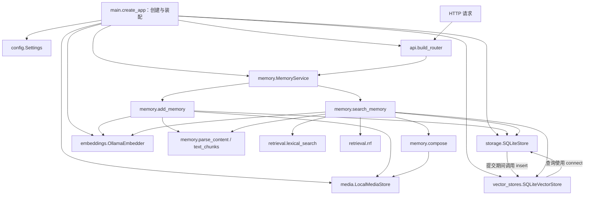

`storage` 与 `vector_stores` 的相互使用是当前共享 SQLite 的具体实现：`commit_add()` 调用传入对象的 `insert(conn, ...)`，`search()` 使用 `store.connect()`。这不是所有未来数据库都必须维持的依赖形式；换成外部向量库时需要重新设计提交协调。

### 文件地图

```text
src/memory_app/
  main.py                   应用工厂、对象装配、异常响应
  config.py                 运行配置
  api/
    schemas.py              外部数据结构与标识校验
    routes.py               路由、鉴权与业务入口连接
  memory/
    service.py              Add/Search 门面、耗时日志
    add.py                  写入流程
    search.py               查询流程
    models.py               Unit、Candidate 内部类型
    errors.py               内部异常分类
    parser.py               有序内容解析
    units.py                400 字符文本分块
    evidence.py              原始证据还原与响应预算
  storage/sqlite.py         原始记忆、请求记录、事务
  media/
    validation.py           图片 Data URI、格式、大小校验
    local.py                图片文件与 URI 恢复
  embeddings/
    base.py                 Embedder 协议
    ollama.py               本机 HTTP 调用与向量校验
  vector_stores/sqlite.py   向量写入及线性相似度查询
  retrieval/
    lexical.py              中文字符/双字词与英文词 BM25
    fusion.py               RRF 排序
scripts/                    外部 smoke、故事演示、小评测
tests/                      接口行为、边界与故障检查
```

各包的 `__init__.py` 用于包组织，没有隐藏的业务流程。`src/memory_demo.egg-info`、`__pycache__`、`.conda` 是安装或运行产物，不属于业务模块。

### 为什么这样分

#### 1. 把“选择工具”和“使用工具”分开

你可以这样理解目前的主链路：外界通过 HTTP 调用 `api`；API 将请求交给 `MemoryService`；这个服务再调用 `add_memory()` 或 `search_memory()`；两个流程函数使用存储、媒体、向量生成和检索能力，完成工作并返回数据。

`main.py` 的任务是启动时把这些对象创建好并连接起来。它读取 `config.py` 中的配置，选择使用 SQLite、磁盘图片存储和 Ollama，然后把这些对象交给 MemoryService。它不负责每个请求具体先执行哪一步。

三个角色分别是：

- **main 选择并装配工具**：例如创建 `OllamaEmbedder`，知道我们当前用的是 Ollama。
- **Add/Search 安排工作步骤**：例如“先生成查询向量，再找相似记忆”，使用 `embedder.embed(...)`，不用自己创建 Ollama 客户端。
- **具体模块执行工作**：例如 `OllamaEmbedder.embed()` 知道怎样发 HTTP 请求给 Ollama，以及怎样检查返回的向量。

除了 `memory/`，数据库相关代码在 `storage/sqlite.py` 与 `vector_stores/sqlite.py`：前者主要保存原始记忆和请求记录，后者负责向量。SQLite 是数据库；SQL 是这些文件里使用的查询语言，我们没有另建一个名为 `sql` 的模块。

#### 2. “对象通过参数传入”是什么意思

下面是 main 中装配代码的简化写法；省略了具体配置参数：

```python
store = SQLiteStore(...)           # 创建原始记忆存储对象
media = LocalMediaStore(...)       # 创建图片存储对象
embedder = OllamaEmbedder(...)     # 创建向量生成对象
vectors = SQLiteVectorStore(store)

service = MemoryService(store, media, embedder, vectors)
```

这里传入的是已经创建好的 Python 对象。MemoryService 保留它们，收到请求时继续传给流程函数。实际代码使用 `self.dependencies` 保存四个对象：

```python
self.dependencies = (store, media, embedder, vectors)
result = add_memory(payload, *self.dependencies)
```

`*self.dependencies` 把元组里的四个对象展开为四个参数，等价于：

```python
result = add_memory(payload, store, media, embedder, vectors)
```

这样，Add/Search 拿到对象就能调用它的方法。比如调用 `embedder.embed(chunks)`，不必在流程函数内部固定写 `OllamaEmbedder(...)`。这种由外部创建对象、再交给使用者的方式通常叫“依赖注入”；在这里就是传参数，并不需要额外框架。

所以，将来换 embedding 时，我们可以提供另一个拥有相同方法的对象，再调整 main 和配置。HTTP 路由仍然调用 `service.add()`、`service.search()`。模型前缀、向量维度和已有索引也需要相应处理，不能只更换类名就认为迁移完成。

#### 3. “流程接收普通字典”是什么意思

外部发来的是 JSON。API 先用 Pydantic 请求模型检查字段，再通过 `body.model_dump(mode="json")` 转成 Python 字典，交给业务层。流程里就可以这样取值：

```python
user_id = payload["user_id"]
messages = payload["messages"]
```

因此，Add/Search 无需直接操作 FastAPI 的 HTTP Request 对象。以后 HTTP 字段格式变化，可以优先在 API 层完成校验与转换，让业务层继续收到约定好的数据。直接从脚本调用流程函数时，脚本也要提供符合约定的字典；它不会自动经过 HTTP 层的全部校验。

#### 4. “按方法约定协作”和 Protocol 是什么

流程对对象的要求是具体的。例如，向量生成对象应当提供 `embed(texts, query=False)` 方法，返回一组向量，并有 `version` 属性说明向量版本。当前 Ollama 实现和测试用的模型替身都按这个约定工作。

`embeddings/base.py` 用 Python 的 `Protocol` 把这个要求写了出来：

```python
class Embedder(Protocol):
    version: str

    def embed(self, texts: list[str], *, query: bool = False) -> list[list[float]]: ...
```

它表达的是：“任何对象，只要具有这里约定的属性与方法，就可以符合 Embedder 接口。”它不负责实际计算，也不会自动保证某个对象返回正确向量；实际执行与校验在 `OllamaEmbedder` 中。

其他存储、媒体对象也有这样的调用要求，比如 `store.list_units(user_id)`、`media.put(key, raw)`，但当前没有为它们逐个编写 Protocol 声明，主要靠具体实现和测试保证配合正确。业务参数也尚未全面使用 Protocol 类型标注，所以目前的协议声明主要帮助阅读与后续类型检查。

“没有统一继承大基类”表示我们没有要求所有工具都继承同一个 `BaseTool`；“没有插件注册框架”表示它们没有经过自动发现、注册和加载，而是在 main 中直接创建并传入。当前只有少量实现，这样组织足够清楚。

#### 5. 设计计划和已写代码需要区分

完整架构计划列出了未来可能需要的目录和接口，但 V0 只写了当前用得上的部分。例如 `vision/`、`llms/`、Pi 适配器尚未创建，存储与媒体的正式协议文件也尚未补齐。

阅读本章的文件地图，可以知道现在已经有什么；阅读完整架构计划，可以知道后面准备加什么。后续增加真实的新实现时，再完善对应接口和装配方式。

源码入口：[create_app](D:/Dev/Windows/Python/26-10-Memory/src/memory_app/main.py:14)、[MemoryService](D:/Dev/Windows/Python/26-10-Memory/src/memory_app/memory/service.py:10)、[Unit 与 Candidate](D:/Dev/Windows/Python/26-10-Memory/src/memory_app/memory/models.py:5)。

### 自检

你能否说明：为什么不用让 `main.py` 执行每次 Search？为什么 `embeddings` 和 `vector_stores` 分开？为什么目录里还没有 `vision` 和 `llms`？

下一章：[启动装配与 HTTP 接口](#note-12)。

---

<a id="note-12"></a>

## 12. V0 源码导读：启动装配与 HTTP 接口

> 日期：2026-10-02 · V0 实际实现  
> [返回阅读导航](#note-10)

### 应用怎样启动

启动命令中的 `memory_app.main:create_app` 指向 Python 包里的函数，`--factory` 表示 Uvicorn 应调用它来创建应用。`create_app()` 返回一个 FastAPI 对象，而不是立刻执行 Add/Search。

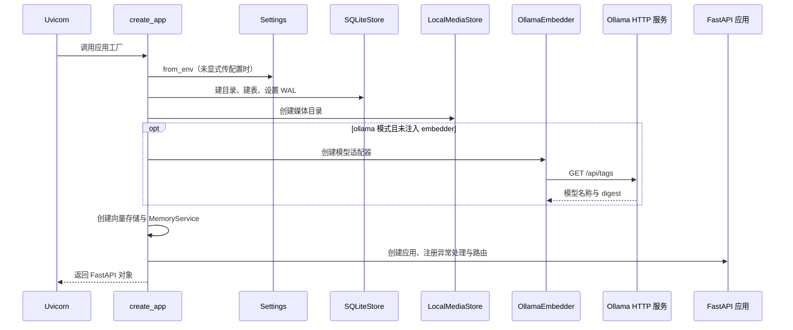

配置或模型初始化失败会阻止应用工厂成功返回。这发生在开始接收请求之前，所以不能把启动错误理解为某次 HTTP 请求返回了 503。

源码：[应用工厂](D:/Dev/Windows/Python/26-10-Memory/src/memory_app/main.py:14)、[模型初始化](D:/Dev/Windows/Python/26-10-Memory/src/memory_app/embeddings/ollama.py:7)。

### 配置表

| 环境变量 | 默认值 | 使用位置 |
| --- | --- | --- |
| `MEMORY_DATA_DIR` | `data` | 数据库与媒体根目录，相对当前工作目录 |
| `MEMORY_EMBEDDINGS` | `ollama` | `ollama` 或 `none`，控制是否创建模型 |
| `OLLAMA_BASE_URL` | `http://localhost:11434` | Ollama HTTP 地址 |
| `OLLAMA_EMBED_MODEL` | `nomic-embed-text:latest` | 需要已存在的完整模型标签 |
| `MEMORY_API_KEY` | 空字符串 | 是否开启 Add/Search 鉴权 |

`Settings` 是冻结的 dataclass，用于保存配置。`.env.example` 只是说明，程序不会自动读取 `.env`。默认从环境变量取值，测试也可以显式传入 `Settings(data_dir=tmp_path, ...)`。使用 `.conda/python.exe` 并不自动激活 shell 的所有环境变量。

源码：[Settings](D:/Dev/Windows/Python/26-10-Memory/src/memory_app/config.py:7)。

### 一次请求如何越过 API 边界

`build_router(service, api_key, mode)` 在函数内部定义路由。内部函数通过 Python 闭包保留传入的 service，因此收到请求时使用启动期间创建的同一个业务服务对象。

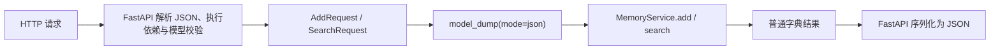

这张图强调请求对象转换的位置，不规定 FastAPI 内部鉴权与所有字段校验的精确先后顺序。

业务流程使用字典，未导入 FastAPI；这样演示、评测脚本也可以直接调用业务函数。不过直接调用者需遵守数据约定，不能假定自动获得 Pydantic 的全部校验。

源码：[build_router](D:/Dev/Windows/Python/26-10-Memory/src/memory_app/api/routes.py:6)、[请求模型](D:/Dev/Windows/Python/26-10-Memory/src/memory_app/api/schemas.py:41)。

### 三个接口

| 接口 | 输入 | 输出 |
| --- | --- | --- |
| `GET /health` | 无 | status、version、embeddings 模式 |
| `POST /add` | request_id、user_id、session_id、非空 messages | success=true 与原样三个 ID |
| `POST /search` | query、user_id、top_k，可选 options | 排序后的 data 数组 |

消息角色支持 `user` 和 `assistant`，时间戳是可选严格整数。Content 是非空字符串或非空的有序 text/image_url 数组。`top_k` 是 0–100 的严格整数，布尔值不作为整数接受。这是当前实现的范围。

Identifier 校验拒绝只有空白的标识，但不去掉有效标识首尾空格。因此 `alice` 与 ` alice ` 是两个不同范围；服务原样回传 ID。空白内容在 `parse_content()` 进一步拒绝。

Health 不需鉴权，也不实时检查 Ollama 或数据库写入。它能返回 200 不等于每条能力都已通过探测。`/docs`、`/openapi.json` 是 FastAPI 提供的说明入口，目前未额外保护。

### 鉴权和错误分类

设置 API Key 后，支持 `X-Api-Key`、`Authorization: Bearer ...` 或 `Authorization: Token ...`。识别到后一种头时会覆盖前一种值，比较使用 `secrets.compare_digest()`。当前 V0 依靠调用方正确提供 user_id，并没有把 API Key 映射成独立用户身份。

| 类型 | HTTP 状态 | 情况 |
| --- | --- | --- |
| 鉴权失败 | 401 | 提供的 Key 不匹配 |
| Conflict | 409 | 同用户、同 request_id，内容不同 |
| 模型校验 / InvalidContent | 422 | 字段错误、空白内容或非法图片 |
| ModelUnavailable | 503 | 请求阶段模型不可用 |
| StorageUnavailable | 503 | 数据库或文件访问失败 |

验证错误响应仅保留 loc/type/msg，不回显整段输入 Base64。未知的程序错误没有被统一吞掉，仍可能是 500；明确的 503 分类不是保证所有错误都可自动恢复。

### 自检

为什么 `--factory` 必须与工厂函数配套？`model_dump()` 发生在哪里？为什么重启后才会重新读取环境配置？

下一章：[Add 写入调用链](#note-13)。

---

<a id="note-13"></a>

## 13. V0 源码导读：Add 写入调用链

> 日期：2026-10-02 · V0 实际实现  
> [返回阅读导航](#note-10)

### 主函数的输入与输出

`add_memory(payload, store, media, embedder, vectors)` 接收已在 HTTP 层校验并转换的字典，以及四个启动时装配的能力对象。输出只是成功标识与三个原样 ID，记忆本身保存在存储里。

源码：[add_memory](D:/Dev/Windows/Python/26-10-Memory/src/memory_app/memory/add.py:12)、[MemoryService.add](D:/Dev/Windows/Python/26-10-Memory/src/memory_app/memory/service.py:14)。

### 函数调用与分支图

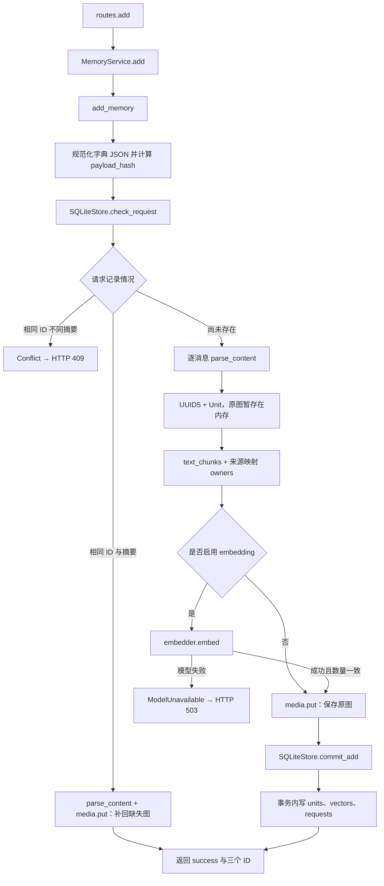

### 逐步解释

1. 将传入字典按键排序并用固定 JSON 分隔符序列化，计算 SHA-256。这里的摘要是 API 标准化后的数据摘要，不是原始 HTTP 字节的哈希。例如 JSON 键的顺序变化不会制造不同请求。
2. 以 `(user_id, request_id)` 查幂等记录。相同内容直接复用成功状态并补回缺失原图；不同内容抛出冲突。不同用户可以使用相同 request_id。
3. 遍历消息并解析有序图文。所有消息先验证，统计整次 Add 的图片大小；没有因第一条消息合法就提前提交第一条。
4. 每条消息按 `[user_id, request_id, 消息序号]` 生成 UUID5，创建一个 Unit。相同来源生成相同 ID，同消息内容在不同 request_id 下可以成为不同单元。
5. 文本每 400 字符分块，保存 `owners=(unit_id, chunk_order)`。模型输出向量后，用这个列表把各块重新关联到原始单元。
6. 模型计算完成后保存图片，再提交数据库。模型 HTTP 请求不占用 SQLite 写事务。
7. 事务提交成功后返回响应。离线模式没有向量，但已存文本能立即用于词法检索；纯图片单元能按相同图片哈希检索。

### 写入时序图

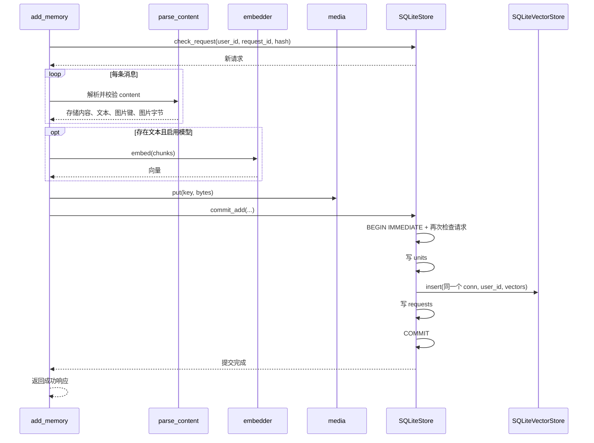

### 为什么事务里还要检查一次

请求 A、B 可能同时在第一次检查时看到“未存在”，各自开始模型计算。`BEGIN IMMEDIATE` 让写入事务有明确的并发边界；后来进入的请求会再次检查，发现同摘要就不重复写，不同摘要就冲突。数据库主键进一步约束重复记录。

这保证最终记录不重复，但不会阻止并发重复请求各自消耗一次 embedding 计算。当前没有“处理中”状态或单请求锁队列。

源码：[事务提交](D:/Dev/Windows/Python/26-10-Memory/src/memory_app/storage/sqlite.py:54)。

### 失败时的边界

模型失败不会提交新单元。数据库写入途中失败，units、vectors、requests 一起回滚。原图已保存而数据库失败时，文件可能留下未引用副本；文件系统不属于 SQLite 事务，当前没有垃圾回收。

重复 Add 的图片恢复只补缺失文件。`media.put()` 遇到已存在路径会直接返回，因此没有校验已存在但损坏的文件内容，也不会靠重试重建旧模型版本的向量。

### 跟着一个例子读

上传“3号机床出现红色告警灯”及一张照片时，Unit 的 content 保留两块及顺序，text 只包含那句文字，media_keys 指向原图。embedding 来自文字，向量记录指向 Unit ID。Add 本身没有识别图片里的灯；调用方已经给出了这段说明。

### 自检

为什么把模型计算放在数据库事务外？为什么重复请求还可能调用 `media.put()`？为什么一个消息单元可以对应多个向量记录？

下一章：[Search 查询调用链](#note-14)。

---

<a id="note-14"></a>

## 14. V0 源码导读：Search 查询调用链

> 日期：2026-10-02 · V0 实际实现  
> [返回阅读导航](#note-10)

### 查询的目标

`search_memory()` 返回最多 top_k 条同一用户的原始证据。模型只负责把查询转成向量，没有回答问题的 LLM 调用。

源码：[search_memory](D:/Dev/Windows/Python/26-10-Memory/src/memory_app/memory/search.py:13)、[MemoryService.search](D:/Dev/Windows/Python/26-10-Memory/src/memory_app/memory/service.py:25)。

### 函数调用图

从上到下是当前执行顺序：先词法，再可选图片哈希，再可选向量，最后融合。这些通道当前没有并行调度。

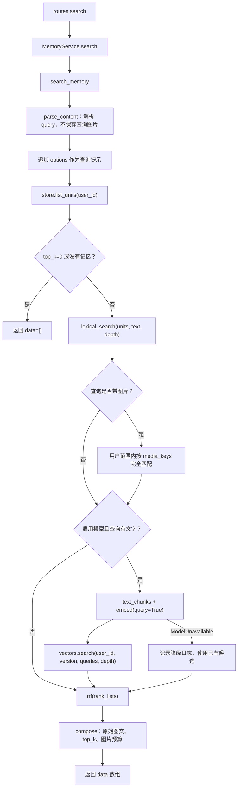

### 查询处理

解析 query 时产生文本与图片键，图片字节只用于校验和算哈希，不会保存为新的记忆。顶层 options 拼接到文本中参与召回，但不会生成答案或成为事实记录。

先按 user_id 加载 Unit 列表。session_id 不限制检索，因此同一用户能跨会话找回记忆。向量通道也在 SQL 中限定 user_id 和模型版本，图片哈希路径同样包含用户范围。

查询的候选深度是 `max(top_k * 3, 30)`，是每路最多召回多少条，不是最终返回条数。`top_k=100` 时每路深度为 300，融合后再由 compose 挑选最多 100 条。

### 三路各返回什么

| 通道 | 条件与输入 | 候选来源 |
| --- | --- | --- |
| BM25 | 用户 Unit 中的 text、查询文字 | 词法分数大于零的消息 |
| 图片哈希 | query 含图片 | 包含完全相同图片字节的消息 |
| 文本向量 | 有 embedder 且有查询文字 | 当前模型版本的用户向量记录 |

候选都是 `Candidate(id, score)`。图片哈希候选分数设为 1，但 RRF 只读取排名，并不会因此自动获得最高权重。当前哈希候选顺序来自按 Unit ID 排序的列表。

纯图片 query 没有附带文本或 options 时，不会做文本 embedding；它只可能靠相同图片哈希命中。视觉相似但字节不同的图片不能靠这条通道识别。

### 结果如何还原

compose 根据候选 ID 在已经加载的 Unit 中找到原始内容，检查原图大小，按顺序恢复图片 Data URI。超过剩余图片预算时跳过整个单元并继续后面的候选，不截去单元里的某一张图。因此实际返回条数可能少于 top_k。

每条结果包含 id、content、score、created_at。score 是融合分数，不是回答可信概率。created_at 是持久化时的时间；原消息 timestamp 与 role 存在 Unit 中，但当前响应没有单独返回，也没有据此做时间排序。

源码：[compose](D:/Dev/Windows/Python/26-10-Memory/src/memory_app/memory/evidence.py:4)。

### 故障与无证据的区别

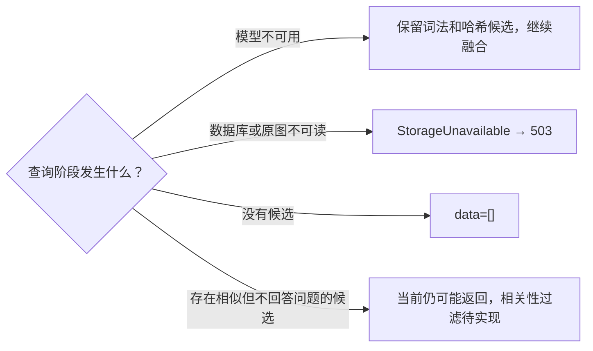

向量计算错误的 try 区域也包含向量搜索，但只捕获 ModelUnavailable；数据库错误不会被误当成模型降级。原图缺失时不会悄悄返回文字片段，整个请求明确报告存储不可用。

当前没有可靠的“这个问题没有答案证据”判断。相关内容靠前只能说明检索相似，不能说明用户的护照号等事实存在。

### 自检

为什么每一路都要保留用户范围？depth 和 top_k 有什么区别？为什么 Search 模型故障可以降级，而原始证据损坏要报错？

下一章：[数据存储与图文还原](#note-15)。

---

<a id="note-15"></a>

## 15. V0 源码导读：数据存储与图文还原

> 日期：2026-10-02 · V0 实际实现  
> [返回阅读导航](#note-10)

### 内部对象和数据库表的区别

Python 中使用 `Unit` 表示一条消息来源的记忆，使用 `Candidate` 表示检索命中的 ID 与分数。Unit 是 dataclass，在写库时经 `asdict()` 变成字典，再序列化为 JSON。数据库没有给 Unit 每个字段单独建列。

| Unit 字段 | 用途 |
| --- | --- |
| id | 稳定来源 ID，连接检索块与原消息 |
| user_id、session_id | 用户隔离与来源会话 |
| role、timestamp | 原消息角色与可选 Unix 毫秒时间 |
| content | 原文，或保持顺序的文本块与内部图片引用 |
| text | 拼接出的文本检索内容，不含图片像素含义 |
| created_at | 本次写入生成的 UTC ISO 时间 |
| media_keys | 图片文件键列表，用于匹配与响应预算 |

源码：[Unit](D:/Dev/Windows/Python/26-10-Memory/src/memory_app/memory/models.py:5)、[parse_content](D:/Dev/Windows/Python/26-10-Memory/src/memory_app/memory/parser.py:5)。

### 表结构与关系

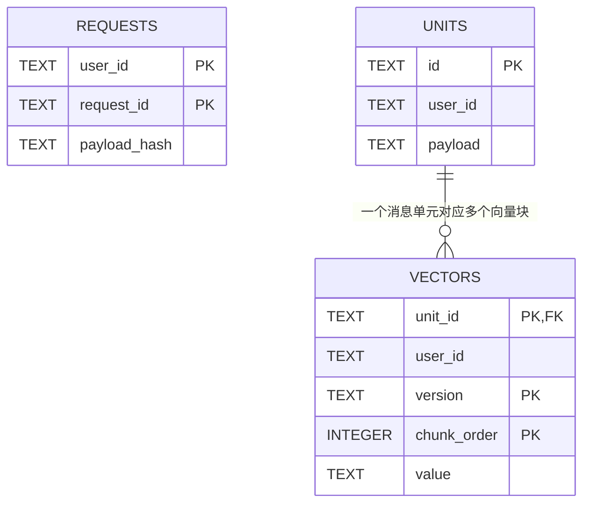

requests 的复合主键是 `(user_id, request_id)`；vectors 的复合主键是 `(unit_id, version, chunk_order)`，unit_id 外键连接 units.id。requests 和 units 没有显式数据库外键，来源关系通过稳定 ID 的生成规则与同一事务维持。

requests 只记录已成功提交的摘要，没有 pending/failed 状态。Unit 的 JSON 中也没有独立 request_id 字段。设计计划中的 RawMessage、ContentPart、DerivedArtifact、MemoryState 尚未分别建表；当前以 Unit JSON 保留消息字段，并通过 vectors 保存一种派生索引。

同一 SQLite 文件中同时存事实和索引，职责仍分开：SQLiteStore 管理请求与 Unit，SQLiteVectorStore 管理向量写入与查询。

源码：[建表](D:/Dev/Windows/Python/26-10-Memory/src/memory_app/storage/sqlite.py:11)、[向量写入](D:/Dev/Windows/Python/26-10-Memory/src/memory_app/vector_stores/sqlite.py:9)。

### 事务边界

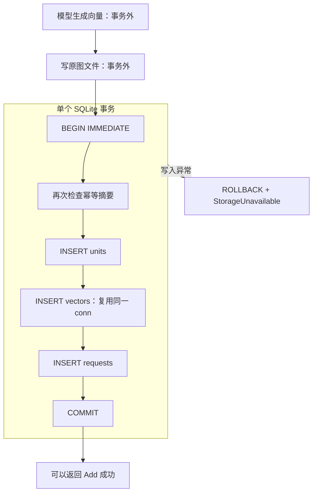

图中的正常写入路径假设事务内复查仍是新请求；若另一请求已先提交，则复用或冲突分支提前结束。`with conn` 负责事务提交或回滚，`connect()` 的 finally 负责关闭连接。每次使用创建独立连接，没有全局共享一个 SQLite connection。

WAL 有助于读写并发，`BEGIN IMMEDIATE` 在写入流程明确申请写事务；仍然是 SQLite 单写者，无法据此推定已经能承受比赛 Full 的规模。连接等待上限设置为 30 秒。

源码：[connect](D:/Dev/Windows/Python/26-10-Memory/src/memory_app/storage/sqlite.py:31)、[commit_add](D:/Dev/Windows/Python/26-10-Memory/src/memory_app/storage/sqlite.py:54)。

### 图片如何从 HTTP 走到磁盘

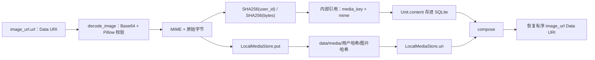

图片 Data URI 不作为整段 Base64 保存在数据库。内部图片块形如：

```json
{"type":"image_url","media_key":"用户哈希/图片哈希","mime":"image/png"}
```

返回时会还原为外部格式，文本和图片的顺序保持。解码后的原始图片字节未重编码，Base64 文本的换行等书写形式可能规范化；因此保证的是原图字节与内容顺序，不是输入 URI 字符串所有表现形式都逐字符不变。

验证接受 PNG/JPEG/WebP，单图最多 10 MiB，核对声明 MIME 与真实文件格式，调用 Pillow.verify 并处理解压炸弹警告。实际图片没有经过 OCR 或视觉模型。

源码：[decode_image](D:/Dev/Windows/Python/26-10-Memory/src/memory_app/media/validation.py:14)、[媒体对象](D:/Dev/Windows/Python/26-10-Memory/src/memory_app/media/local.py:8)。

### 原子文件保存与幂等

同一用户的相同字节使用同一个文件路径。`put()` 在目标目录创建临时文件，写入后 flush/fsync，再 `os.replace()` 到最终路径。finally 清理残留临时文件。

这是单个文件的原子替换，不是媒体与数据库联合事务。同一用户跨多条消息可以共享原图，返回预算仍按实际返回的图片出现次数累计；不同用户有独立路径。

若文件已存在，put 直接返回。缺失文件可以通过原 Add 请求重放补回，但已存在的损坏文件尚未校验。缺图被 Search 访问时会变为明确 503，不会输出半份内容。

### 当前存储限制

数据库没有迁移版本、用户删除和 TTL；未引用图片缺少垃圾回收。原文可支撑未来重建派生索引，但 request_id 未独立保存在 Unit JSON 等细节，需要在新增治理功能时评估迁移。读取 units 当前按 ID 排序，未按消息时间或来源序号排序；图文块顺序保留不等于已经实现会话顺序恢复。

### 自检

为什么一个 SQLite 文件仍可以有两个职责不同的对象？哪些操作会随回滚撤销？为什么图片恢复时不需要重新算 embedding？

下一章：[Embedding 与检索算法](#note-16)。

---

<a id="note-16"></a>

## 16. V0 源码导读：Embedding 与检索算法

> 日期：2026-10-02 · V0 实际实现  
> [返回阅读导航](#note-10)

### 一条文本怎样变成检索候选

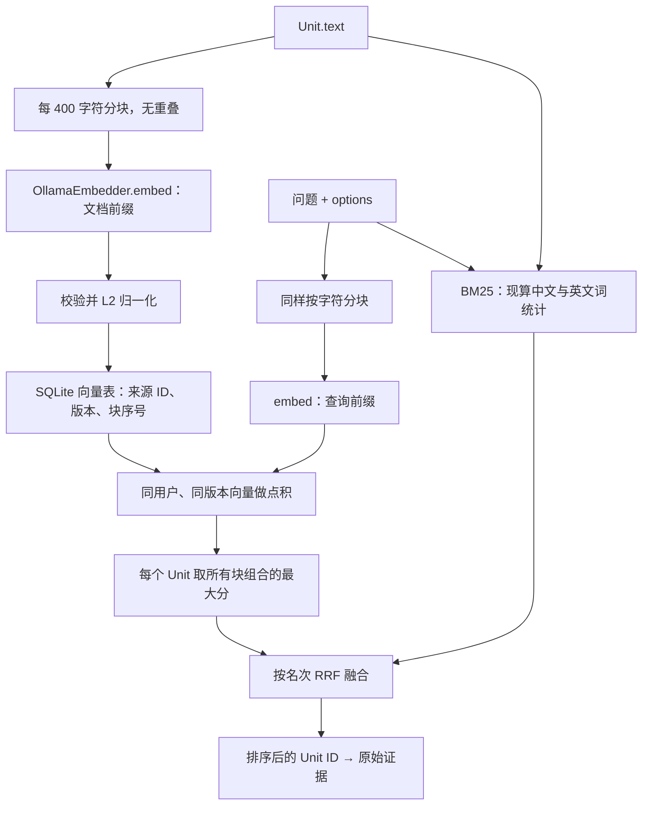

### 分块的职责

`text_chunks()` 只是按 Python 字符长度每 400 切一块，没有句子识别、tokenizer、重叠或摘要。400 字符与 400 模型 token 不同，当前不能保证任意内容都一定落在模型上下文上限内。

分块用于向量生成，BM25 仍使用整个 Unit.text；Search 返回完整 Unit.content。长消息末尾也会得到向量，不会只索引前 400 字符。

源码：[text_chunks](D:/Dev/Windows/Python/26-10-Memory/src/memory_app/memory/units.py:1)。

### Ollama 适配器

初始化查询 `/api/tags`，确认完整标签存在并读取模型 digest。向量版本由模型标签、digest、前缀策略版本、分块版本组成，确保查询只使用对应版本的记录。

`embed(texts, query=False)` 每批最多 16 条文本，调用 `/api/embed`：文档加 `search_document: `，查询加 `search_query: `，显式 `truncate=False`，单次 HTTP 超时 120 秒。`trust_env=False` 避免本地请求使用 shell 代理配置。

校验检查输出数量、非空、真正的数值类型、有限数值、非零向量和同次调用维度一致，再做 L2 归一化。HTTP 或格式错误统一转换为 ModelUnavailable。

源码：[初始化](D:/Dev/Windows/Python/26-10-Memory/src/memory_app/embeddings/ollama.py:7)、[embed](D:/Dev/Windows/Python/26-10-Memory/src/memory_app/embeddings/ollama.py:19)。

当前版本的 digest 在初始化时读取，没有在每次请求前检查标签是否在服务运行期间被重新指向另一模型。切换模型时应重启并重建相应索引；自动重建工具尚未实现。默认前缀是为当前 nomic 配置编写的，替换其他模型需重新确认其要求。

### 向量存储与相似度

SQLiteVectorStore 从表里取出同用户、同版本的全部向量，JSON 解码后逐条计算点积。对于归一化向量，点积就是余弦相似度。

一条消息有多个文本块时，取该消息任意文档块与任意查询块组合的最大分。最终按分数降序，分数相同时按 Unit ID 排序。维度不同的记录当前会跳过，没有重建或告警修复流程。

这是线性扫描，没有 ANN 索引。当前向量通道没有最小相关性阈值，负分候选也可能进入排名；它会找“相对最像”的内容，不能证明证据充分。

源码：[向量 search](D:/Dev/Windows/Python/26-10-Memory/src/memory_app/vector_stores/sqlite.py:15)。

### BM25 词法通道

英文与数字用小写 `[a-z0-9_]+` 提取；中文连续片段同时产生单字和相邻双字词。它没有使用完整中文分词器。例如“红色告警灯”产生单字及“红色、色告、告警、警灯”等相邻组合。

每次 Search 对该用户全部 Unit.text 重算词频、文档频率与平均长度，再以 BM25 形式计算得分，参数为 k1=1.2、b=0.75。查询词先转为集合；分数为零的文档不进入候选。

这条通道并没有提前建立 SQLite FTS 表。目录称为检索能力，实际实现是 Python 中现算 BM25。单字匹配可提高召回，也会让“我”“的”“号”等共同字造成噪声；目前没有停用词处理。

源码：[tokens](D:/Dev/Windows/Python/26-10-Memory/src/memory_app/retrieval/lexical.py:7)、[lexical_search](D:/Dev/Windows/Python/26-10-Memory/src/memory_app/retrieval/lexical.py:15)。

### RRF：统一排序尺度

每条候选在每路的排名 rank 从 1 开始，融合分数是所有命中通道的 `1 / (60 + rank)` 之和。k=60 是当前默认值，不是比赛规定。

同一路重复 ID 只加一次分，不同路相同 ID 累加。RRF 使用 ID 与排名，不比较 BM25 分数与余弦值；融合后按得分降序、ID 稳定处理并列。

| 候选 | BM25 排名 | 向量排名 | RRF 分数（近似） |
| --- | ---: | ---: | ---: |
| A | 1 | 3 | 0.03227 |
| B | 4 | 1 | 0.03202 |
| C | 2 | 未命中 | 0.01613 |

单路输入也会经过当前 rrf 函数，只是保持那一路排名并将分数变成倒数排名值。RRF 不能找回各路都没有召回的无描述图片。

源码：[rrf](D:/Dev/Windows/Python/26-10-Memory/src/memory_app/retrieval/fusion.py:4)。

### pass、Protocol 与可替换点

`Embedder(Protocol)` 描述 version 属性与 embed 方法约定。OllamaEmbedder 不必显式继承它，只要结构符合即可；当前流程参数没有全面标注 Protocol，主要靠方法调用与测试验证。

协议方法里的 `...` 是声明占位；真正生成向量的是适配器。`errors.py` 类体中的 `pass` 表示继承父类行为无需添加实现，不是留空的检索算法。

源码：[Embedder 协议](D:/Dev/Windows/Python/26-10-Memory/src/memory_app/embeddings/base.py:4)、[异常类型](D:/Dev/Windows/Python/26-10-Memory/src/memory_app/memory/errors.py:1)。

### 自检

为什么向量版本不能只写 `latest`？为什么先保留单路效果，再看融合效果？为什么余弦排名最高仍可能没有答案证据？

下一章：[测试运行与扩展指南](#note-17)。

---

<a id="note-17"></a>

## 17. V0 源码导读：测试运行与扩展指南

> 日期：2026-10-02 · V0 实际实现  
> [返回阅读导航](#note-10)

### 三种验证各自证明什么

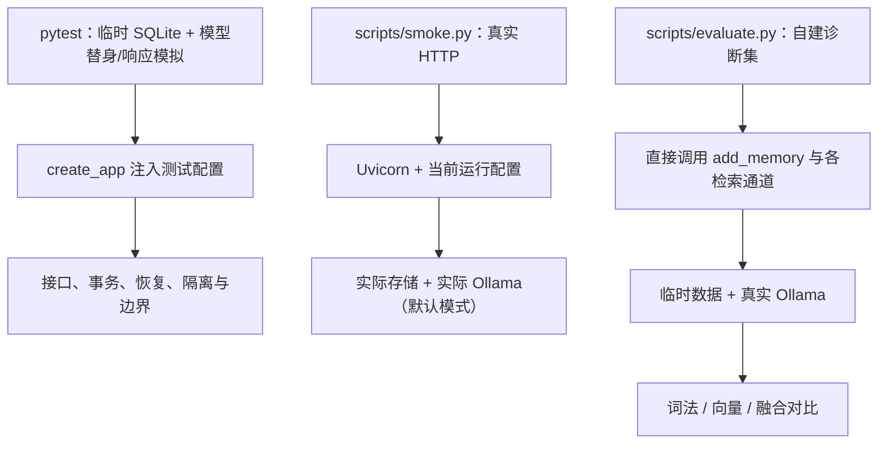

单元与行为检查提供确定性故障场景；HTTP smoke 验证服务真正可调用；小评测比较真实检索效果。三者互补。evaluate 绕过 HTTP，不验证鉴权、API 模型转换或真实整条 Search 输出预算，也不会自动因为一个检索指标差就退出失败。

### 当前检查覆盖

当日修复后运行结果为 29 项通过。其中参数化输入会分别计数，所以测试函数数量和用例数量不同。

| 文件 | 重点 |
| --- | --- |
| [test_memory.py](D:/Dev/Windows/Python/26-10-Memory/tests/test_memory.py:34) | 重启、幂等、隔离、top_k、图文原样恢复、鉴权、并发重试、向量故障降级 |
| [test_resilience.py](D:/Dev/Windows/Python/26-10-Memory/tests/test_resilience.py:34) | 空白标识、三种图片、批量校验、事务回滚、丢图恢复、并发冲突、非法向量、长消息与版本隔离 |

测试使用 `tmp_path` 保存独立数据；故障注入用 monkeypatch 暂时替换对象方法。原图丢失检查只移除临时夹里的测试图，再重放 Add 验证恢复。测试没有删除实际 Demo 数据。

故障测试先获得预期失败，再修复并回归。初次新增 15 项中 7 项失败，涉及空白标识、数据库错误、丢图、模型列表格式、布尔向量；详细证据见[测试修复记录](#note-09)。

### 实际运行

在项目根目录执行，已有 `.conda` 时无需重新创建：

```powershell
# 启动默认 Ollama 模式的服务
.\.conda\python.exe -m uvicorn memory_app.main:create_app --factory --host 127.0.0.1 --port 8000
```

另一个终端执行：

```powershell
# 确定性检查，不要求本地模型真的运行
.\.conda\python.exe -m pytest -q
# 真实 HTTP smoke，需要服务启动
.\.conda\python.exe scripts\smoke.py
# 三条文本故事与三个查询
.\.conda\python.exe -X utf8 scripts\demo.py
# 真实 Ollama 检索诊断，不要求 HTTP 服务启动
.\.conda\python.exe -X utf8 scripts\evaluate.py
```

smoke 用随机 user_id，留下少量图片与文本。demo 用固定 `demo-local`，相同写入可重试；如果修改了脚本里的故事却沿用同 request_id，会出现合理的 409。evaluate 使用临时目录，结束后清理数据，且它固定创建 OllamaEmbedder，不会因 `MEMORY_EMBEDDINGS=none` 自动变为离线评测。

服务未启用自动 reload；改源码后需要重启才能加载。查看 <http://127.0.0.1:8000/docs> 可以交互调用。完整安装说明与已验证依赖版本见[项目 README](../README.md)。

源码：[smoke](D:/Dev/Windows/Python/26-10-Memory/scripts/smoke.py:12)、[demo](D:/Dev/Windows/Python/26-10-Memory/scripts/demo.py:7)、[evaluate](D:/Dev/Windows/Python/26-10-Memory/scripts/evaluate.py:18)。

### 小评测结果怎么解读

当日自建集有 6 条文本和 1 张无说明图片，8 个有证据查询。包括多证据问题与 1 道视觉问题。另有护照号无证据探测，不计入以下指标。

| 通道 | Hit@1 | 平均 Recall@3 |
| --- | ---: | ---: |
| BM25 | 75.0% | 87.5% |
| nomic | 75.0% | 83.3% |
| RRF | 87.5% | 87.5% |

融合在 7 道文本题首条都命中，但图片题全部失败。护照号问题产生了无关候选。这个小集合用来展示失败原因与两路互补，不能推定比赛分数或普遍优于单路，也没有评价最终答案。

### 扩展时主要改哪里

| 目标 | 修改位置 | 验证重点 |
| --- | --- | --- |
| 更换文本模型 | `embeddings`、config、main | 前缀/维度/版本、重建旧索引、中文效果 |
| 增加图片描述/OCR | 新增 `vision`，必要时 `llms`；Add 派生步骤 | 原图不被替代，无描述图片问题改善 |
| 图像语义召回 | 图像 embedding、向量记录类型、Search 通道 | 文本与图像表征兼容、用户隔离、融合 |
| 更换向量数据库 | `vector_stores` 与提交协调、装配 | 外部数据库无法共享当前 SQLite 事务 |
| 加相关性过滤或重排 | `retrieval` 与 Search 排序阶段 | 有证据召回与无证据误召的取舍 |
| 按用户删除与 TTL | storage、vector_stores、media | 原始数据与派生副本一起治理、共享图片引用 |
| 接入 Pi | 新增 integrations，调用 MemoryService | 复用核心流程，证据回到 Agent 上下文 |

协议的完善也应跟随真实替换。当前新模型可以注入 create_app；但直接替换存储并不只需要“换一个名字”，它还要满足幂等、事务、来源读取与错误分类等语义。

### 尚未实现与已知限制

没有视觉像素理解、自动 caption/OCR、时间意图排序、冲突事实治理、reranker、图谱、LLM 答案生成或 Pi。没有索引自动重建、媒体损坏校验、孤立文件清理、TTL、删除、迁移、Docker 和公网部署。

检索是单用户线性扫描，BM25 每次重算。整体 HTTP body 限额与限流尚未实现，图片解码限制不等于接收超大 HTTP 输入前就拦截。所有这些能力需要独立实现与验证，当前文档中的调用图没有把它们画成已存在模块。

### 学习练习

先运行 demo，再在源码里定位一次 Add 与 Search 经过的函数；然后阅读故障测试，解释“失败后为什么没有半条记忆”。想修改算法时，先用 evaluate 保留单路与融合的结果，再比较同一批问题。

返回：[阅读导航](#note-10)。
