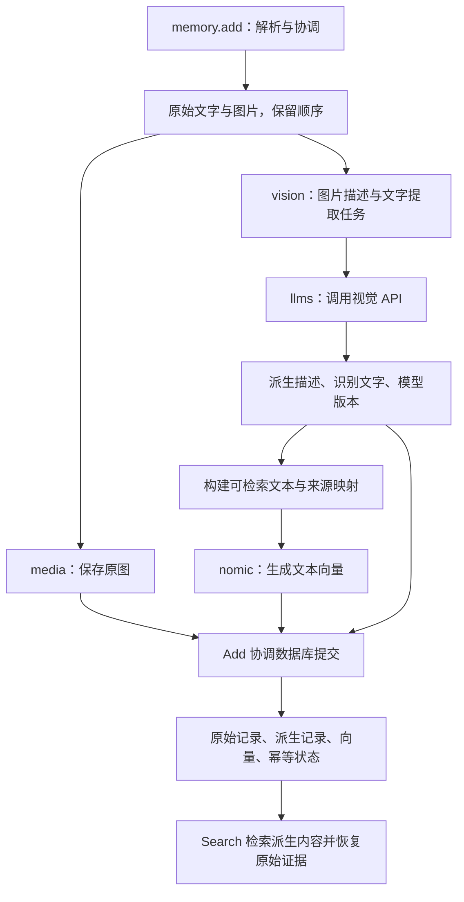

# 1004 未来 TODO：图片理解与多模态记忆

> 日期：2026-10-04  
> 状态：后续学习与实施计划，尚未接入视觉模型或 OCR。  
> 目标：沿用 V0 的功能模块结构，让没有附带说明的图片也能被文字问题检索，并返回原始图文证据。

## 1. 我们为什么需要下一步

V0 已经能保存图片，但“保存图片”和“理解图片”是两件事。目前检索使用消息里的文字，或通过图片哈希找到字节完全相同的图片。图片上出现的颜色、物体、型号等，如果没有写进附带文字，系统就缺少对应的检索线索。

之前的小评测中，无说明的红色图片无法通过文字问题找到。这是本轮升级要解决的具体问题。Add/Search、用户隔离、原图存储和流程协调继续沿用；新增的能力负责从图片中产生检索线索。

## 2. 先理解四个概念

| 概念 | 输入与输出 | 例子 |
| --- | --- | --- |
| 图片描述 / caption | 图片 → 描述文字 | “一台设备的面板上有红色指示灯” |
| OCR | 图片 → 可见文字，部分实现还返回位置 | 读出铭牌上的“型号 M42” |
| 文本 embedding | 文字 → 数值向量 | 把上述描述变成可供相似度查询的向量 |
| 视觉 embedding | 图片像素 → 图像表征向量 | 在兼容的图文模型中进行跨模态检索 |

视觉模型可以同时描述画面和读取文字，第一轮不一定需要独立 OCR 工具。但要分别记录“画面描述”和“识别出的文字”，以便发现漏读、误读和幻觉。正式 OCR 模型是否必要，由文字密集图片上的效果决定。

我们第一轮考虑的是“图片 → 文字 → 文本向量”。nomic 处理的是这些文字，不会因此直接理解图片像素。这个方案容易接进当前文本检索链路，但描述遗漏的细节仍可能无法检索；视觉 embedding 是之后可以比较的另一种方案。

## 3. 从 Mem0 借鉴哪部分

本次查阅的 Mem0 开源代码中，开启 `enable_vision` 后，会使用配置的 LLM 将图文内容转换为文字，再进入记忆处理流程。它没有为这一环节指定唯一视觉模型。可参考其“先产生文字、再进入文本记忆链路”的方法。

我们还需要保留原图和原始消息，并把派生描述关联回它们。搜索命中描述后，要能返回对应原图。模型生成的描述不是用户原话，也不能覆盖原始证据。

源码参考：[Mem0 图片处理](https://github.com/mem0ai/mem0/blob/main/mem0/memory/utils.py)、[Mem0 Add 流程](https://github.com/mem0ai/mem0/blob/main/mem0/memory/main.py)。上游 main 分支会变化，实施时记录参考版本。

## 4. 模型与模块怎样分工

结合目前只有核显、已有 Ollama/nomic、接受付费 API 且倾向 DeepSeek 的条件，开发候选是：用远程视觉 API 描述图片，本地 nomic 生成文本向量。2026-10-04 查阅的 [DeepSeek 视觉文档](https://api-docs.deepseek.com/guides/vision/)说明 `deepseek-flash` 支持图片输入；尚未用我们的账号实际验证，也未最终确定模型。

| 位置 | 计划承担的职责 |
| --- | --- |
| `main.py`、`config.py` | 创建模型对象，读取服务地址、模型名与运行开关 |
| `memory/add.py` | 将图片派生步骤接入写入流程，决定成功与失败条件 |
| 新增 `vision/` | 决定描述哪些信息、怎样组织输入、怎样检查输出 |
| 新增 `llms/` | 实际调用选定视觉 API，处理超时与服务错误 |
| `media/` | 继续保存原图，提供读取能力 |
| `storage/` | 新增描述/OCR 的派生记录及来源关联 |
| `embeddings/`、`vector_stores/` | 生成并保存派生文字的向量 |
| `retrieval/`、`memory/evidence.py` | 检索派生信息，按来源取回原始证据 |

`vision` 负责“让模型做什么”，`llms` 负责“怎样调用这个模型”。MemoryService 仍是统一入口，Add/Search 仍统筹流程，不把图片处理的细节堆到 main 中。

## 5. 拟新增的写入链路

下图是未来方案，不是当前已实现调用图。实际编码时仍应把外部模型调用放在 SQLite 写事务外，原图和数据库的提交顺序由 Add 统一协调。

例如上传一张设备照片，视觉模型得到“红色指示灯”和“型号 M42”。以后问“哪张照片的型号是 M42？”，可以先命中派生文字，再通过来源 ID 找回照片。描述中没有确认的内容应保留不确定性，不推断灯亮的原因或设备故障类型。

图片 query 也需要单独处理：计划用相同的视觉能力产生临时查询描述，参与检索，但不把查询图片写成新记忆。直接比较视觉相似度仍属于后续视觉 embedding 方案。

## 6. 准备以什么方式存储

| 数据 | 计划保存位置 | 关键关联 |
| --- | --- | --- |
| 原图字节 | 当前本地媒体目录 | 用户范围、图片内容哈希、media_key |
| 原始消息与有序内容 | 当前 SQLite Unit 记录 | memory_id、user_id、图片引用 |
| 描述与 OCR 结果 | SQLite 新增派生记录 | 用户、来源图片、类型、内容、模型/提示词版本、生成时间 |
| 派生文字向量 | 向量表扩展 | 派生记录 ID、来源 memory_id、embedding 版本与块序号 |

当前向量主键只含 unit_id、version、chunk_order。增加原文、描述、OCR 等多种来源后，需要设计 artifact_id 或等价来源字段，防止块编号冲突。图片出现在多条消息里时，可以复用图像派生结果，但仍需分别关联到各条消息。

缓存建议以“用户范围 + 图片哈希 + 视觉模型版本 + 提示词版本”为键，避免重复处理，也避免不同版本的结果混用。文件名或一段描述不能替代明确的来源映射。

Search 默认返回原始图文；若后续需要同时提供模型描述，应明确标成派生信息。数据库迁移、旧数据补处理和索引重建也要有独立步骤。

## 7. 一项项的 TODO

### A. 先学习并确定开发条件

- [ ] A1：复习 V0 的 Add/Search 调用图，找到新增视觉步骤的位置。
- [ ] A2：阅读 Mem0 图片处理函数，记录参考版本及可借鉴部分。
- [ ] A3：确定开发用视觉 API 与模型，先验证账号实际支持图片输入。
- [ ] A4：确定一轮实验的费用预算、图片数量和最大可接受延迟。
- [ ] A5：核对正式比赛 Add/Search 的模型限制，分别维护开发配置与参赛配置。

### B. 准备能揭示问题的样例

- [ ] B1：准备少量有权使用的测试图片：纯画面、设备铭牌、截图、小字、模糊图与相似图片。
- [ ] B2：为每张图片人工记录可确认的对象、颜色、文字和来源 ID。
- [ ] B3：写出只靠图片细节才能找回证据的问题，不把目标信息提前写进附带文字。
- [ ] B4：加入多图消息、同图重复上传、不同用户相同图片及无证据问题。
- [ ] B5：在 V0 上运行这些问题，保存失败例子与 baseline 结果。

### C. 先验证一次视觉调用，再接入主流程

- [ ] C1：写清视觉任务的输入输出约定，区分 description、visible_text 与不确定内容。
- [ ] C2：新增最小 `llms` 适配器和配置，凭据从环境变量读取。
- [ ] C3：用一张测试图跑通模型调用，检查描述与实际像素是否一致。
- [ ] C4：新增 `vision` 的任务组织和输出校验，记录模型与提示词版本。
- [ ] C5：验证超时、非法响应、空输出与限流，不把调用失败伪装成空描述成功。

### D. 完成来源、存储与写入

- [ ] D1：设计派生记录及向量来源字段，明确与原图、原消息的关联。
- [ ] D2：写数据库迁移步骤，在测试数据库中验证旧记录仍可读取。
- [ ] D3：接入 Add 的图片派生步骤，外部模型调用不占用数据库写事务。
- [ ] D4：让原文与派生文字参与检索，保留各自类型，不覆盖原始 content。
- [ ] D5：实现按版本缓存，同图重复写入时复用派生结果并保持用户范围。
- [ ] D6：明确视觉失败策略：返回可重试错误，或明确记录降级状态；同步更新成功条件与测试。
- [ ] D7：验证重试与并发不会重复写派生记录，不会暴露半成品记忆。
- [ ] D8：提供旧图片补处理和派生索引重建方式，不靠重新上传全部历史数据。

### E. 完成查询与效果验证

- [ ] E1：文字问题能够命中图片派生文字，并返回正确的原始消息和图片。
- [ ] E2：按 memory_id 去重，多个派生块命中同消息时不重复占用 top_k。
- [ ] E3：为图片 query 生成临时描述，不把 query 保存成记忆；保留现有哈希匹配。
- [ ] E4：验证用户隔离、图文顺序、原图恢复与响应图片预算。
- [ ] E5：比较 V0、加入描述、加入文字提取的效果，记录 Recall@K、首条命中、费用与延迟。
- [ ] E6：逐项分析误读、描述遗漏、无关候选与时间关系问题，保留失败记录。
- [ ] E7：运行全部回归检查和真实 HTTP smoke，补上视觉通道故障测试。
- [ ] E8：根据新代码更新架构计划、V0 后续版本导读和 Mermaid 调用图。

### F. 用实验决定是否继续扩展

- [ ] F1：若铭牌、小字或文档识别仍不可靠，比较独立 OCR 方案。
- [ ] F2：若描述遗漏导致视觉问题持续漏检，比较兼容的图文 embedding 通道。
- [ ] F3：扩大含正例和无证据问题的集合，评估相关性过滤或重排，检查召回损失。
- [ ] F4：结合容量与费用再决定媒体对象存储、专用向量库或更复杂部署。

## 8. 第一轮完成标准

第一轮先证明：上传没有附带目标细节的图片后，通过关于图片里颜色、物体或文字的问题能找回正确原图；来源关联、用户隔离与幂等仍正确；视觉失败有清楚行为；效果、成本和失败案例可复现。

建议顺序是 A/B → C → D → E，再根据失败原因推进 F。图片描述路线的模型、费用和故障策略尚待决定，本篇是计划，不代表已经授权或执行付费 API 调用。

关联：[V0 源码导读](./2026-10-02-V0源码导读/2026-10-02-00-阅读导航.md) · [已有测试与修复](./2026-10-02-09-Demo学习思路与测试修复结果.md) · [完整架构计划](./2026-10-02-06-多模态记忆系统完整架构计划.md)
