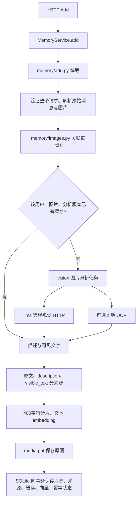
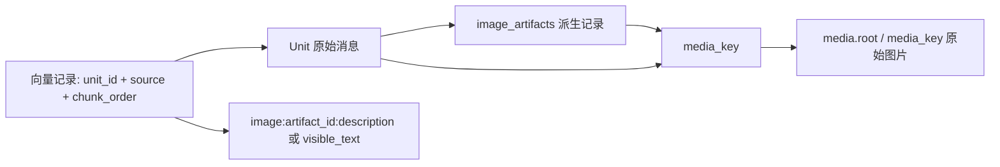
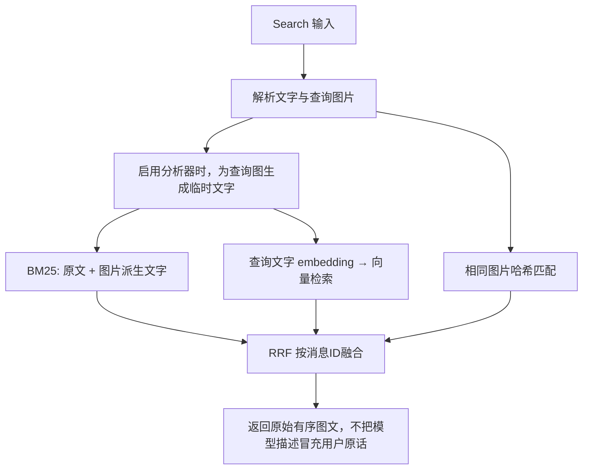

# 2026-10-10 学习笔记：Mem-Gallery 本地检索诊断

## 思路

用户已下载 Mem-Gallery JSON，希望了解 scripts 工具并继续写评测脚本。先冻结检索算法，用实际数据定位问题，再决定是否调整分片和排序。不接付费 API，不急着实现视觉理解。

本地 AI/机器人场景包含 12 次会话、185 轮对话、57 道题。每轮有 user、assistant，部分有现成 image_caption；问答有 question、answer、point、session_id、clue。clue 指向 D1:5 等轮次，有些题 clue 为空。当前没有下载原图。

## 结果

新增 `scripts/evaluate_mem_gallery.py` 和 `tests/test_mem_gallery_evaluation.py`。未修改业务检索算法。

历史对话经现有 Add 写入临时 SQLite，每轮两条消息分别保存，另行映射消息 ID 到数据集轮次。问题、答案、clue、人物介绍不写入记忆。结束或异常退出后清理临时数据库，不改 demo 数据。

三路检索使用现有 BM25、SQLite 向量查询、RRF；候选深度沿用 Search 的 `max(top_k * 3, 30)`，查询沿用当前分片和 embedding 前缀。默认使用本地 Ollama；`--embeddings none` 只测 BM25，不伪造 dense/fusion 成绩。模型失败会中断，不把降级结果算成向量成绩。

每次生成唯一文件名的 Markdown 和 JSON 报告，放在 `data/evaluations/mem-gallery/`，不覆盖之前结果。记录数据 SHA256、模型版本、图片描述开关、分片大小、K、候选深度、题数、索引耗时、单次检索耗时、总体及分 point 标签指标；逐题展示参考答案、标注证据和候选原文。耗时不是稳定性能基准。

## 指标与边界

- Hit@K：前 K 条消息至少命中一个标注轮次。
- Recall@K：覆盖标注轮次的比例。
- MRR@K：第一个标注轮次排第 r 时记 1/r，前 K 条没有命中记 0。
- 全部证据找回率：所有标注轮次都找回的题目比例。

K 按消息而非去重轮次计数。同轮 user/assistant 可占两个名额，但同一轮只贡献一次召回。任一角色命中都算轮次命中，是较宽松的诊断，不保证能回答问题。没有 clue 的题只展示候选、不计分，不能视为拒答准确率。

场景全部历史作为静态记忆库，不模拟逐会话写入或提问时间截止。默认前 10 道题不是代表性随机样本。point 只保留原标签，不猜测含义。

默认不索引图片描述、不读取原图。`--include-captions` 显式加入数据集已有描述，必须单独报告，不等于我们实现了图片理解。

脚本直接调用 Add 和检索组件，不验证 HTTP、鉴权、Search 原图恢复或输出预算。本地检索指标不是上游完整问答评分，也不是竞赛成绩。

## 怎样运行和学习

在仓库根目录执行，不用启动 FastAPI：

```powershell
.\.conda\python.exe scripts\evaluate_mem_gallery.py
# 离线仅 BM25
.\.conda\python.exe scripts\evaluate_mem_gallery.py --embeddings none
# 全部题目
.\.conda\python.exe scripts\evaluate_mem_gallery.py --limit 0
# 使用数据集已有图片描述
.\.conda\python.exe scripts\evaluate_mem_gallery.py --include-captions
```

终端输出报告路径。先看总表，再选一两道失败题，对照标注证据和实际候选，区分没召回、排序靠后、缺上下文、缺图片信息。一次只改一个因素，保留原结果比较。

## 当日验证记录

- 全部自动检查 34 项通过，包含新增的 5 项评测工具检查：标签与历史分离、描述开关、无效 clue 拒绝、轮次去重指标、离线报告、受控向量与融合流程。
- 下载的 20 个场景均通过解析和 clue 引用检查，不代表已经完成这 20 个场景的效果评测。
- AI/机器人场景的离线 BM25 全题测试：57 题中 49 题有 clue，8 题不计分。K=5 消息时 Hit@5=0.6122、Recall@5=0.4613、MRR@5=0.5017、全部证据找回率=0.3673。索引 370 条消息。
- 报告：`data/evaluations/mem-gallery/20261010T033212Z-dd89cf86.md` 及同名 JSON。这是静态全历史、无图片描述的轮次级诊断，不是官方成绩。

## 真实 Ollama 首轮结果

索引全部 185 轮（370 条消息），耗时约 416.5 秒，然后测试原始顺序前 10 题，其中 8 题有 clue、2 题不计分。未使用图片描述。

| 通道 | Hit@5 | Recall@5 | MRR@5 | 全部证据找回率 |
| --- | --- | --- | --- | --- |
| BM25 | 0.625 | 0.500 | 0.53125 | 0.375 |
| 向量 | 0.750 | 0.625 | 0.65000 | 0.500 |
| RRF | 0.625 | 0.500 | 0.62500 | 0.375 |

报告：`data/evaluations/mem-gallery/20261010T033621Z-3d4c43fe.md` 及同名 JSON。不能把这 8 道计分题和前面的 49 题总体指标直接对比。

值得一起看 Q2：问 AI 对就业的影响，标注 D1:5 在向量路线排第 5，RRF 前 5 未包含它。融合并不保证胜过单路。但融合返回的 D2:1、D2:9 也讨论就业，因此“没命中标注轮次”不一定等于“完全没有可用证据”；clue 指标需要结合原文人工判断。

Q6 是按图片内容找机械臂，三路都未命中标注轮次，符合当前没有读取图片或图片描述的能力边界；不能只凭这道失败断定 embedding 或分片算法有问题。

这轮只记录现状，没有调整 BM25、分片或 RRF，也没有接入视觉功能。下一步先读 Q2、Q6，再决定扩大测试还是做单因素对比。

## 本地网页实验台

用户希望在网页选择实验、阅读召回原文和理解比率。本轮新增独立 `memory_app/lab/`（管理 API 和静态 HTML）及 `scripts/lab.py`，不向竞赛 main.py 添加管理端点。

```powershell
.\.conda\python.exe scripts\lab.py
```

打开 `http://127.0.0.1:8010`。先选已有三路报告，再筛选“向量命中、融合未命中”，即可查看 Q2 的标注原文和三路结果。页面解释 Hit、Recall、MRR、全部证据找回率，并显示分 point 标签指标。宽屏三栏对照，窄屏纵向排列。

启动按钮只运行固定 Mem-Gallery 脚本，允许选择已有场景、题数、K、模型和描述开关，不接受任意命令或任意文件路径。一次仅一个后台子进程，重复启动返回冲突；完成后保存独立报告并自动展示，失败时显示日志。网页刷新不停止任务。关闭启动进程会终止未完成实验；强制中断可能留下系统临时目录，未完成实验不生成完整报告。

仅监听 127.0.0.1，限制 Host、拒绝跨源启动请求、拒绝读取报告目录外文件。数据集文本用 textContent 渲染，不当作 HTML 执行。不加载远程网页资源。这是个人本地工具，不是公网管理平台，不运行 demo/smoke 等会写入服务数据库的脚本。

新增 6 项自动检查，全套 40 项通过：真实离线子进程与报告读取、失败可见与重试、单任务互斥、路径限制、来源和参数校验。使用 computer-use 在浏览器实查了历史报告和 Q2 筛选，修复窄屏长选项造成的横向溢出。正在运行实验时按钮禁用，避免重复占用模型资源。

## 现有工具分工

`smoke.py` 检查运行中的 HTTP 链路，留下随机用户的小量测试数据；`demo.py` 用固定 demo-local 用户演示三条故事；`evaluate.py` 用极小自建样本比较检索路线；新脚本用公开数据做更具体的诊断。`tests/` 用受控条件保护程序行为，不等于真实模型效果评测。

## V0.2 图片能力迭代

### 日期与用户思路

2026-10-10。用户先提出：在 Add 时处理图片，原图保存到固定位置，图片相关向量写入向量库，现有 API 不一定要改；希望先对齐模块颗粒度再实施。讨论了 payload（请求携带的数据）、media.key（用户范围内的文件哈希标识）、media.put（将原始字节写到 root/key），以及图片向量和向量查找算法不是同一层的问题。

最终同意第一版走“图片 → 描述／OCR → 文本 embedding”，不引入直接图片 embedding，不换 HNSW，不把模型调用塞进 main 或 storage。继续采用之前参考 Mem0 的按功能分模块组织，但本轮代码独立实现，未复制 Mem0 源码。

### 结果：哪些文件做什么

| 文件／目录 | 本轮职责 |
| --- | --- |
| `vision/base.py` | 定义分析输出 ImageAnalysis：description 与 visible_text |
| `vision/caption.py` | 视觉任务提示词、严格 JSON 输出检查 |
| `llms/compatible.py` | 可配置 HTTPS Chat Completions 调用；图片 Base64 输入 |
| `vision/ocr.py` | 可选本地 Tesseract CPU OCR，无独显要求 |
| `vision/pipeline.py` | 组合分析器、按用户／图片／版本读取缓存 |
| `vision/factory.py`、config、main | 配置和装配，默认全部关闭 |
| `memory/images.py` | 为每条消息的每张图生成派生来源记录 |
| `memory/indexing.py` | 原文、图片描述、可见文字分来源分片与建向量 |
| `storage/sqlite.py` | 原子提交派生记录与缓存，兼容旧库，提供补处理写入 |
| `memory/backfill.py` | 已有消息图片补分析，不改变原始内容 |
| `scripts/inspect_image.py` | 单张真实图片检查与 JSON 报告 |
| `scripts/backfill_images.py` | 指定用户预览／补处理，远程需额外允许上传 |

服务与包版本升级为 0.2.0。Add/Search 请求与返回格式不变；health 增加 image_analysis 状态。不是自动启用付费模型，也没有下载任何视觉模型或 OCR 引擎。

### Add 调用图



所有模型调用在数据库写事务外。先验证整个请求，避免后面的非法消息导致前面的图片已经产生 API 费用。模型失败不写消息；如果文件已经保存、数据库提交失败，仍可能留下未引用文件，沿用原来的重试与后续清理边界。

### 来源如何关联



Unit.content 保留原始有序图文，Unit.text 保留用户原始文字。新增 image_artifacts 存 description、visible_text、media_key、生成时间、版本与 providers。providers 保存模型名／服务地址／提示词哈希或 OCR 引擎／语言／版本，不保存 API Key。组合模式中的 visible_text 拼接视觉转录和独立 OCR 输出，不代表二者互相验证过。

原文 source 为 text；每张图的描述与可见文字有各自 source，所以块编号都从 0 开始也不会冲突。检索最终按 unit_id 合并，不会因同一图片多个派生块命中而重复返回消息。向量仍保存在 SQLite，逐个比相似度，没有换检索算法。

缓存只复用同用户、同图片内容、同分析版本的结果；跨用户不共享。版本包含服务地址、模型名、提示词／语言及手动 revision。远程模型同名升级、OCR 语言包变化时，应提升 revision 并补处理。并发重复请求可能重复付费调用，但幂等记录、消息与缓存不会重复提交；本轮未实现跨进程 single-flight。

### Search 调用图



查询图片不保存成新记忆，也不将新分析写入持久缓存；同图已有 Add 缓存则复用。分析失败时 Search 保留已有文字／哈希通道；Add 则返回可重试 503。独立 OCR 识别不到文字可以合法为空，但远程 caption 的两个字段都为空视为无效输出。

### 迁移、旧数据与工具

旧 vectors 表首次启动时在事务内增加 source 维度，旧向量保留为 text，旧 Unit 缺少 image_artifacts 仍能读。升级前建议停止写入并备份数据库与媒体；关闭新开关可保持 baseline 行为，但旧版代码不一定兼容升级后的向量写入格式，不能只降级代码。

补处理只针对明确的 user_id，默认预览不改库、不调用模型；--apply 才处理。应用前停止服务写入，按消息原子替换派生信息及派生向量，原始文字向量不动。失败时此前完成的消息保留，可再次运行。切换 embedding 的完整原文重建不是这个工具的职责。

单图检查脚本使用临时数据库，保存描述与检索 ID 的 JSON，不保存报告中的 Base64。输出位于 data/evaluations/images，尚未接入现有 Mem-Gallery 网页报告列表。报告只有一张图时，“搜到了”不能当成准确率，应先读提取文字，再准备多张干扰图做效果评测。

具体 PowerShell 配置与命令见 README 的“V0.2 图片能力怎么启用”。API 默认没有开新能力，不能只更新代码就期待已有图片自动变得可搜；旧图需要明确补处理，新的分析器也需要配置。

### 测试发现、修复与实际验证边界

- 原有 40 项测试保持通过；新增 21 项检查，总计 61 项通过。
- 检查文字搜图片、原文与图文顺序保留、多图派生 source 不冲突、缓存用户隔离、模型版本变化、幂等并发、数据库失败回滚、旧库重复迁移、旧图重复补处理、查询临时分析、故障降级、非法／截断／限流响应和 OCR 命令安全。
- 重复运行发现 Windows 同图并发保存时 os.replace 偶发 PermissionError。修复为：若另一写入者已经发布相同内容地址的目标文件，则视为已保存；目标不存在时仍报错。新增确定性回归测试，并对并发场景重复运行 5 轮通过。
- 修正初始化顺序：先验证分析配置，再打开数据库，避免配置错误却先修改数据库。新增测试的数据库路径已全部限定为临时目录；第一次配置异常检查曾提前触发本地 data/memory.sqlite3 的兼容 schema 迁移，未执行消息写入或图片补分析。
- 真实 HTTP smoke 在独立临时数据库和受控分析器上通过 health、Add、重试、Search、原图还原与用户隔离；未接触正在运行的实验台任务。
- 本机未检测到 Tesseract 命令，没有自动安装；远程服务、模型和凭据未确定，没有执行付费调用。OCR 适配器和远程输出校验用受控测试验证，真实识图质量、费用、延迟仍未验证，不把这次测试说成图片效果达标。

实现参考：[Tesseract 官方命令行说明](https://tesseract-ocr.github.io/tessdoc/Command-Line-Usage.html)、[DeepSeek 官方视觉输入说明](https://api-docs.deepseek.com/guides/vision/)（仅用于确认 Chat Completions 图片输入结构；代码没有默认绑定 DeepSeek 模型，也未验证账号可用性）。

### 下一步一起决定

1. 确定真实视觉服务的准确模型名与 base URL；密钥在本机配置，不发到聊天、不提交 Git。
2. 决定先只试远程描述，还是先安装本地 OCR；独立 OCR 是可选项，不必同时启用。
3. 用少量有权使用的图片检查提取内容，再准备有干扰项的检索问题；记录误读、遗漏和幻觉。
4. 再扩展图片效果报告／网页展示；现有 Mem-Gallery --include-captions 仍只是使用数据集已有描述，不代表运行了我们的视觉模型。
5. 核对竞赛模型限制与费用预算；真实视觉验证通过后再勾选 1004 TODO 中的效果与验收项目。
