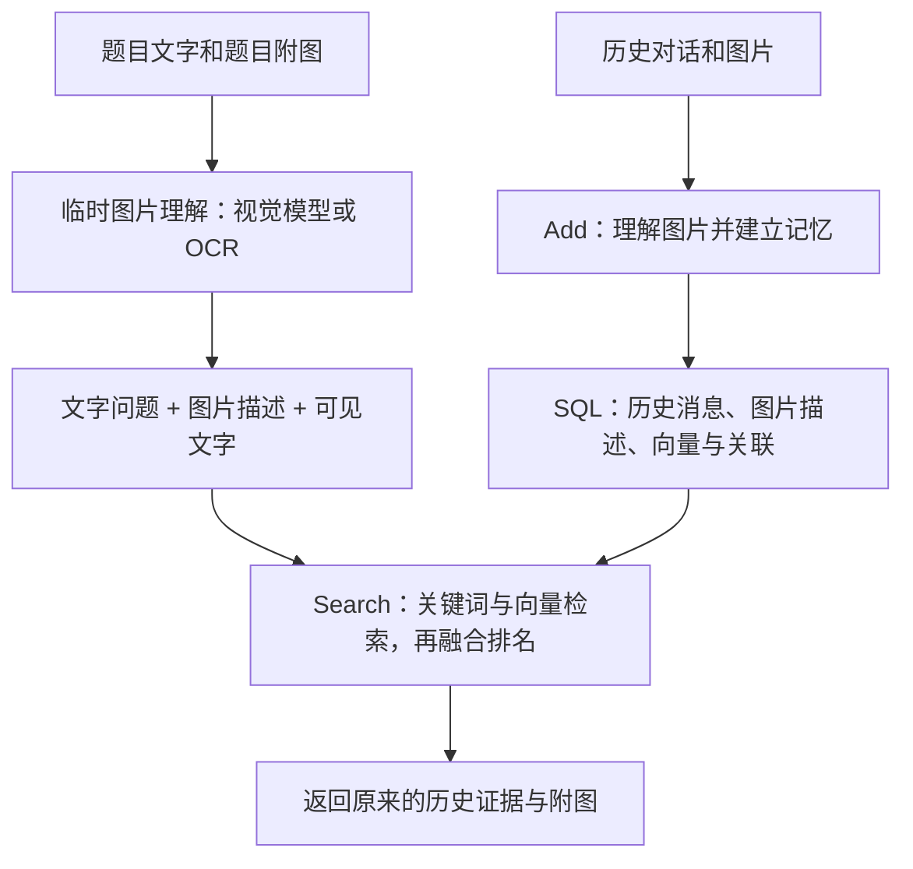

# 2026-10-24 学习笔记：把题目附图接入检索

## 思路：先区分历史与问题

我们从工作台中的低分题出发，发现某些题目问“图片里的产品叫什么”，但旧评测脚本只传入了文字，丢掉了题目自己的 `question_image`。
这不等于历史图片全部丢失：旧实验已经处理历史的 `input_image`。少的是查询这条支路。

最初的想法是：题目图片 → OCR → Add → SQL。需要纠正最后两步：题目是用来寻找历史的线索，不是新的历史事实。
就像拿照片去找旧相册，不能先把手中的照片塞进相册，再说自己找到了。



上面的两条支路不同：只有历史那条会写入可检索的记忆；提问那条只产生本次查询要用的线索。
报告和断点可以保存这些线索，方便检查或避免续跑重复付费，但它们不是新增历史。
参考答案、clue、数据集提供的题图描述，不能拿来生成真实图片模式下的查询线索。

## 结果：这次改了哪些位置

- `memory/query.py`：共用的临时查询图片理解函数；生产 Search 和评测复用它，不调用 Add 或 media.put。
- `scripts/evaluate_mem_gallery.py`：读取题图，识别真实格式，保存报告副本；把图片理解结果加入查询文字，传给关键词与向量路线。融合路线也保留与生产 Search 一致的图片字节身份匹配候选。
- `scripts/download_mem_gallery_images.py`：同时收集历史图片与题目图片，不再只下载历史图片。
- 工作台：题目区域展示提问附图和实际检索文字；另行展示应召回与实际召回的历史图。旧报告提示未处理题图，纯文字报告提示题图被省略。
- 新检查点带 `query-images-v1` 标识，不能把旧版结果直接续跑成新版结果。旧报告保留不动。

OCR 主要读图里的文字。没有文字、需要理解画面的图片，通常还需要视觉模型；目前 `--image-analysis configured` 复用我们已经配置的图片理解管线，不是强制只用 OCR。

## 本地发现与下一步

检查 `AI_Robotics_Automation_Future_Tech` 场景：题目附图共 8 张（`QA_IMG_001.png` 到 `QA_IMG_008.png`），修复时本地均未下载。
先运行已更新的下载脚本，再新建完整评测。实际质量变化要看新报告，不能用代码测试结果代替真实召回指标。

```powershell
.\.conda\python.exe -X utf8 scripts/download_mem_gallery_images.py `
  --data data/benchmarks/mem-gallery/data/dialog/AI_Robotics_Automation_Future_Tech.json

.\.conda\python.exe -u -X utf8 scripts/evaluate_mem_gallery.py `
  --data data/benchmarks/mem-gallery/data/dialog/AI_Robotics_Automation_Future_Tech.json `
  --embeddings compatible --with-images --image-analysis configured --limit 0 --top-k 5
```

第二条会调用所配置的远程模型，可能收费，并重新索引历史。本次修复过程不执行这条付费评测。
新报告生成后，重启工作台并刷新页面，再选择新报告；不要期待旧报告自动出现题图。

## 验证关注点

用可控的假图片理解工具和假向量模型做离线测试：泛泛的文字问题必须借助题图线索才能检索到；题图处理不能写历史表或媒体库；报告不能包含 Base64；缺失题图必须在模型调用前被发现；查询分析成功但 embedding 失败后，续跑应复用查询分析缓存。前端检查提问图片、参考图片和实际图片分开呈现。

全套离线测试结果：`161 passed`。本次没有调用付费 API，也没有重算旧报告；尚未验证真实数据上的新版指标。
